# 🎓 FPT Alumni Connect — Nền tảng Kết nối Cựu sinh viên & Sinh viên Đại học FPT

[](https://github.com/F-Alumni/UI-UX)
[](https://www.figma.com/)
[-10B981?style=for-the-badge)](https://www.w3.org/WAI/WCAG21/quickref/)
[](https://prm393-material.web.app/)

> **Dự án:** Thiết kế UI/UX ứng dụng di động có hỗ trợ AI (Google Stitch → Figma → Flutter Handoff)  
> **Môn học:** PRM323 — Cross-Platform Application Development  
> **Nhóm thực hiện:** **Nhóm 4** — Lớp PRM323 Đại học FPT TP. Hồ Chí Minh  
> **Căn cứ Quy chuẩn:** Đề Lab 2 (12 trang), Bộ chuẩn [PRM393 UI/UX Material](https://prm393-material.web.app/), Bộ 12 trường Persona, Quality Gates P0–P5, và 20 tiêu chí UI Checklist.

---

## 📖 1. Giới thiệu Tổng quan Dự án (Project Overview)

### 1.1. Bối cảnh Vấn đề (Problem Statement)
- **Sinh viên đang học (Đặc biệt năm 3 & năm 4):** Gặp rất nhiều trở ngại khi chuẩn bị đi thực tập doanh nghiệp (OJT) hoặc làm đồ án tốt nghiệp (Cap Stone). Các kênh mạng xã hội hiện tại (Facebook Groups, Discord) thường bị trôi bài, nhiều tin tuyển sinh/quảng cáo rác và không thể phân loại theo đúng Campus hoặc chuyên ngành hẹp.
- **Cựu sinh viên (Alumni):** Rất sẵn lòng chia sẻ kinh nghiệm và mở rộng cơ hội việc làm cho đàn em, nhưng vô cùng bận rộn trong giờ làm việc. Cựu sinh viên sợ bị lộ số điện thoại cá nhân, sợ bị làm phiền ngoài giờ và ngần ngại việc phải nhắn tin qua lại nhiều lần chỉ để chốt một buổi hẹn tư vấn.

### 1.2. Giải pháp: FPT Alumni Connect
**FPT Alumni Connect** là ứng dụng di động mạng xã hội học đường chuyên biệt giải quyết bài toán kết nối giữa Cựu sinh viên và Sinh viên Đại học FPT trên toàn quốc (5 cơ sở: TP.HCM, Hà Nội, Đà Nẵng, Cần Thơ, Quy Nhơn):
- **Chia sẻ Lịch cá nhân qua Google Calendar:** Thêm trực tiếp đường dẫn **Google Calendar (`US-11`)** vào hồ sơ cá nhân để người khác có thể xem thời gian rảnh/bận và chủ động nhắn tin liên hệ khi cần.
- **Danh bạ Thông minh:** Tìm kiếm và lọc thành viên chính xác theo **Campus** và **Chuyên ngành hẹp** (SE, AI, IA, Digital Marketing...) với vùng chạm chuẩn `48×48dp` (`US-06`).
- **An toàn & Quyền riêng tư:** Tùy chọn ẩn số điện thoại/email cá nhân qua các công tắc **Privacy có nhãn [ON]/[OFF] (`US-09`)** và cơ chế **Chặn người dùng quấy rối (`US-10`)** kèm hộp thoại xác nhận.
- **Xác thực Sinh viên FPT:** Tối ưu hóa xác thực thông qua bộ thông tin học vụ (Mã số sinh viên `SE193059`, Campus, Ngành, Chuyên ngành hẹp) thuận tiện và chính xác (`US-03`).

---

## 👥 2. Bảng Phân công & Đóng góp Thành viên (Contribution Matrix — Cân bằng 25%/người)

Nhóm 4 phân chia công việc theo đúng cấu trúc: **Mỗi thành viên phụ trách 1 mảng chuyên môn xuyên suốt (Lead) VÀ sở hữu cố định 2 màn hình** từ khâu Wireframe, Final UI, Đặc tả kỹ thuật đến Flutter Handoff. Nhờ đó, cả 4 thành viên đều có lịch sử đóng góp rõ ràng trên Git và Figma:

| Thành viên | Vai trò Chuyên môn (Lead Role) | 2 Màn hình Sở hữu | Trang Figma Tham gia | File Repository Phụ trách | Tỷ lệ Đóng góp |
| :--- | :--- | :---: | :---: | :--- | :---: |
| **TV1: Võ Quang Tâm**<br>*(MSSV: SE192621)* | **UX Research, Persona & User Flow Lead**<br>- Bộ 3 Persona chuẩn 12 trường & Coverage Matrix<br>- Kiến trúc IA 8 màn hình, 3 User Flows Mermaid<br>- Quản lý `README.md` dự án | **`S01`** (Login & Google Auth)<br>**`S02`** (Student Verify & Reset Pass) | **Page 01** (Chủ trì)<br>**Page 02, 03** (`S01, S02`) | - [`ux/persona.md`](ux/persona.md)<br>- [`ux/user-flow.md`](ux/user-flow.md)<br>- [`README.md`](README.md)<br>- Phần `S01, S02` trong Screen Spec & Handoff | **25%** |
| **TV2: Trương Chí Trung**<br>*(MSSV: SE193059 — Leader)* | **AI Generation (Google Stitch) & Critique Lead**<br>- Viết prompt Stitch, xuất 4 màn hình `v0`<br>- 3 vòng lặp tinh chỉnh Before/After (`I01`–`I03`)<br>- AI Critique 7 phát hiện & 7 Quyết định thiết kế | **`S03`** (Home Feed Chung & Ngành)<br>**`S04`** (Member Search & Directory) | **Page 02, 03** (`S03, S04` + áp dụng cải tiến AI) | - [`ai/ai-design-log.md`](ai/ai-design-log.md)<br>- [`assets/stitch/*`](assets/stitch/)<br>- Phần `S03, S04` trong Screen Spec & Handoff | **25%** |
| **TV3: Nguyễn Phương Khải**<br>*(MSSV: SE183590)* | **Design System & Reusable Components Lead**<br>- Soạn `design/DESIGN.md` (Tokens & Rules)<br>- Tạo Figma Variables/Styles (Color, Type, Grid)<br>- Dựng 9 Component bằng Auto Layout + Variants<br>- Bảng Mapping tokens trong Handoff | **`S05`** (Member Public Profile)<br>**`S06`** (Direct & Group Chat Room) | **Page 04, 05** (Chủ trì)<br>**Page 02, 03** (`S05, S06`) | - `design/DESIGN.md`<br>- Bảng Mapping trong `flutter-handoff.md`<br>- Phần `S05, S06` trong Screen Spec & Handoff | **25%** |
| **TV4: Đỗ Trọng Tín**<br>*(MSSV: SE190218)* | **Interactive Prototype, QA & Handoff Lead**<br>- Kiểm tra Accessibility (WCAG AA, 48dp, 14sp)<br>- Nối dây Prototype 3 flows (Starting point, Overlay)<br>- Xuất ảnh chụp Figma `assets/figma/` | **`S07`** (My Profile & Calendar Link)<br>**`S08`** (Privacy & Blocked List) | **Page 06** (Chủ trì)<br>**Page 02, 03** (`S07, S08`) | - Checklist A11y trong `design-decisions.md`<br>- Tổng hợp Screen Spec & Handoff<br>- Phần `S07, S08` trong Screen Spec & Handoff | **25%** |

---

## 🗂️ 3. Cấu trúc Thư mục Kho mã nguồn (Repository Architecture)

```
UI-UX/
├── README.md                      # Tài liệu tổng quan dự án & Bảng phân công Nhóm 4 (TV1 quản lý)
├── phan-cong-nhom4.md             # Bản phân công công việc chi tiết 4 thành viên (Cân bằng 25%)
│
├── ux/                            # [UX Research & Foundation] (TV1 Chủ trì)
│   ├── persona.md                 # Bộ 3 Personas chuẩn 12 trường PRM393 & Ma trận bao phủ 50 Stories
│   └── user-flow.md               # Sơ đồ IA 8 màn hình & 3 User Flows chi tiết bằng Mermaid Flowcharts
│
├── design/                        # [Design System, Decisions & Screen Specifications] (TV3 & TV4 Chủ trì)
│   ├── DESIGN.md                  # Hệ thống Design Tokens (Màu, Chữ, Lưới 8dp) & 9 Nhóm Component (CMP-01..09)
│   ├── design-decisions.md        # Quyết định D01..D07, Checklist A11y WCAG 2.2 AA & 20 Tiêu chí UI Simplicity (100/100)
│   └── screen-spec.md             # Đặc tả chi tiết 6 phần (Layout, Components, States, Interactions, Nav, Constraints) cho S01..S08
│
├── docs/                          # [Tài liệu Hướng dẫn Bảo vệ & Blueprint]
│   ├── figma-blueprint.md         # Hướng dẫn cấu trúc Figma 6 Pages
│   └── lab2-slide-and-demo-guide.md # Nội dung 12 Slide báo cáo, Kịch bản Demo 5 phút & Bộ câu hỏi phản biện Q&A
│
├── handoff/                       # [Developer Handoff]
│   └── flutter-handoff.md         # Bàn giao Flutter: Token Mapping, Widget Trees, Regex Validators, Semantics
│
├── ai/                            # [AI Stitch Generation & Critique Log] (TV2 Chủ trì)
│   └── ai-design-log.md           # Nhật ký Stitch v0, 3 vòng lặp có ý nghĩa, 7 phát hiện Heuristics & Quyết định
│
└── assets/                        # [Tài nguyên Hình ảnh Bằng chứng]
    ├── figma/                     # Trọn bộ 8 ảnh chụp màn hình Mobile chính thức (s01.png -> s08.png, không có Booking 1-1)
    └── stitch/                    # 15 ảnh chụp màn hình v0 và Before/After từ Google Stitch
        ├── v0_overview_all_4_screens.png
        ├── iter1_before.png / iter1_after.png
        ├── iter2_before.png / iter2_after.png
        └── iter3_before.png / iter3_after.png
```

---

## 🔗 4. Chuỗi Truy vết Thiết kế Toàn diện (Full Traceability Chain)

Dự án bảo đảm tính liêm chính học thuật và tính nhất quán 100% qua chuỗi truy vết từ bằng chứng thực tế đến mã nguồn bàn giao:

```mermaid
flowchart LR
    E["<b>4 Bằng chứng Khảo sát</b><br>(E01..E04)"] --> P["<b>3 Personas Chuẩn</b><br>(P01..P03 - 12 trường)"]
    P --> US["<b>11 User Stories Cốt lõi</b><br>(US-01..US-11)"]
    US --> F["<b>3 User Flows Chuẩn</b><br>(F01..F03)"]
    F --> S["<b>8 Màn hình Chuẩn</b><br>(S01..S08)"]
    S --> AI["<b>3 Vòng lặp AI Stitch</b><br>(I01..I03 Before/After)"]
    AI --> D["<b>7 Quyết định Thiết kế</b><br>(D01..D07 Accept/Modify/Reject)"]
    D --> FIGMA["<b>Figma Canvas 6 Trang</b><br>(Auto Layout + Variables)"]
    FIGMA --> FLUTTER["<b>Flutter Handoff</b><br>(Clean Architecture & Semantics)"]
```



---

## 🎨 5. Tóm tắt Hệ thống Thiết kế & Quy chuẩn Công thái học (Design Tokens)

- **Khung nhìn chuẩn di động:** `360 × 800 dp` (Khảo sát theo Persona Trương Chí Trung `P01`), kiểm tra co giãn tốt ở `412 dp` và tablet `≥ 600 dp`.
- **Lưới khoảng cách (8dp Spacing Grid):** Padding ngang cố định `16 dp`; khoảng cách các khối `8dp, 16dp, 24dp, 32dp`.
- **Vùng chạm tối thiểu (Touch Target):** **`≥ 48 × 48 dp`** cho 100% các nút bấm, ô nhập liệu, dropdown, chip lọc và icon tương tác.
- **Bảng màu nhận diện FPT & Tương phản WCAG 2.1 AA:**
  - `Primary Navy Blue`: `#1B365D` (AppBar, tiêu đề H1/H2, viền Focus) — Tương phản **12.6 : 1**.
  - `Secondary Orange`: `#F27024` (Nút CTA chính, Tab đang chọn) — Màu nhận diện thương hiệu FPT.
  - `Emerald Green`: `#10B981` (Tích xanh Verified Alumni, Thông báo kích hoạt thành công).
  - `Danger Red`: `#DC2626` (Viền lỗi Inline, Nút Chặn người dùng quấy rối, Banner mất mạng).
  - `Text Secondary`: `#595959` trên nền trắng `#FFFFFF` đạt tương phản **`5.4 : 1`** (Vượt chuẩn WCAG AA `4.5:1`).
- **Thang chữ:** `Hanken Grotesk` (Headings `20sp–24sp Bold`) và `Inter` (Body & Controls `14sp–16sp`). Không có chữ nội dung nào nhỏ hơn `14sp`.

---

## 📱 6. Cấu trúc 6 Trang trên Figma (Figma Canvas Architecture)

| Trang Figma | Tên Trang | Nội dung Trọng tâm | Thành viên Phụ trách |
| :---: | :--- | :--- | :---: |
| **Page 01** | `01_UX_Foundation` | Cover art, Project Brief, Bằng chứng khảo sát, 3 Personas 12 trường, Sơ đồ cây IA 8 màn hình, 3 User Flows. | **TV1 (Chủ trì)** |
| **Page 02** | `02_Wireframes` | Bản vẽ khung dây trắng đen (Low-fidelity) cho 8 màn hình `S01`–`S08` (Padding 16dp, Auto Layout). | **Cả 4 Thành viên** (`S01`–`S08`) |
| **Page 03** | `03_Final_UI` | Giao diện hoàn thiện kích thước chuẩn `360×800dp`, 100% dùng Components từ Page 05 + Các biến thể trạng thái (Loading, Error, Dialog) đặt cạnh. | **Cả 4 Thành viên** (`S01`–`S08`) |
| **Page 04** | `04_Design_System` | Toàn bộ Figma Variables/Styles: Bảng màu Color Tokens, Thang chữ Typography, Lưới Spacing 8dp, Bo góc Radius. | **TV3 (Chủ trì)** |
| **Page 05** | `05_Components` | 9 Nhóm Component Reusable bắt buộc dựng bằng Auto Layout và Variants: Button, Text Field, Card, Nav Bar, App Bar, Dialog, Loading, Empty, Error. | **TV3 (Chủ trì)** |
| **Page 06** | `06_Interactive_Prototype` | Nối dây tương tác hoàn chỉnh cho 3 Flows (`F01`, `F02`, `F03`), có điểm bắt đầu (Starting point), hiệu ứng Overlay Dialog và chuyển cảnh kết quả. | **TV4 (Chủ trì)** |

---

## 🏆 7. Bảng Đối chiếu Nghiệm thu (Quality Gates P0–P5 & Checklist 20 Tiêu chí)

| Cửa Kiểm định (Quality Gate) | Tiêu chí Yêu cầu theo Rubric Lab 2 | Kết quả Kiểm tra Thực tế trong Dự án | Trạng thái |
| :---: | :--- | :--- | :---: |
| **P0: User Research** | Đủ 3 Personas chuẩn 12 trường dữ liệu, có bằng chứng nghiên cứu thực tế. | Hoàn thành trong [`ux/persona.md`](ux/persona.md) (`P01, P02, P03` đủ 12 trường). | ✅ **PASSED** |
| **P1: Coverage** | 100% 11 User Stories (`US-01` → `US-11`) được bao phủ đầy đủ. | Ma trận bao phủ chi tiết trong `persona.md` và `user-flow.md`. | ✅ **PASSED** |
| **P2: Architecture & Flows** | Sơ đồ IA 8 màn hình, 3 User Flows có đủ Happy Path, Alternative và Error Path. | Vẽ chi tiết bằng Mermaid Flowcharts trong [`ux/user-flow.md`](ux/user-flow.md). | ✅ **PASSED** |
| **P3: AI Generation & Critique** | Prompt nguyên văn Stitch, 3 vòng lặp tinh chỉnh Before/After, 7 Heuristic findings. | Hoàn thành 100% trong [`ai/ai-design-log.md`](ai/ai-design-log.md) kèm 15 ảnh chụp. | ✅ **PASSED** |
| **P4: Design System & Specs** | Viewport 360×800dp, Grid 8dp, Touch ≥48dp, Contrast ≥4.5:1, đủ 5 states cho mỗi màn. | Hoàn thành trong [`design/screen-spec.md`](design/screen-spec.md). | ✅ **PASSED** |
| **P5: Developer Handoff** | Widget tree Flutter sạch, Regex validation, Token mapping và Semantics accessibility. | Hoàn thành trong [`handoff/flutter-handoff.md`](handoff/flutter-handoff.md). | ✅ **PASSED** |

---

## 🚀 8. Hướng dẫn Dành cho Lập trình viên Flutter

Toàn bộ thông số thiết kế, mã hex, cỡ chữ, và code mẫu Dart đã được kiểm thử tính tương thích với Flutter 3.x. Để tích hợp vào dự án di động:
1. Tham khảo bảng ánh xạ token tại mục 1 trong [`handoff/flutter-handoff.md`](handoff/flutter-handoff.md).
2. Tái sử dụng trực tiếp code mẫu form đăng nhập `S01` và form xác thực học vụ sinh viên `S02`.
3. Kiểm tra tính năng trợ năng bằng công cụ **Accessibility Scanner** trên thiết bị Android thật.
