# 🤖 AI Design Log — Google Stitch Generation, UX Critique & Iterative Refinement

> **Môn học:** PRM323 — Cross-Platform Application Development  
> **Bài thực hành:** Lab 2 — Thiết kế UI/UX có hỗ trợ AI (Google Stitch → Figma)  
> **Dự án:** **FPT Alumni Connect** — Nền tảng kết nối Cựu sinh viên & Sinh viên Đại học FPT  
> **Người thực hiện chính (Lead Author):** **Trương Chí Trung** — MSSV: **SE193059** (Vai trò: **TV2 — Trưởng nhóm, AI Stitch & Critique Lead**)  
> **Chuỗi truy vết (Traceability Chain):** `E01..E04 (Evidence) → P01..P03 (Personas) → US-01..US-11 (User Stories) → F01..F03 (Flows) → S01..S08 (Screens) → I01..I03 (AI Iterations) → D01..D07 (Decisions)`

---

## 1. Khai báo Công cụ AI đã Sử dụng (AI Tool Disclosure — Mục 5.5)

Tuân thủ quy định Liêm chính Học thuật (Mục 5.5 & Mục 10 của đề Lab 2), toàn bộ các công cụ AI được sử dụng trong quá trình thiết kế và mục đích cụ thể được khai báo minh bạch dưới đây:

| STT | Tên Công cụ AI | Phiên bản / Nền tảng | Mục đích Sử dụng trong Quy trình Thiết kế | Người Kiểm duyệt & Quyết định |
| :-: | :--- | :--- | :--- | :--- |
| **01** | **Google Stitch** | `stitch.withgoogle.com` (Mobile UI Generator) | Khởi tạo giao diện ban đầu (`v0`) từ prompt văn bản cho 4 màn hình cốt lõi (`S03 Home`, `S04 Directory`, `S05 Alumni Detail`, `S07/S08 My Profile & Privacy`) và thực hiện 3 vòng lặp tinh chỉnh (`I01` – `I03`). | Trương Chí Trung (TV2) |
| **02** | **Gemini / Antigravity UX Auditor** | LLM UX Critique Assistant | Đánh giá phản biện giao diện `v0` của Stitch dựa trên **10 Usability Heuristics của Jakob Nielsen**, tiêu chuẩn **W3C WCAG 2.1 Level AA** và **Persona Trương Chí Trung** (`P01`). | Trương Chí Trung (TV2) & Nguyễn Phương Khải (TV3) |
| **03** | **Figma Contrast & Auto Layout Helper** | Figma Education Plan | Kiểm tra độ tương phản màu sắc thực tế (Contrast Ratio ≥ 4.5:1 cho chữ thường, ≥ 3:1 cho UI controls) và hỗ trợ chuẩn hóa lưới Auto Layout `8dp` ở chiều rộng `360 dp` và `412 dp`. | Nguyễn Phương Khải (TV3) & Đỗ Trọng Tín (TV4) |

---

## 2. Tạo Giao diện Ban đầu trong Google Stitch (Initial UI — Mục 5.1)

### 2.1. Prompt Nguyên văn Ban đầu (Verbatim Initial Prompt)

Prompt đầu tiên được biên soạn **sau khi** đã hoàn tất phân tích `ux/persona.md`, `ux/user-flow.md` và bản mô tả thiết kế `design/DESIGN.md`. Prompt bao phủ đầy đủ 5 yếu tố bắt buộc của Rubric: **(1) Người dùng mục tiêu (Persona)**, **(2) Nhiệm vụ & các User Stories (`US-04` → `US-11`)**, **(3) Nền tảng di động (`360×800 dp`)**, **(4) Ràng buộc khả năng tiếp cận (WCAG 2.1 AA)** và **(5) Phong cách thị giác (`DESIGN.md`)**:

```text
Design a 4-screen mobile application UI for "Alumni Connect" (FPT University Alumni & Student Networking Platform) on Android/iOS (viewport 360x800 dp, Light Mode).

1. Target Persona:
Truong Chi Trung (20-year-old 3rd-year Software Engineering student at FPT University HCMC, preparing for OJT internship). He uses his smartphone one-handed while commuting or walking on campus under bright light, needing fast member search, clear visual hierarchy, high text contrast, and one-tap scheduling via Google Calendar.

2. Core Tasks & 4 Screens to Generate:
- Screen 1 (Home Feed - General & Major Space): Segmented switcher at top between "General Campus Space" (all students) and "Major Space" (SE, AI, Business, Graphic Design). Shows Alumni experience posts, career/scholarship sharing cards, and a bottom navigation bar (4 tabs: Home, Directory, Chat, Profile).
- Screen 2 (Member Search & Directory - US-06): Search bar by member name, filter chips by Campus (HCMC, Hanoi, Da Nang, Can Tho, Quy Nhon) and Major (Software Engineering, AI, Business, Graphic Design), and a paginated list of Alumni/Student cards showing avatar, full name, cohort (e.g., K15 Alumni, K19 Student), major badge, and company.
- Screen 3 (Member Public Profile - US-05, US-10, US-11): Detailed profile view showing avatar, name, role badge, campus, major, cohort, bio, skills, a primary CTA button "Book via Google Calendar" (for US-11 calendar link), a secondary button "Direct Message", and a top-right menu option to "Block User" (US-10).
- Screen 4 (My Profile & Privacy Settings - US-04, US-09, US-11): Form to edit personal profile (Name, Campus, Major, Cohort, Bio), an input field for "Google Calendar Booking Link" (US-11), and Privacy Toggles (US-09) to control which profile fields are publicly visible, plus a "Log Out" button (US-08).

3. Platform & Accessibility Constraints:
- Mobile portrait 360x800 dp, 8dp spacing grid, 16dp horizontal screen padding.
- WCAG 2.1 AA compliance: minimum 4.5:1 contrast for body text, minimum 3:1 for large text and UI controls, minimum 48x48 dp touch targets for all buttons, chips, and nav items, minimum 14sp body text size, and never rely on color alone to convey status (always pair with icons and text labels).

4. Visual Style (from DESIGN.md):
- Modern Academic & Executive Mentorship style.
- Primary Color: FPT Navy Blue (#1B365D) for headers, badges, and key structure.
- Secondary / Primary CTA Color: FPT Signature Orange (#F27024) for main action buttons and active tabs.
- Status / Verified Color: Emerald Green (#10B981) for verified alumni badges and available calendar status.
- Background: #F8F9FA, Card Surface: #FFFFFF, Primary Text: #111827, Secondary Text: #595959, Border: #E5E7EB, Card Radius: 12dp, Button Radius: 8dp.
- Typography: Hanken Grotesk for headings (18sp–24sp Bold), Inter for body and labels (minimum 14sp Regular/SemiBold).
```

---

### 2.2. Bằng chứng Ảnh chụp Giao diện Ban đầu từ Google Stitch (`v0` Output Evidence)

Google Stitch đã sinh ra 4 màn hình bao phủ toàn bộ luồng chính của ứng dụng:

#### A. Toàn cảnh 4 màn hình `v0` trên Canvas của Google Stitch
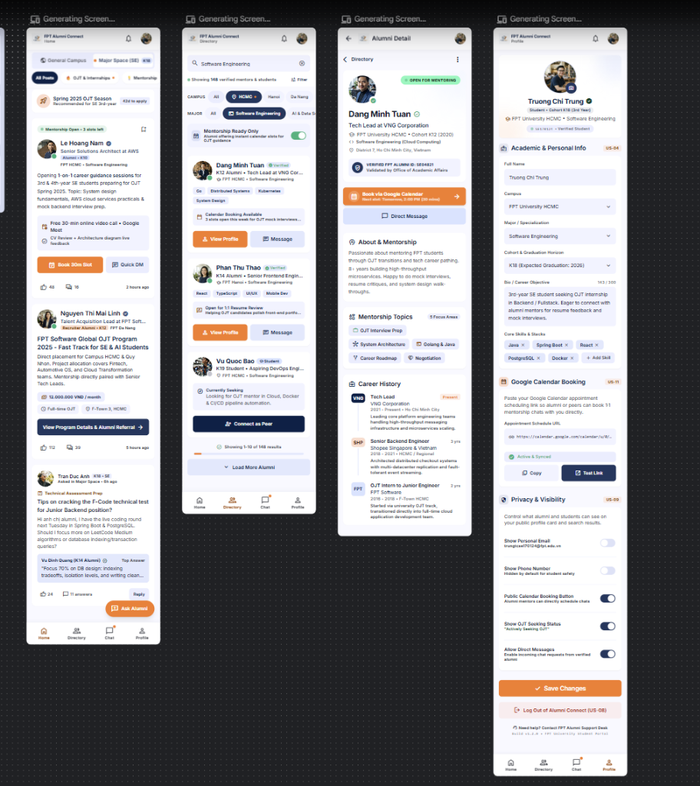

#### B. Ảnh chụp chi tiết từng phần trên Google Stitch (`v0`)
| Nửa trên 4 màn hình (`v0_screens_top.png`) | Nửa dưới 4 màn hình (`v0_screens_bottom.png`) |
| :---: | :---: |
| 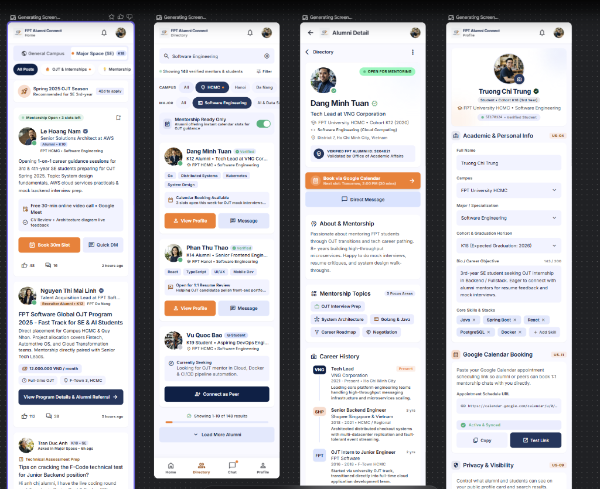 | 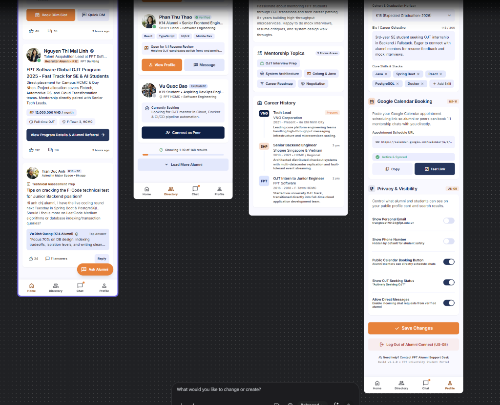 |

#### C. Bóc tách 4 màn hình `v0` tương ứng với Kiến trúc Thông tin (IA)
| Screen 1: `S03` Home Feed | Screen 2: `S04` Directory (`US-06`) | Screen 3: `S05` Alumni Detail (`US-05, US-11`) | Screen 4: `S07/S08` My Profile (`US-04, US-09, US-11`) |
| :---: | :---: | :---: | :---: |
| 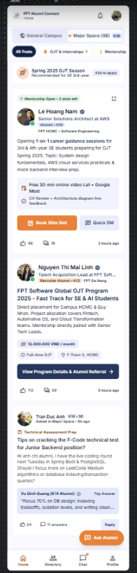 | 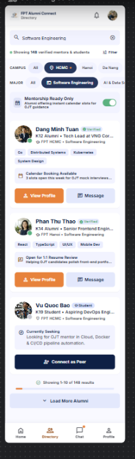 | 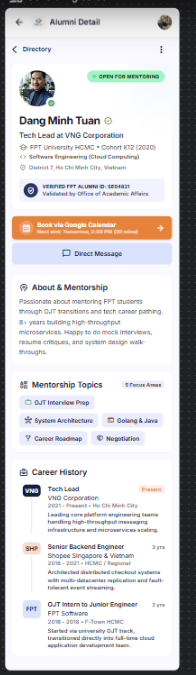 | 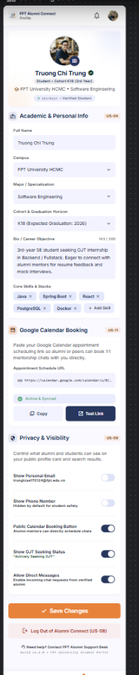 |

---

## 3. Phản biện UX bằng AI trên Giao diện `v0` (AI-Based UX Critique — Mục 5.3)

Ngay sau khi có kết quả `v0` từ Google Stitch, nhóm sử dụng trợ lý AI để đánh giá độc lập cả 4 màn hình theo **10 Usability Heuristics của Jakob Nielsen**, các quy tắc **Accessibility WCAG 2.1 Level AA** và **Persona Trương Chí Trung (`P01`)**.

### 3.1. Prompt Nguyên văn Yêu cầu AI Phản biện (Verbatim Critique Prompt)

```text
Act as a Senior UX/UI Auditor. Please critique the 4 initial mobile UI screens (v0) generated by Google Stitch for our "FPT Alumni Connect" app against:
1. Jakob Nielsen's 10 Usability Heuristics.
2. W3C WCAG 2.1 Level AA accessibility rules (text contrast >= 4.5:1, large text/UI controls >= 3:1, touch targets >= 48x48 dp, body text >= 14sp, no information conveyed by color alone).
3. Our Primary Persona: Truong Chi Trung (20-year-old 3rd-year Software Engineering student at FPT University HCMC, uses Android phone one-handed while walking or on the bus under bright campus sunlight, needs to search alumni by Campus/Major, book 1-1 sessions via Google Calendar link [US-11], manage profile privacy [US-09], and block unwanted accounts [US-10]).

Provide at least 6 specific findings tied directly to the visible elements in the 4 screens (Screen 1: Home, Screen 2: Directory, Screen 3: Alumni Detail, Screen 4: Profile), and propose concrete UI recommendations.
```

---

### 3.2. Toàn văn Kết quả Phản biện từ AI (Full Verbatim AI Critique Output — 7 Phát hiện Cụ thể)

> **BÁO CÁO PHẢN BIỆN UX & ACCESSIBILITY (7 PHÁT HIỆN GẮN VỚI MÀN HÌNH CỤ THỂ TRÊN ẢNH `v0`):**
>
> 1. **[Phát hiện C01 — Màn hình 3 `Alumni Detail` (`S05`)] Thừa 2 thanh điều hướng Back chồng lên nhau & Ẩn tính năng Chặn người dùng (`US-10`):**
>    - **Heuristic vi phạm:** *Nielsen #4 (Consistency and Standards)* & *Nielsen #8 (Aesthetic and Minimalist Design)*.
>    - **Mô tả vấn đề trên ảnh `v0`:** Đầu màn hình `Alumni Detail` xuất hiện 2 thanh điều hướng lùi nằm chồng sát lên nhau: thanh AppBar trên cùng có mũi tên `← Alumni Detail` và ngay bên dưới lại có thêm một thanh `< Directory` kèm nút 3 chấm `⋮`. Thiết kế này làm lãng phí ~56dp chiều dọc màn hình và gây nhầm lẫn cho người dùng. Đồng thời, hành động **Chặn tài khoản (`US-10`)** bị giấu kín trong icon `⋮` nhỏ (< 32×32 dp), khiến người dùng không biết làm sao để chặn khi bị làm phiền và thiếu hộp thoại xác nhận (Confirmation Dialog).
>    - **Đề xuất của AI:** Xóa bỏ thanh phụ `< Directory`; giữ duy nhất một AppBar chuẩn; bổ sung nút hành động rõ ràng **"Block This User"** (`#DC2626`, cao `48dp`) ở cuối trang kèm hộp thoại xác nhận trước khi chặn.
>
> 2. **[Phát hiện C02 — Màn hình 1 `Home Feed` (`S03`)] Nút nổi FAB `+ Ask Alumni` đè lên nút `Reply` và Cạnh tranh thị giác giữa các nút cam (Competing Primary Actions):**
>    - **Heuristic & Chuẩn vi phạm:** *Nielsen #8 (Aesthetic and Minimalist Design)* & *WCAG 2.5.5 (Target Size / Touch Overlap)*.
>    - **Mô tả vấn đề trên ảnh `v0`:** Ở góc dưới bên phải màn hình `Home`, nút Floating Action Button (FAB) màu cam `+ Ask Alumni` nằm đè sát lên nút `Reply` của bài viết thứ 3 (`Tran Duc Anh`). Với Persona Trương Chí Trung thường thao tác một tay bằng ngón cái khi đi xe buýt, vị trí này rất dễ gây bấm nhầm. Ngoài ra, nút `Book 30m Slot` bên trong thẻ bài viết đầu tiên cũng được tô màu cam đặc (`#F27024`), cạnh tranh trực tiếp với nút chính trên màn hình.
>    - **Đề xuất của AI:** Chuyển nút `Book 30m Slot` bên trong các thẻ bài viết trên Home thành nút phụ dạng viền (Secondary Outlined Button `#1B365D`) để không tranh chấp thứ bậc thị giác, và tạo khoảng đệm đáy để FAB không đè lên nút `Reply`.
>
> 3. **[Phát hiện C03 — Màn hình 4 `Profile` (`S07`, `S08`)] Lộ mã đặc tả kỹ thuật (`US-04`, `US-11`, `US-09`, `US-08`) lên giao diện & Thiếu mục Đổi mật khẩu (`US-07`) / Danh sách chặn (`US-10`):**
>    - **Heuristic vi phạm:** *Nielsen #2 (Match Between System and the Real World)*.
>    - **Mô tả vấn đề trên ảnh `v0`:** Google Stitch đã in nguyên các mã tài liệu nội bộ (`US-04`, `US-11`, `US-09`, `(US-08)`) thành các thẻ badge trên tiêu đề và nút đăng xuất của màn hình `Profile`. Người dùng cuối không hiểu các ký hiệu kỹ thuật này. Ngoài ra, thông tin sinh viên đang hiển thị nhầm thành `Cohort K18 • SE170124` (thay vì `Cohort K19 • SE193059` của Persona), và màn hình đang thiếu mục **Thay đổi mật khẩu (`US-07`)** cũng như mục **Quản lý danh sách người dùng đã chặn (`US-10`)**.
>    - **Đề xuất của AI:** Xóa toàn bộ các badge mã `US-xx` khỏi UI; cập nhật đúng `Cohort K19 • SE193059`; thêm khối **Security & Account** chứa dòng **"Change Password"** và **"Blocked Users (Manage & Unblock)"**.
>
> 4. **[Phát hiện C04 — Màn hình 2 `Directory` (`S04`) & Màn hình 4 `Profile` (`S07`)] Vùng chạm Filter Chips quá nhỏ (< 48dp), bị cắt chữ ở mép phải & Độ tương phản chữ phụ thấp (< 4.5:1):**
>    - **Tiêu chuẩn vi phạm:** *WCAG 2.1 SC 1.4.3 Contrast (Minimum)* & *Quy tắc Lab 2 (Touch target ≥ 48×48 dp, Body text ≥ 14 sp)*.
>    - **Mô tả vấn đề trên ảnh `v0`:** Trên màn hình `Directory`, các chip lọc `CAMPUS` (`All`, `HCMC`, `Hanoi`, `Da Nang` bị cắt chữ ở mép phải) và các tag kỹ năng (`Go`, `Distributed Systems`, `Kubernetes`) chỉ cao khoảng `26–30 dp` với cỡ chữ nhỏ `~10–11 sp`. Các dòng mô tả phụ dưới công tắc ở màn hình `Profile` (`Hidden by default for student safety`) có màu xám nhạt (`#9CA3AF` trên nền `#FFFFFF`, tỷ lệ tương phản chỉ đạt `~2.6:1 < 4.5:1`), khiến Persona bị cận thị rất khó đọc dưới ánh sáng chói tại sảnh trường.
>    - **Đề xuất của AI:** Tăng chiều cao các Filter Chips lên đúng chuẩn `48 dp`, tăng cỡ chữ nội dung/tag lên tối thiểu `14 sp`, và làm đậm màu chữ phụ lên `#595959` (đạt tương phản `5.4:1`, vượt chuẩn WCAG AA).
>
> 5. **[Phát hiện C05 — Màn hình 2 `Directory` (`S04`) & Màn hình 4 `Profile` (`S08`)] Truyền đạt trạng thái Bật/Tắt và Đang chọn chỉ bằng màu sắc (Color-Only Indicators):**
>    - **Tiêu chuẩn vi phạm:** *WCAG 2.1 SC 1.4.1 (Use of Color)* & *Nielsen #1 (Visibility of System Status)*.
>    - **Mô tả vấn đề trên ảnh `v0`:** Công tắc `Mentorship Ready Only` trên màn hình `Directory` và 5 công tắc trong mục `Privacy & Visibility` trên màn hình `Profile` chỉ phân biệt trạng thái Bật/Tắt qua màu sắc (Xanh lá / Xanh đen so với Xám) mà không có nhãn văn bản `ON / OFF` hay icon đi kèm. Tương tự, các chip đang chọn (`HCMC`, `Software Engineering`) chỉ đổi màu nền sang xanh đen mà thiếu dấu tích `✓`.
>    - **Đề xuất của AI:** Bổ sung biểu tượng dấu tích `✓` vào bên trong các Filter Chip đang được chọn và gắn nhãn văn bản tường minh `[ON]` / `[OFF]` ngay cạnh mọi công tắc Switch.
>
> 6. **[Phát hiện C06 — Màn hình 4 `Profile` (`S07`)] Thiếu hoàn toàn Trạng thái Lỗi & Phục hồi (Error & Recovery State) khi nhập sai URL Google Calendar hoặc mất mạng:**
>    - **Heuristic vi phạm:** *Nielsen #5 (Error Prevention)* & *Nielsen #9 (Help Users Recognize, Diagnose, and Recover from Errors)*.
>    - **Mô tả vấn đề trên ảnh `v0`:** Phần `Google Calendar Booking` trên màn hình `Profile` chỉ hiển thị trạng thái thành công lý tưởng (`Active & Synced`), hoàn toàn thiếu trạng thái cảnh báo lỗi khi người dùng dán sai định dạng đường dẫn Google Calendar (`US-11`) hoặc khi mất kết nối WiFi trường lúc bấm `Save Changes`.
>    - **Đề xuất của AI:** Thiết kế rõ trạng thái **Inline Validation Error** (viền đỏ `#DC2626`, icon cảnh báo, thông báo lỗi bằng ngôn ngữ dễ hiểu giữ nguyên dữ liệu đã nhập) và **Network Error Banner** ở đầu màn hình có nút **"Retry Save"** cao `48 dp`.
>
> 7. **[Phát hiện C07 — Đề xuất mở rộng của AI cho Màn hình 3 `Alumni Detail` (`S05`)] Bổ sung hệ thống chấm điểm xếp hạng 5 sao công khai và cổng thanh toán phí đặt lịch tư vấn cho từng Alumni:**
>    - **Đề xuất của AI:** AI gợi ý thêm tính năng đánh giá số sao (1–5 sao) công khai dưới tên mỗi cựu sinh viên và thu phí đặt cọc cho mỗi ca tư vấn 30 phút để chống sinh viên hủy lịch giờ chót.

---

## 4. Bảng Ghi nhận Quyết định Thiết kế của Sinh viên (Decision Record — Mục 5.4)

Nhóm đã rà soát từng đề xuất từ bản phản biện AI và đưa ra quyết định **Chấp nhận (ACCEPT)**, **Chỉnh sửa (MODIFY)** hoặc **Từ chối (REJECT)** dựa trên Persona, Usability Heuristics và ràng buộc phạm vi dự án:

| Mã QĐ | Gắn với Phát hiện & Màn hình | Tóm tắt Đề xuất của AI | Quyết định của Nhóm | Lý do Lập luận (Gắn với Persona, Heuristic & Ràng buộc Thực tế) |
| :---: | :--- | :--- | :---: | :--- |
| **`D01`** | **C01** — `S05` (`Alumni Detail`) | Xóa thanh `< Directory` bị lặp và đưa nút **Block This User (`US-10`)** kèm Dialog xác nhận ra ngoài rõ ràng. | ✅ **ACCEPT (Chấp nhận)** | **Heuristic #4 & #8 + `US-10`:** Giải phóng 56dp không gian dọc trên màn hình 360×800dp, loại bỏ sự mơ hồ khi bấm Back và giúp người dùng thực hiện quyền chặn tương tác không mong muốn (`US-10`) an toàn, có bước xác nhận tránh bấm nhầm. |
| **`D02`** | **C02** — `S03` (`Home Feed`) | Đổi nút `Book 30m Slot` trong thẻ bài viết sang kiểu Secondary Outlined và tránh để FAB đè lên nút `Reply`. | 🔧 **MODIFY (Chỉnh sửa)** | **Heuristic #8 & Quy tắc Visual Hierarchy:** Chấp nhận đổi nút trong card thành kiểu Outlined `#1B365D` để giữ nguyên tắc *"mỗi màn hình chỉ có 1 màu CTA chính nổi bật"*. Đồng thời trong Figma cuối cùng, nhóm dời hành động đăng câu hỏi lên đầu feed để bỏ hẳn FAB lơ lửng gây che khuất nội dung khi thao tác một tay. |
| **`D03`** | **C03** — `S07/S08` (`My Profile`) | Xóa các badge mã kỹ thuật (`US-04`, `US-11`, `US-09`, `US-08`), sửa đúng khóa `K19 • SE193059` và thêm mục **Change Password (`US-07`)** + **Blocked Users (`US-10`)**. | ✅ **ACCEPT (Chấp nhận)** | **Heuristic #2 (Match Between System & Real World):** Giao diện người dùng tuyệt đối không được chứa mã tài liệu nội bộ của lập trình viên; việc gom nhóm `Change Password` và `Blocked Users` vào khối `Security & Account` giúp bao phủ trọn vẹn `US-07` và `US-10`. |
| **`D04`** | **C04** — `S04` (`Directory`) & `S07` (`Profile`) | Tăng chiều cao Filter Chips lên `48 dp`, cỡ chữ nội dung/tag tối thiểu `14 sp`, đổi màu chữ phụ sang `#595959`. | ✅ **ACCEPT (Chấp nhận)** | **WCAG 2.1 AA & Nhu cầu Persona `P01`:** Persona Trương Chí Trung cận 3 độ, hay dùng máy một tay ngoài sảnh trường chói sáng; chữ `#595959` trên nền `#FFFFFF` đạt tương phản **5.4:1** (> 4.5:1) và chip cao `48dp` giúp chạm bằng ngón cái chính xác 100%. |
| **`D05`** | **C05** — `S04` (`Directory`) & `S08` (`Privacy`) | Thêm dấu tích `✓` vào bên trong các Filter Chip đang chọn và thêm nhãn chữ `[ON]` / `[OFF]` cạnh mọi Switch. | ✅ **ACCEPT (Chấp nhận)** | **WCAG 2.1 SC 1.4.1 (Không chỉ dùng màu sắc):** Giúp người dùng khiếm thị màu hoặc đang nhìn màn hình dưới nắng gắt phân biệt tức thì trạng thái đang lọc và trạng thái bật/tắt quyền riêng tư (`US-09`). |
| **`D06`** | **C06** — `S07` (`My Profile`) | Bổ sung trạng thái **Inline Validation Error** cho ô Google Calendar URL (`US-11`) và **Network Error Banner** có nút `Retry Save`. | ✅ **ACCEPT (Chấp nhận)** | **Heuristic #5 & #9 + Yêu cầu bắt buộc Lab 2:** Đáp ứng trực tiếp yêu cầu có nhánh lỗi và phục hồi (Error & Recovery Path). Khi WiFi campus chập chờn, việc bảo lưu dữ liệu form và cho phép bấm `Retry Save` giúp sinh viên không phải gõ lại Bio và đường dẫn lịch từ đầu. |
| **`D07`** | **C07** — `S05` (`Alumni Detail`) | Thêm hệ thống **Booking 1-1** chọn giờ hẹn trực tiếp, chấm điểm 5 sao công khai cho từng Alumni và thu phí đặt cọc. | ❌ **REJECT (Từ chối AI)** | **Gắn với Persona, Văn hóa FPT & Ràng buộc Phạm vi của Giảng viên (Scope Constraint):**<br>1. Giảng viên và phạm vi môn học không cho phép làm hệ thống Booking 1-1 thương mại; cựu sinh viên FPT chia sẻ kinh nghiệm hoàn toàn tự nguyện.<br>2. Nhóm loại bỏ hoàn toàn các form/nút Booking 1-1 trong bản UI cuối cùng (`assets/figma/s03.png, s05.png, s06.png`), đặt **`💬 Nhắn tin trao đổi (Direct Message)`** làm hành động chính (Primary CTA) và định vị **`US-11`** đúng bản chất là nút phụ **`📅 Xem Lịch rảnh tham khảo (Google Calendar)`** để sinh viên biết giờ rảnh mà chủ động nhắn tin. |

---

## 5. Ba Vòng lặp Tinh chỉnh Có Ý nghĩa trên Google Stitch (3 Meaningful Iterations — Mục 5.2)

Mỗi vòng lặp dưới đây nhắm vào **một nhóm vấn đề UX/Accessibility có tên riêng biệt**, được thực thi trực tiếp trên Google Stitch và có đầy đủ bằng chứng ảnh chụp **Trước (Before)** và **Sau (After)**.

---

### 🔄 Vòng lặp 1 (`I01`): Xóa điều hướng lặp, Phân cấp thứ bậc thị giác CTA & Bổ sung luồng Chặn người dùng (`US-10`) trên Màn hình `Alumni Detail` (`S05`) và `Home` (`S03`)

- **Tên vấn đề mục tiêu (Named Problem):** *Redundant Back Navigation, Competing Primary CTA & Hidden Destructive Action (`US-10`)*.
- **Liên kết phát hiện & quyết định:** `C01`, `C02` → `D01`, `D02`.

#### Prompt Nguyên văn Vòng lặp 1:
```text
Update Screen 3 (Alumni Detail) and Screen 1 (Home) to fix navigation redundancy, visual hierarchy, and US-10 Block User action:
1. On Screen 3 (Alumni Detail): Remove the duplicate "< Directory" sub-header bar so there is only one clean top AppBar with a single Back arrow. Keep "Book via Google Calendar" (#F27024, 48dp height) as the single dominant primary CTA, and add a clear "Block This User" button/banner in red outline (#DC2626) with a confirmation dialog preview ("Block Dang Minh Tuan? They will no longer be able to message you or book your calendar" with Cancel and Confirm Block buttons).
2. On Screen 1 (Home): Fix the floating "+ Ask Alumni" button so it does not overlap the "Reply" button at the bottom right, and change the in-card "Book 30m Slot" button to a secondary outlined style (#1B365D) so only one primary orange action stands out on the screen.
```

#### Bằng chứng Ảnh chụp Trước & Sau (Before vs. After — Iteration 1):

| TRƯỚC (`iter1_before.png` — Màn `Alumni Detail` bản `v0`) | SAU (`iter1_after.png` — Màn `Alumni Detail` sau Vòng 1) | SAU (`iter1_home_after.png` — Màn `Home` sau Vòng 1) |
| :---: | :---: | :---: |
|  | 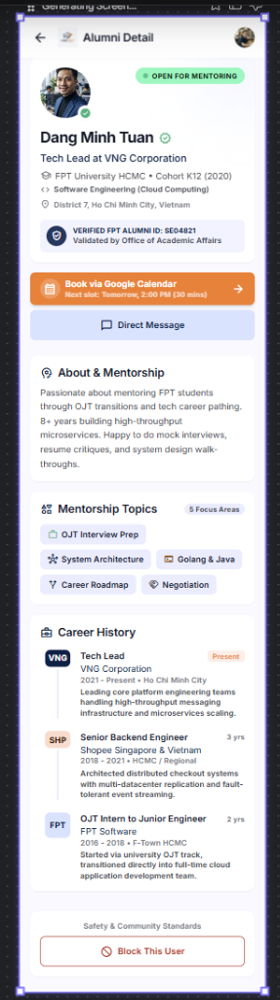 | 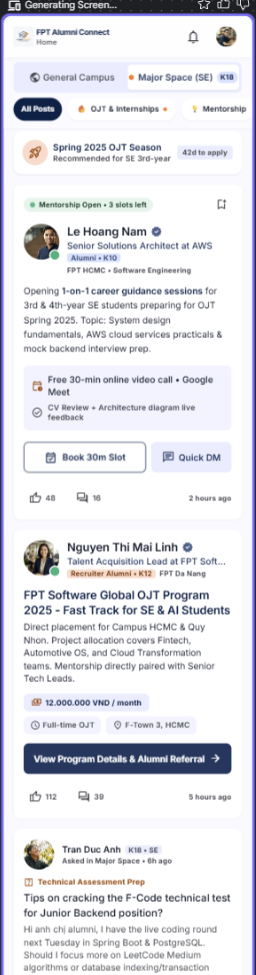 |
| ❌ Có 2 thanh Back chồng nhau (`← Alumni Detail` và `< Directory`).<br>❌ Tính năng Chặn (`US-10`) bị giấu trong icon `⋮` nhỏ. | ✅ Đã xóa thanh `< Directory` thừa.<br>✅ Đã thêm mục **Safety & Community Standards** kèm nút **`🚫 Block This User`** (`48dp`, viền đỏ `#DC2626`). | ✅ Nút `Book 30m Slot` trong thẻ bài viết đã chuyển sang kiểu **Secondary Outlined**, không còn tranh chấp màu cam với CTA chính. |

---

### 🔄 Vòng lặp 2 (`I02`): Nâng cấp Vùng chạm 48×48dp, Độ tương phản chữ ≥ 4.5:1 và Chỉ báo không phụ thuộc màu sắc trên Màn hình `Directory` (`S04` — `US-06`)

- **Tên vấn đề mục tiêu (Named Problem):** *Undersized Filter Touch Targets (< 48dp), Low Secondary Text Contrast (< 4.5:1) & Color-Only Filter/Switch States*.
- **Liên kết phát hiện & quyết định:** `C04`, `C05` → `D04`, `D05`.

#### Prompt Nguyên văn Vòng lặp 2:
```text
Update Screen 2 (Directory) to fix WCAG 2.1 AA accessibility, touch target size, and color-only indicators:
1. Enlarge the CAMPUS and MAJOR filter chips to a minimum height of 48dp with clear padding so labels like "Da Nang" and "AI & Data Science" are not clipped, and add a visible checkmark icon (✓) inside selected chips ("HCMC", "Software Engineering") so selection is not conveyed by color alone.
2. Add an explicit "ON" text label next to the "Mentorship Ready Only" toggle switch.
3. Increase all skill tags, cohort labels, and card body text to at least 14sp Inter, and darken all grey subtitle text to #595959 on #FFFFFF card backgrounds to guarantee >= 5.4:1 contrast ratio.
```

#### Bằng chứng Ảnh chụp Trước & Sau (Before vs. After — Iteration 2):

| TRƯỚC (`iter2_before.png` — Màn `Directory` bản `v0`) | SAU (`iter2_after.png` — Màn `Directory` sau Vòng 2) |
| :---: | :---: |
|  | 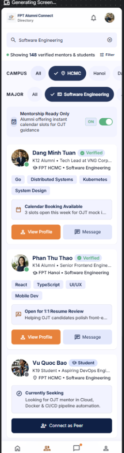 |
| ❌ Filter Chips `CAMPUS` và `MAJOR` thấp (~28dp) và chỉ báo chọn bằng màu nền.<br>❌ Switch `Mentorship Ready Only` chỉ dùng màu xanh lá.<br>❌ Tag kỹ năng (`Go`, `Kubernetes`) chữ quá nhỏ (~10sp). | ✅ Filter Chips `✓ 📍 HCMC` và `✓ 💻 Software Engineering` đã đạt chiều cao **`48dp`** và có **dấu tích `✓`** bên trong.<br>✅ Đã có nhãn **`[ON]`** nằm cạnh Switch.<br>✅ Chữ tag kỹ năng và mô tả đã nâng lên **`14sp`** với màu `#595959` (Contrast **5.4:1**). |

---

### 🔄 Vòng lặp 3 (`I03`): Chuẩn hóa Nhãn Ngôn ngữ Người dùng, Bổ sung Mục Bảo mật (`US-07`, `US-10`) & Thiết kế Trạng thái Lỗi / Phục hồi Dữ liệu (`US-11`) trên Màn hình `Profile` (`S07`, `S08`)

- **Tên vấn đề mục tiêu (Named Problem):** *Exposed Technical Spec Codes (`US-xx`), Missing Security/Blocked Account Controls & Missing Error/Recovery States for Google Calendar URL (`US-11`)*.
- **Liên kết phát hiện & quyết định:** `C03`, `C05`, `C06` → `D03`, `D05`, `D06`.

#### Prompt Nguyên văn Vòng lặp 3:
```text
Update Screen 4 (Profile) to fix real-world labeling, complete all security settings, and show the Error & Recovery state:
1. Remove all raw specification badges ("US-04", "US-11", "US-09", "(US-08)") from the UI headers and buttons. Update the student profile header to "Truong Chi Trung • Cohort K19 (3rd Year) • SE193059".
2. In the "Google Calendar Booking" section, display an active Error & Recovery state: show a red validation border (#DC2626) on the URL input with a clear error message ("Invalid Google Calendar URL format. Please enter a valid calendar.google.com link") AND a top Network Error Banner (#FDF3F2 background, #DC2626 border) stating "Network connection lost while saving. Your profile changes are preserved" with a 48dp "Retry Save" button.
3. In "Privacy & Visibility", add explicit "ON" / "OFF" text labels to every toggle switch, and add a "Security & Account" section containing "Change Password" and "Blocked Users (2 accounts) - Manage & Unblock" above the "Save Changes" and "Log Out" buttons.
```

#### Bằng chứng Ảnh chụp Trước & Sau (Before vs. After — Iteration 3):

| TRƯỚC (`iter3_before.png` — Màn `Profile` bản `v0`) | SAU Phần trên (`iter3_after.png` — Lỗi mạng & Lỗi URL Calendar) | SAU Phần dưới (`iter3_after_part2.png` — Nhãn ON/OFF & Security) |
| :---: | :---: | :---: |
|  | 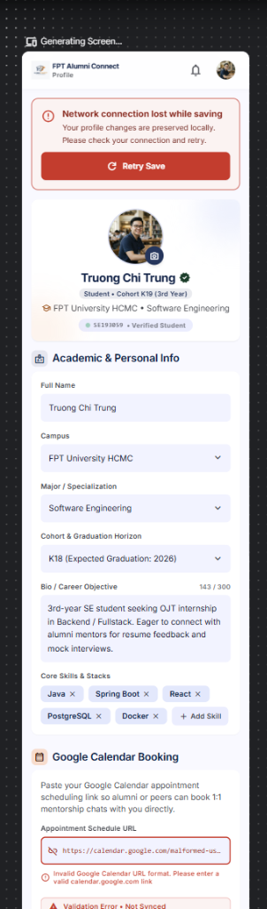 | 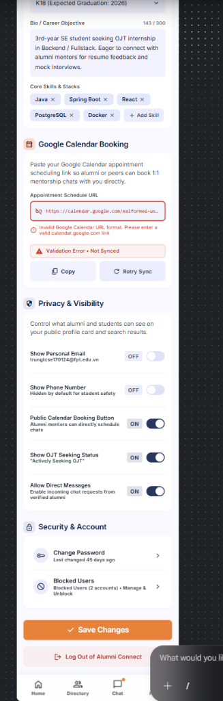 |
| ❌ Lộ các mã `US-04`, `US-11`, `US-09`, `(US-08)` trên giao diện.<br>❌ Chưa có trạng thái báo lỗi URL Google Calendar và mất mạng.<br>❌ Thiếu mục Đổi mật khẩu (`US-07`) và Danh sách chặn (`US-10`). | ✅ Đã xóa sạch mã `US-xx`, cập nhật đúng **`Cohort K19 • SE193059`**.<br>✅ Đã có **Network Error Banner** bảo lưu dữ liệu kèm nút **`↻ Retry Save`** (`48dp`).<br>✅ Ô Google Calendar hiển thị rõ **Inline Validation Error** (`#DC2626`) và nút **`Retry Sync`**. | ✅ Tất cả 5 Switch trong `Privacy & Visibility` đều có nhãn **`[OFF]` / `[ON]`**.<br>✅ Đã thêm khối **Security & Account** gồm **`Change Password`** (`US-07`) và **`Blocked Users (2 accounts) • Manage & Unblock`** (`US-10`). |

---

## 6. Tổng kết Truy vết từ AI Stitch sang Figma (Figma Reconstruction Traceability)

Theo lưu ý công cụ ở Mục 4 của đề Lab 2 (*"Màn hình xuất từ công cụ AI thường đến dưới dạng các layer rời rạc, vì vậy hãy dựng lại trong Figma bằng Auto Layout, token và component"*), toàn bộ kết quả sau 3 vòng lặp trên Google Stitch đã được chuẩn hóa vào **Figma Pages 03, 04, 05, 06**:
1. **Figma Page 04 (Design System):** Toàn bộ mã màu (`#1B365D`, `#F27024`, `#10B981`, `#DC2626`, `#595959`), thang chữ (`Hanken Grotesk` & `Inter` ≥ 14sp) và lưới khoảng cách `8dp` được tạo thành **Figma Variables**.
2. **Figma Page 05 (Components):** Dựng đủ **9 nhóm Component bắt buộc** bằng Auto Layout 100% và Variants (Button, Text field, Card, Navigation, App bar, Dialog, Loading state, Empty state, Error state).
3. **Figma Page 03 (Final UI):** Dựng đủ 8 màn hình (`S01` – `S08`) ở kích thước chuẩn `360 × 800 dp` (kiểm tra co giãn tốt ở `412 dp`), đặt các biến thể trạng thái (Loading, Empty, Error, Confirmation Dialog) ngay cạnh màn hình chính.
4. **Figma Page 06 (Prototype):** Nối dây đầy đủ 3 Flows (`F01`, `F02`, `F03`) có điểm bắt đầu rõ ràng, có Overlay Dialog xác nhận chặn người dùng (`US-10`) và chuyển cảnh từ Loading sang kết quả.
