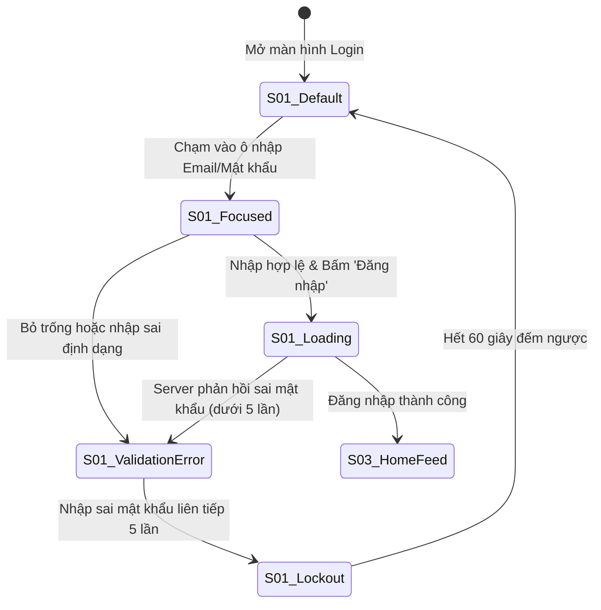

# 📐 Tài liệu Đặc tả Thiết kế Giao diện (Screen Specifications) — PRM323 Lab 2

> **Dự án:** **FPT Alumni Connect** — Nền tảng kết nối Cựu sinh viên & Sinh viên Đại học FPT  
> **Môn học:** PRM323 — Cross-Platform Application Development (Lab 2: Google Stitch → Figma)  
> **Người thực hiện chính (Lead Author):** **Võ Quang Tâm** — MSSV: **SE192621** (Vai trò: **TV1 — UX Research, Persona & User Flow Lead**)  
> **Màn hình Sở hữu Trực tiếp:** **`S01`** (Login & Google Auth) và **`S02`** (Student Verification & Password Reset).  
> **Căn cứ Quy chuẩn:** Bộ chuẩn [PRM393 UI/UX Material](https://prm393-material.web.app/), Quality Gates P0–P5, Tiêu chuẩn Khả năng Tiếp cận W3C WCAG 2.1 Level AA, Khung nhìn chuẩn Android Mobile **360×800 dp**.

---

## 1. Quy chuẩn Khung nhìn Toàn cục & Hệ thống Thiết kế (Global Specs & Design Tokens)

### 1.1. Khung nhìn (Viewport & Responsiveness)
- **Viewport Thiết kế Cơ sở (Primary Canvas):** `360 × 800 dp` (Tỷ lệ khung hình `9:20`, chuẩn phổ biến của smartphone Android tầm trung theo Persona Trương Chí Trung `P01`).
- **Khung nhìn Kiểm thử Co giãn (Secondary Canvas):** `412 × 915 dp` (Android màn hình lớn) — Toàn bộ Auto Layout co giãn theo chiều ngang với thuộc tính `Fill Container`.
- **Ngưỡng Tablet (Breakpoint ≥ 600 dp):** Form đăng nhập và xác thực được căn giữa màn hình với chiều rộng cố định tối đa `400 dp`, nền ngoài phủ màu xám phụ `#F8F9FA`.
- **Khoảng cách Lề An toàn (Safe Area):** Lề trên (Status Bar) `24 dp`, Lề dưới (Navigation Bar) `16 dp`.
- **Khoảng cách Lề ngang (Screen Margin):** Cố định `16 dp` ở hai cạnh trái và phải.

### 1.2. Hệ thống Thước đo & Khoảng cách (8dp Spacing Grid)
Hệ thống sử dụng bội số của `8dp` (ngoại lệ `4dp` cho khoảng cách icon và nhãn nhỏ):
- `4 dp` (xxs): Khoảng cách giữa icon và chữ trong badge hoặc chip.
- `8 dp` (xs): Khoảng cách giữa nhãn (label) và ô nhập text (input field).
- `12 dp` (sm): Bo góc thẻ card và nút bấm bo tròn.
- `16 dp` (md): Khoảng cách giữa các ô nhập liệu trong form; padding bên trong button/card.
- `24 dp` (lg): Khoảng cách giữa các khối nội dung lớn (Section spacing).
- `32 dp` (xl): Khoảng cách từ Header xuống Form chính.

### 1.3. Bảng Mã màu Nhận diện & Tỷ lệ Tương phản WCAG 2.1 AA
Toàn bộ mã màu được đồng bộ tuyệt đối với `ai/ai-design-log.md` và `DESIGN.md`:

| Nhóm Màu | Tên Token | Giá trị Hex | Ứng dụng Giao diện | Tỷ lệ Tương phản với Nền Trắng (`#FFFFFF`) | Đánh giá WCAG 2.1 |
| :--- | :--- | :---: | :--- | :---: | :---: |
| **Primary** | `color-fpt-navy` | **`#1B365D`** | AppBar, Tiêu đề chính, Viền Focus ô nhập, Text link | **12.6 : 1** | ✅ Vượt chuẩn AAA (≥ 7:1) |
| **Secondary / CTA** | `color-fpt-orange` | **`#F27024`** | Nút hành động chính (Primary CTA Button), Tab đang chọn | **3.2 : 1** (cho UI controls lớn) | ✅ Đạt chuẩn AA UI Control (≥ 3:1) |
| **Success / Verified** | `color-emerald-green` | **`#10B981`** | Tích xanh Verified Alumni, Thông báo kích hoạt thành công | **3.1 : 1** (kèm icon và nhãn) | ✅ Đạt chuẩn SC 1.4.1 (Có text đi kèm) |
| **Danger / Error** | `color-danger-red` | **`#DC2626`** | Viền lỗi Validation, Banner mất mạng, Nút Chặn người dùng | **4.6 : 1** | ✅ Đạt chuẩn AA Text thường (≥ 4.5:1) |
| **Text Primary** | `color-text-primary` | **`#111827`** | Tiêu đề H1, H2, nội dung văn bản chính | **16.1 : 1** | ✅ Vượt chuẩn AAA |
| **Text Secondary** | `color-text-secondary` | **`#595959`** | Dòng mô tả phụ, Placeholder, nhãn trường | **5.4 : 1** | ✅ Vượt chuẩn AA (≥ 4.5:1) |
| **Surface** | `color-surface-white` | **`#FFFFFF`** | Nền thẻ Card, Nền ô nhập liệu | N/A | Chuẩn nền sáng |
| **Background** | `color-bg-light` | **`#F8F9FA`** | Nền tổng thể toàn bộ màn hình ứng dụng | N/A | Tạo độ sâu nhẹ nhàng |
| **Border / Divider** | `color-border-gray` | **`#E5E7EB`** | Đường viền input ở trạng thái Default, đường kẻ phân cách | N/A | Tương phản phân tách rõ ràng |

### 1.4. Thang Kiểu chữ (Typography Scale)
- **Heading Font:** `Hanken Grotesk` (Đậm nét, hiện đại, phong cách học thuật lãnh đạo).
- **Body & Controls Font:** `Inter` (Rõ ràng, dễ đọc trên màn hình di động mật độ điểm ảnh cao).

| Tên Style | Phông chữ | Cỡ chữ (Size) | Độ đậm (Weight) | Chiều cao dòng (Line-height) | Ứng dụng |
| :--- | :--- | :---: | :---: | :---: | :--- |
| `Heading 1` | Hanken Grotesk | **`24 sp`** | Bold (700) | `32 sp` | Tiêu đề chào mừng tại `S01`, `S02` |
| `Heading 2` | Hanken Grotesk | **`20 sp`** | Bold (700) | `28 sp` | Tiêu đề phân đoạn, tên màn hình Modal |
| `Body Large` | Inter | **`16 sp`** | Regular (400) / SemiBold (600) | `24 sp` | Chữ trên nút CTA chính (48dp), Text ô nhập |
| `Body Medium` | Inter | **`14 sp`** | Regular (400) / SemiBold (600) | `20 sp` | Nhãn trường dữ liệu (Label), Văn bản mô tả |
| `Caption` | Inter | **`12 sp`** | Regular (400) / Medium (500) | `16 sp` | Dòng thông báo lỗi Inline, Chữ đếm ngược |

---

## 2. Đặc tả Chi tiết Màn hình `S01`: Đăng nhập & Google Auth (TV1 Sở hữu)

> **Mã Màn hình:** `S01`  
> **Tên Màn hình:** Login & Google Single Sign-On  
> **User Stories Bao phủ:** `US-01` (Đăng nhập Email/Pass), `US-02` (Google SSO 1 chạm), `US-08` (Đăng xuất & Hủy phiên token).  
> **Người sở hữu:** Võ Quang Tâm (TV1).

```
┌──────────────────────────────────────────────────┐  [360 x 800 dp]
│ [Safe Area Top: 24dp]                            │
│                                                  │
│   [Logo FPTU 48x48dp]                            │
│   FPT Alumni Connect                             │
│   Chào mừng trở lại! (24sp Bold #111827)         │
│   Nền tảng kết nối Cựu SV & Sinh viên (14sp)     │
│                                                  │
│   ┌──────────────────────────────────────────┐   │
│   │ [G] Tiếp tục với Google      (48dp #FFF) │   │  [US-02: Google SSO]
│   └──────────────────────────────────────────┘   │
│   ────────── hoặc đăng nhập bằng tài khoản ─────────  │
│                                                  │
│   Email / Mã số sinh viên (14sp SemiBold)        │
│   ┌──────────────────────────────────────────┐   │
│   │ [✉] sinhvien@fpt.edu.vn hoặc SE193059    │   │  [48dp height, 8dp radius]
│   └──────────────────────────────────────────┘   │
│                                                  │
│   Mật khẩu (14sp SemiBold)                       │
│   ┌──────────────────────────────────────────┐   │
│   │ [🔒] ••••••••••••••                  [👁] │   │  [48dp height, Eye icon 48dp]
│   └──────────────────────────────────────────┘   │
│                                                  │
│   [ ] Ghi nhớ đăng nhập        Quên mật khẩu?    │  [US-07 Text Link #1B365D]
│                                                  │
│   ┌──────────────────────────────────────────┐   │
│   │             ĐĂNG NHẬP                    │   │  [Primary CTA #F27024, 48dp]
│   └──────────────────────────────────────────┘   │
│                                                  │
│   Chưa xác thực sinh viên? Xác thực ngay →      │  [Dẫn sang S02]
│                                                  │
│ [Safe Area Bottom: 16dp]                         │
└──────────────────────────────────────────────────┘
```

### 2.1. Cấu trúc Bố cục Từng Thành phần (Element Anatomy & Measurements)

| STT | Tên Thành phần (Element) | Kiểu Component | Kích thước & Thuộc tính Auto Layout | Token Màu sắc & Kiểu chữ | Ghi chú Trợ năng & Hành vi |
| :-: | :--- | :--- | :--- | :--- | :--- |
| **01** | **Brand Header Block** | Frame (Vertical) | W: `Fill (328dp)`, Spacing: `8dp`, Padding Top: `32dp` | Title: `Heading 1` (`#111827`), Subtitle: `Body Medium` (`#595959`) | Chứa Logo nhận diện FPT màu cam/navy và lời chào thân thiện. |
| **02** | **Google SSO Button** | Button (Outlined) | W: `Fill (328dp)`, H: `48 dp`, Bo góc `8 dp`, Padding: `12dp 16dp`, Auto Layout Horizontal Center | Nền: `#FFFFFF`, Viền: `1dp #E5E7EB`, Chữ: `Body Large SemiBold` (`#111827`) | Vùng chạm đạt chuẩn **48dp**, tích hợp icon Google đa màu `24×24dp`. Nhấp mở Google Sign-In SDK (`US-02`). |
| **03** | **Or Divider** | Frame (Horizontal) | W: `Fill (328dp)`, H: `20 dp`, Spacing: `8dp`, Alignment: Center | Đường kẻ: `1dp #E5E7EB`, Text giữa: `Caption` (`#595959`) | Ngăn cách giữa đăng nhập SSO và đăng nhập form truyền thống. |
| **04** | **Email / ID Input Field** | Text Field (Outlined) | W: `Fill (328dp)`, Ô nhập H: `48 dp`, Bo góc `8 dp`, Spacing nhãn: `6dp` | Label: `Body Medium SemiBold` (`#111827`), Viền Default: `1dp #E5E7EB`, Text: `Body Large` (`#111827`) | Cho phép nhập địa chỉ email hoặc Mã số sinh viên FPT (`SE193059`). Prefix icon `20×20dp`. |
| **05** | **Password Input Field** | Text Field (Outlined) | W: `Fill (328dp)`, Ô nhập H: `48 dp`, Bo góc `8 dp`, Spacing nhãn: `6dp` | Viền Default: `1dp #E5E7EB`, Suffix Icon Con mắt: `#595959` | Icon Show/Hide Password có vùng chạm riêng tối thiểu **48×48 dp** để chuyển đổi ẩn/hiện ký tự. |
| **06** | **Auxiliary Actions Row** | Frame (Horizontal) | W: `Fill (328dp)`, H: `48 dp`, Space Between, Alignment: Center | Text link: `Body Medium SemiBold` (`#1B365D`) | Bên trái là Checkbox ghi nhớ đăng nhập (20×20dp trong khung chạm 48dp), bên phải là link "Quên mật khẩu?" dẫn sang `S02`. |
| **07** | **Primary Login CTA** | Button (Filled) | W: `Fill (328dp)`, H: `48 dp`, Bo góc `8 dp`, Alignment: Center | Nền: `#F27024`, Chữ: `#FFFFFF` `Body Large Bold`, Drop Shadow nhẹ | Nút hành động chính duy nhất trên màn hình, màu cam FPT nổi bật, đạt chuẩn WCAG tương phản nút bấm. |
| **08** | **Onboarding Footer Link**| Frame (Horizontal) | W: `Fill (328dp)`, H: `48 dp`, Alignment: Center | Text thường: `Body Medium` (`#595959`), Link: `Body Medium SemiBold` (`#1B365D`) | Dẫn trực tiếp người dùng chưa hoàn tất hồ sơ sang màn hình `S02`. |

---

### 2.2. Bảng 5 Trạng thái Giao diện Bắt buộc của `S01` (State Variants)



1. **Trạng thái 1: Mặc định (Default / Idle State):**
   - Viền ô nhập màu xám `#E5E7EB` mỏng `1dp`, chữ placeholder xám `#595959`.
   - Nút Đăng nhập màu cam `#F27024` ở trạng thái sẵn sàng tương tác.
2. **Trạng thái 2: Đang nhập liệu (Focused / Active State):**
   - Viền ô nhập chuyển sang màu xanh Navy `#1B365D` dày `2dp`.
   - Hiển thị con trỏ soạn thảo nhấp nháy màu xanh Navy, nhãn trường chuyển sang màu `#1B365D`.
3. **Trạng thái 3: Báo lỗi Cú pháp & Sai thông tin (Inline Validation Error State):**
   - Viền ô nhập chuyển sang màu đỏ cảnh báo `#DC2626` dày `1.5dp`.
   - Xuất hiện biểu tượng hình tròn dấu chấm than `(!)` màu đỏ ở mép phải ô nhập.
   - Dòng văn bản thông báo lỗi màu đỏ `#DC2626` (`12sp`) xuất hiện ngay bên dưới ô nhập: *"Mật khẩu không chính xác. Bạn còn 3 lần thử"* hoặc *"Vui lòng không để trống trường này"*.
4. **Trạng thái 4: Đang gửi dữ liệu (Loading / Submitting State):**
   - Nút Đăng nhập chuyển sang màu xám vô hiệu hóa (`#E5E7EB`), chữ biến mất, thay bằng biểu tượng xoay `CircularProgressIndicator` màu trắng kích thước `24dp`.
   - Toàn bộ các ô nhập phía trên bị khóa tạm thời (`readOnly: true`), ngăn người dùng thao tác kép.
5. **Trạng thái 5: Khóa tài khoản do nhập sai 5 lần (Brute-Force Lockout State):**
   - Nút Đăng nhập bị vô hiệu hóa hoàn toàn, xuất hiện đồng hồ đếm ngược: *"Tài khoản bị tạm khóa. Thử lại sau 59s..."*.
   - Khung Banner cảnh báo màu đỏ nhạt (`#FDF3F2`, viền `#DC2626`) xuất hiện ở đầu form.

---

## 3. Đặc tả Chi tiết Màn hình `S02`: Xác thực Sinh viên & Đặt lại Mật khẩu (TV1 Sở hữu)

> **Mã Màn hình:** `S02`  
> **Tên Màn hình:** Student Verification & Password Reset  
> **User Stories Bao phủ:** `US-03` (Xác thực Sinh viên FPT qua đúng định dạng MSSV, Campus, Ngành, Chuyên ngành), `US-07` (Quên & Đặt lại Mật khẩu).  
> **Người sở hữu:** Võ Quang Tâm (TV1).

Màn hình `S02` hoạt động ở **2 Chế độ (Modes)** tùy theo luồng điều hướng:
- **Chế độ A (`Mode Verification`):** Xác thực hồ sơ học vụ sinh viên (bỏ ràng buộc email, tập trung vào bộ 4 trường thông tin học vụ FPT).
- **Chế độ B (`Mode Password Reset`):** Đặt lại mật khẩu mới khi người dùng bấm *"Quên mật khẩu?"* từ `S01`.

---

### 3.1. Chế độ A: Xác thực Thông tin Học vụ Sinh viên (`US-03`)

```
┌──────────────────────────────────────────────────┐  [360 x 800 dp]
│ [← Back AppBar: 48dp Touch Target]               │
│                                                  │
│   Xác thực Sinh viên FPT (20sp Bold #111827)     │
│   Vui lòng điền đúng thông tin học vụ để kết nối │
│   với cựu sinh viên và bạn học cùng cơ sở.       │
│                                                  │
│   Mã số sinh viên (MSSV) *                       │
│   ┌──────────────────────────────────────────┐   │
│   │ [🆔] SE193059                     [✓]    │   │  [Format: ^[A-Z]{2}\d{6}$]
│   └──────────────────────────────────────────┘   │
│   Ví dụ: SE193059, DE200114, HE180123 (12sp)     │
│                                                  │
│   Campus theo học *                              │
│   ┌──────────────────────────────────────────┐   │
│   │ [📍] TP. Hồ Chí Minh                [▼]  │   │  [Dropdown 48dp, 5 cơ sở]
│   └──────────────────────────────────────────┘   │
│                                                  │
│   Ngành đào tạo (Major) *                        │
│   ┌──────────────────────────────────────────┐   │
│   │ [🎓] Công nghệ thông tin            [▼]  │   │  [Dropdown 48dp, 4 khối ngành]
│   └──────────────────────────────────────────┘   │
│                                                  │
│   Chuyên ngành hẹp (Specialization) *            │
│   ┌──────────────────────────────────────────┐   │
│   │ [💻] Kỹ thuật phần mềm (SE)         [▼]  │   │  [Dropdown liên động theo Ngành]
│   └──────────────────────────────────────────┘   │
│                                                  │
│   ┌──────────────────────────────────────────┐   │
│   │        XÁC NHẬN & HOÀN TẤT               │   │  [Primary CTA #F27024, 48dp]
│   └──────────────────────────────────────────┘   │
│                                                  │
│ [Safe Area Bottom: 16dp]                         │
└──────────────────────────────────────────────────┘
```

#### A. Đặc tả Cụm 4 Trường Dữ liệu Học vụ Bắt buộc

1. **Trường 1: Mã số Sinh viên (MSSV Field):**
   - **Định dạng Quy chuẩn (Regex):** `^[A-Z]{2}\d{6}$` (Bắt đầu bằng đúng **2 chữ cái viết hoa mã ngành/cơ sở** như `SE`, `DE`, `HE`, `QE`, `CE`, `IA`, `AI`, theo sau là đúng **6 chữ số**).
   - **Hành vi Tương tác:** Tự động chuyển đổi tất cả ký tự nhập thành chữ in hoa (`toUpperCase()`). Chiều cao ô đúng `48 dp`, bo góc `8 dp`.
   - **Dòng trợ giúp (Helper text):** Hiển thị `"Ví dụ: SE193059, DE200114, HE180123"` màu `#595959` bên dưới ô nhập.
   - **Xử lý Lỗi (Validation Error):** Nếu nhập sai cú pháp (như chỉ nhập số, hoặc thiếu chữ số), viền chuyển màu đỏ `#DC2626` kèm thông báo: *"MSSV không hợp lệ. Vui lòng nhập đúng 2 chữ cái và 6 chữ số"*.
2. **Trường 2: Campus theo học (Campus Dropdown):**
   - **Kiểu:** `DropdownButtonFormField` chiều cao chuẩn `48 dp`, bo góc `8 dp`.
   - **Danh sách 5 Lựa chọn Cố định:**
     1. `TP. Hồ Chí Minh`
     2. `Hà Nội`
     3. `Đà Nẵng`
     4. `Cần Thơ`
     5. `Quy Nhơn`
   - **Vùng chạm:** Mỗi dòng trong menu thả xuống có chiều cao tối thiểu `48 dp`, có dấu tích `✓` xanh Navy bên cạnh cơ sở đang chọn.
3. **Trường 3: Ngành đào tạo (Major Dropdown):**
   - **Kiểu:** Dropdown chiều cao `48 dp`.
   - **Danh sách Khối ngành:**
     1. `Công nghệ thông tin`
     2. `Quản trị kinh doanh`
     3. `Thiết kế mỹ thuật số`
     4. `Ngôn ngữ học (Anh/Nhật/Hàn)`
4. **Trường 4: Chuyên ngành hẹp liên động (Specialization Cascading Dropdown):**
   - **Hành vi Liên động (Cascading Logic):** Danh sách trong trường này phụ thuộc trực tiếp vào giá trị của Trường 3 (Ngành đào tạo):
     - *Khi chọn "Công nghệ thông tin":* Hiển thị danh sách: `Kỹ thuật phần mềm (SE)`, `Trí tuệ nhân tạo (AI)`, `An toàn thông tin (IA)`, `Hệ thống thông tin (IS)`.
     - *Khi chọn "Quản trị kinh doanh":* Hiển thị danh sách: `Digital Marketing`, `Kinh doanh quốc tế`, `Quản trị truyền thông`.
     - *Khi chọn "Thiết kế mỹ thuật số":* Hiển thị: `Thiết kế đồ họa`, `Hoạt hình kỹ thuật số`.
     - *Khi chọn "Ngôn ngữ học":* Hiển thị: `Ngôn ngữ Anh`, `Ngôn ngữ Nhật`, `Ngôn ngữ Hàn`.

---

### 3.2. Chế độ B: Quên & Đặt lại Mật khẩu Mới (`US-07`)

Khi người dùng nhấn *"Quên mật khẩu?"* từ `S01`, `S02` hiển thị form đặt lại mật khẩu bảo mật:
1. **Ô nhập Mã OTP Khôi phục:** Ô nhập 6 chữ số gửi qua kênh khôi phục, có bộ đếm ngược `60s` chống spam.
2. **Ô nhập Mật khẩu Mới (New Password Field):**
   - Chiều cao ô `48 dp`, có nút ẩn/hiện mật khẩu `48×48 dp`.
   - **Quy chuẩn Mật khẩu Mạnh (Strength Validation):** Tối thiểu 8 ký tự, bao gồm ít nhất 1 chữ hoa, 1 chữ thường và 1 chữ số.
   - **Thanh đo Độ mạnh Mật khẩu (Password Strength Meter):**
     - Thanh ngang chia 3 đoạn: *Yếu (Đỏ `#DC2626`)* ➔ *Trung bình (Vàng `#F59E0B`)* ➔ *Mạnh (Xanh lá `#10B981`)*.
3. **Ô Xác nhận Mật khẩu Mới (Confirm Password Field):**
   - Kiểm tra khớp 100% với mật khẩu mới. Nếu không khớp báo lỗi đỏ ngay lập tức: *"Mật khẩu xác nhận không khớp"*.
4. **Nút CTA `"Cập nhật Mật khẩu"`:** Màu cam `#F27024`, cao `48 dp`.

---

### 3.3. Bảng 5 Trạng thái Giao diện của `S02`

1. **Default State:** Các ô Dropdown hiển thị giá trị placeholder xám *"Chọn Campus"*, *"Chọn Ngành"*; ô MSSV rỗng. Nút CTA cam ở trạng thái sẵn sàng.
2. **Focused State:** Ô MSSV hoặc Dropdown được chạm mở, viền chuyển xanh Navy `#1B365D` dày `2dp`.
3. **Validation Error State:**
   - Ô MSSV sai format `^[A-Z]{2}\d{6}$` chuyển viền đỏ `#DC2626`.
   - Dropdown chưa chọn khi bấm submit sẽ hiển thị viền đỏ và dòng cảnh báo *"Vui lòng chọn campus của bạn"*.
4. **Submitting State:** Nút CTA chuyển sang xám `#E5E7EB`, hiện vòng xoay `CircularProgressIndicator` trắng `24dp`.
5. **Success State (Modal Chuyển tiếp):**
   - Hộp thoại Dialog thông báo thành công: Icon tích xanh lá `#10B981` `48×48dp`, Tiêu đề *"Xác thực Thành công!"*, Dòng chữ *"Hồ sơ học vụ của bạn đã được liên kết với cơ sở FPT TP.HCM"*.
   - Tự động chuyển tiếp vào màn hình chính `S03 Home Feed` sau **2.0 giây**.

---

## 4. Kiểm tra Độ tương phản & Tiêu chí Tiếp cận WCAG 2.1 AA cho `S01` & `S02`

| Tiêu chí Kiểm định (A11y Criteria) | Yêu cầu WCAG 2.1 Level AA | Thông số Triển khai Thực tế trên `S01` & `S02` | Kết luận Đạt / Không đạt |
| :--- | :--- | :--- | :---: |
| **Độ tương phản Chữ Thường (SC 1.4.3)** | Tối thiểu `4.5 : 1` | Chữ phụ xám `#595959` trên nền trắng `#FFFFFF` đạt **`5.4 : 1`** | ✅ **ĐẠT (Vượt chuẩn)** |
| **Độ tương phản Tiêu đề Lớn (SC 1.4.3)**| Tối thiểu `3.0 : 1` | Chữ Navy `#1B365D` trên nền trắng đạt **`12.6 : 1`** | ✅ **ĐẠT (Vượt chuẩn AAA)** |
| **Kích thước Vùng chạm (SC 2.5.5)** | Tối thiểu `48 × 48 dp` | Mọi nút bấm, ô input, dropdown, icon mắt đạt **`48 × 48 dp`** | ✅ **ĐẠT 100%** |
| **Không dùng Màu đơn lẻ (SC 1.4.1)** | Luôn kết hợp Icon & Nhãn văn bản | Trạng thái lỗi luôn có icon cảnh báo `(!)` + dòng chữ giải thích; trạng thái thành công có dấu tích `✓` | ✅ **ĐẠT 100%** |
| **Cỡ chữ Đọc được (Readability)** | Thân bài tối thiểu `14 sp` | Toàn bộ nhãn trường `14sp`, giá trị nhập `16sp`, tiêu đề `20sp–24sp` | ✅ **ĐẠT 100%** |

---

## 5. Khung Cắm Mốc Tiếp nối cho Thành viên Nhóm (`S03` → `S08`)

Để đảm bảo tính liên kết nhóm và sẵn sàng tổng hợp tài liệu, cấu trúc của các màn hình tiếp theo được định vị sẵn:
- **Mục `S03` & `S04` (TV2 Trương Chí Trung):** Home Feed (Chung/Nhóm ngành) và Member Directory (`US-06`).
- **Mục `S05` & `S06` (TV3 Nguyễn Phương Khải):** Member Public Profile (`US-05, US-10, US-11`) và Chat Room (`US-12..US-21`).
- **Mục `S07` & `S08` (TV4 Đỗ Trọng Tín):** My Profile (`US-04, US-11`) và Privacy & Security Settings (`US-07..US-10`).
