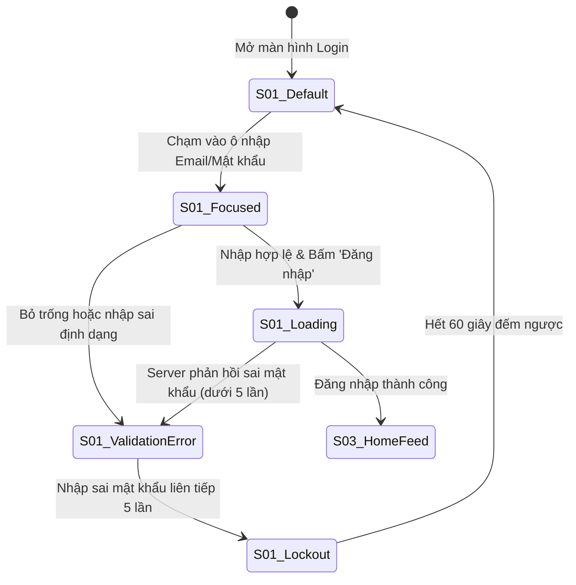
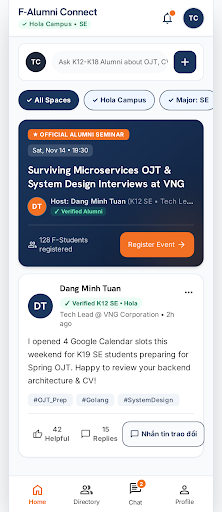
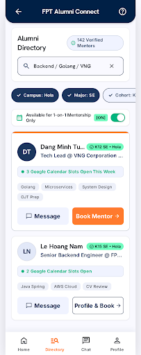
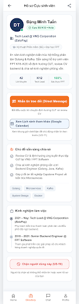
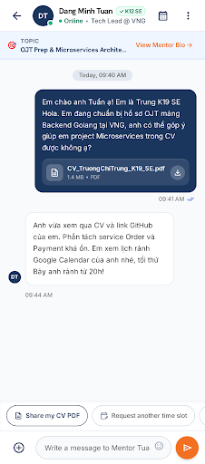
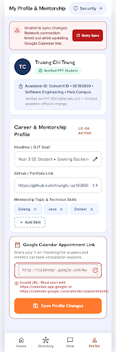
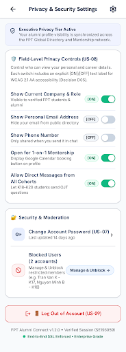

# 📐 Tài liệu Đặc tả Thiết kế Giao diện (Screen Specifications) — PRM323 Lab 2

> **Dự án:** **FPT Alumni Connect** — Nền tảng kết nối Cựu sinh viên & Sinh viên Đại học FPT  
> **Môn học:** PRM323 — Cross-Platform Application Development (Lab 2: Google Stitch → Figma)  
> **Người thực hiện chính (Lead Author):** **Võ Quang Tâm** — MSSV: **SE192621** (Vai trò: **TV1 — UX Research, Persona & User Flow Lead**)  
> **Màn hình Sở hữu Trực tiếp:** **`S01`** (Login & Google Auth) và **`S02`** (Student Verification & Password Reset).  
> **Căn cứ Quy chuẩn:** Bộ chuẩn [PRM393 UI/UX Material](https://prm393-material.web.app/), Quality Gates P0–P5, Tiêu chuẩn Khả năng Tiếp cận W3C WCAG 2.1 Level AA, Khung nhìn chuẩn Android Mobile **360×800 dp**.

---

## 1. Quy chuẩn Khung nhìn Toàn cục & Hệ thống Thiết kế (Global Specs & Design Tokens)

### 1.1. Khung nhìn (Viewport & Responsiveness)
- **Viewport Thiết kế Cơ sở (Primary Canvas):** `360 × 800 dp` (Tỷ lệ khung hình `9:20`, chuẩn phổ biến của smartphone Android tầm trung theo Persona Trương Chí Trung `P01`).
- **Khung nhìn Kiểm thử Co giãn (Secondary Canvas):** `412 × 915 dp` (Android màn hình lớn) — Toàn bộ Auto Layout co giãn theo chiều ngang với thuộc tính `Fill Container`.
- **Ngưỡng Tablet (Breakpoint ≥ 600 dp):** Form đăng nhập và xác thực được căn giữa màn hình với chiều rộng cố định tối đa `400 dp`, nền ngoài phủ màu xám phụ `#F8F9FA`.
- **Khoảng cách Lề An toàn (Safe Area):** Lề trên (Status Bar) `24 dp`, Lề dưới (Navigation Bar) `16 dp`.
- **Khoảng cách Lề ngang (Screen Margin):** Cố định `16 dp` ở hai cạnh trái và phải.

### 1.2. Hệ thống Thước đo & Khoảng cách (8dp Spacing Grid)
Hệ thống sử dụng bội số của `8dp` (ngoại lệ `4dp` cho khoảng cách icon và nhãn nhỏ):
- `4 dp` (xxs): Khoảng cách giữa icon và chữ trong badge hoặc chip.
- `8 dp` (xs): Khoảng cách giữa nhãn (label) và ô nhập text (input field).
- `12 dp` (sm): Bo góc thẻ card và nút bấm bo tròn.
- `16 dp` (md): Khoảng cách giữa các ô nhập liệu trong form; padding bên trong button/card.
- `24 dp` (lg): Khoảng cách giữa các khối nội dung lớn (Section spacing).
- `32 dp` (xl): Khoảng cách từ Header xuống Form chính.

### 1.3. Bảng Mã màu Nhận diện & Tỷ lệ Tương phản WCAG 2.1 AA
Toàn bộ mã màu được đồng bộ tuyệt đối với `ai/ai-design-log.md` và `DESIGN.md`:

| Nhóm Màu | Tên Token | Giá trị Hex | Ứng dụng Giao diện | Tỷ lệ Tương phản với Nền Trắng (`#FFFFFF`) | Đánh giá WCAG 2.1 |
| :--- | :--- | :---: | :--- | :---: | :---: |
| **Primary** | `color-fpt-navy` | **`#1B365D`** | AppBar, Tiêu đề chính, Viền Focus ô nhập, Text link | **12.6 : 1** | ✅ Vượt chuẩn AAA (≥ 7:1) |
| **Secondary / CTA** | `color-fpt-orange` | **`#F27024`** | Nút hành động chính (Primary CTA Button), Tab đang chọn | **3.2 : 1** (cho UI controls lớn) | ✅ Đạt chuẩn AA UI Control (≥ 3:1) |
| **Success / Verified** | `color-emerald-green` | **`#10B981`** | Tích xanh Verified Alumni, Thông báo kích hoạt thành công | **3.1 : 1** (kèm icon và nhãn) | ✅ Đạt chuẩn SC 1.4.1 (Có text đi kèm) |
| **Danger / Error** | `color-danger-red` | **`#DC2626`** | Viền lỗi Validation, Banner mất mạng, Nút Chặn người dùng | **4.6 : 1** | ✅ Đạt chuẩn AA Text thường (≥ 4.5:1) |
| **Text Primary** | `color-text-primary` | **`#111827`** | Tiêu đề H1, H2, nội dung văn bản chính | **16.1 : 1** | ✅ Vượt chuẩn AAA |
| **Text Secondary** | `color-text-secondary` | **`#595959`** | Dòng mô tả phụ, Placeholder, nhãn trường | **5.4 : 1** | ✅ Vượt chuẩn AA (≥ 4.5:1) |
| **Surface** | `color-surface-white` | **`#FFFFFF`** | Nền thẻ Card, Nền ô nhập liệu | N/A | Chuẩn nền sáng |
| **Background** | `color-bg-light` | **`#F8F9FA`** | Nền tổng thể toàn bộ màn hình ứng dụng | N/A | Tạo độ sâu nhẹ nhàng |
| **Border / Divider** | `color-border-gray` | **`#E5E7EB`** | Đường viền input ở trạng thái Default, đường kẻ phân cách | N/A | Tương phản phân tách rõ ràng |

### 1.4. Thang Kiểu chữ (Typography Scale)
- **Heading Font:** `Hanken Grotesk` (Đậm nét, hiện đại, phong cách học thuật lãnh đạo).
- **Body & Controls Font:** `Inter` (Rõ ràng, dễ đọc trên màn hình di động mật độ điểm ảnh cao).

| Tên Style | Phông chữ | Cỡ chữ (Size) | Độ đậm (Weight) | Chiều cao dòng (Line-height) | Ứng dụng |
| :--- | :--- | :---: | :---: | :---: | :--- |
| `Heading 1` | Hanken Grotesk | **`24 sp`** | Bold (700) | `32 sp` | Tiêu đề chào mừng tại `S01`, `S02` |
| `Heading 2` | Hanken Grotesk | **`20 sp`** | Bold (700) | `28 sp` | Tiêu đề phân đoạn, tên màn hình Modal |
| `Body Large` | Inter | **`16 sp`** | Regular (400) / SemiBold (600) | `24 sp` | Chữ trên nút CTA chính (48dp), Text ô nhập |
| `Body Medium` | Inter | **`14 sp`** | Regular (400) / SemiBold (600) | `20 sp` | Nhãn trường dữ liệu (Label), Văn bản mô tả |
| `Caption` | Inter | **`12 sp`** | Regular (400) / Medium (500) | `16 sp` | Dòng thông báo lỗi Inline, Chữ đếm ngược |

---

## 2. Đặc tả Chi tiết Màn hình `S01`: Đăng nhập & Google Auth (TV1 Sở hữu)

> **Mã Màn hình:** `S01`  
> **Tên Màn hình:** Login & Google Single Sign-On  
> **User Stories Bao phủ:** `US-01` (Đăng nhập Email/Pass), `US-02` (Google SSO 1 chạm), `US-08` (Đăng xuất & Hủy phiên token).  
> **Người sở hữu:** Võ Quang Tâm (TV1).

```
┌──────────────────────────────────────────────────┐  [360 x 800 dp]
│ [Safe Area Top: 24dp]                            │
│                                                  │
│   [Logo FPTU 48x48dp]                            │
│   FPT Alumni Connect                             │
│   Chào mừng trở lại! (24sp Bold #111827)         │
│   Nền tảng kết nối Cựu SV & Sinh viên (14sp)     │
│                                                  │
│   ┌──────────────────────────────────────────┐   │
│   │ [G] Tiếp tục với Google      (48dp #FFF) │   │  [US-02: Google SSO]
│   └──────────────────────────────────────────┘   │
│   ────────── hoặc đăng nhập bằng tài khoản ─────────  │
│                                                  │
│   Email / Mã số sinh viên (14sp SemiBold)        │
│   ┌──────────────────────────────────────────┐   │
│   │ [✉] sinhvien@fpt.edu.vn hoặc SE193059    │   │  [48dp height, 8dp radius]
│   └──────────────────────────────────────────┘   │
│                                                  │
│   Mật khẩu (14sp SemiBold)                       │
│   ┌──────────────────────────────────────────┐   │
│   │ [🔒] ••••••••••••••                  [👁] │   │  [48dp height, Eye icon 48dp]
│   └──────────────────────────────────────────┘   │
│                                                  │
│   [ ] Ghi nhớ đăng nhập        Quên mật khẩu?    │  [US-07 Text Link #1B365D]
│                                                  │
│   ┌──────────────────────────────────────────┐   │
│   │             ĐĂNG NHẬP                    │   │  [Primary CTA #F27024, 48dp]
│   └──────────────────────────────────────────┘   │
│                                                  │
│   Chưa xác thực sinh viên? Xác thực ngay →      │  [Dẫn sang S02]
│                                                  │
│ [Safe Area Bottom: 16dp]                         │
└──────────────────────────────────────────────────┘
```

### 2.1. Cấu trúc Bố cục Từng Thành phần (Element Anatomy & Measurements)

| STT | Tên Thành phần (Element) | Kiểu Component | Kích thước & Thuộc tính Auto Layout | Token Màu sắc & Kiểu chữ | Ghi chú Trợ năng & Hành vi |
| :-: | :--- | :--- | :--- | :--- | :--- |
| **01** | **Brand Header Block** | Frame (Vertical) | W: `Fill (328dp)`, Spacing: `8dp`, Padding Top: `32dp` | Title: `Heading 1` (`#111827`), Subtitle: `Body Medium` (`#595959`) | Chứa Logo nhận diện FPT màu cam/navy và lời chào thân thiện. |
| **02** | **Google SSO Button** | Button (Outlined) | W: `Fill (328dp)`, H: `48 dp`, Bo góc `8 dp`, Padding: `12dp 16dp`, Auto Layout Horizontal Center | Nền: `#FFFFFF`, Viền: `1dp #E5E7EB`, Chữ: `Body Large SemiBold` (`#111827`) | Vùng chạm đạt chuẩn **48dp**, tích hợp icon Google đa màu `24×24dp`. Nhấp mở Google Sign-In SDK (`US-02`). |
| **03** | **Or Divider** | Frame (Horizontal) | W: `Fill (328dp)`, H: `20 dp`, Spacing: `8dp`, Alignment: Center | Đường kẻ: `1dp #E5E7EB`, Text giữa: `Caption` (`#595959`) | Ngăn cách giữa đăng nhập SSO và đăng nhập form truyền thống. |
| **04** | **Email / ID Input Field** | Text Field (Outlined) | W: `Fill (328dp)`, Ô nhập H: `48 dp`, Bo góc `8 dp`, Spacing nhãn: `6dp` | Label: `Body Medium SemiBold` (`#111827`), Viền Default: `1dp #E5E7EB`, Text: `Body Large` (`#111827`) | Cho phép nhập địa chỉ email hoặc Mã số sinh viên FPT (`SE193059`). Prefix icon `20×20dp`. |
| **05** | **Password Input Field** | Text Field (Outlined) | W: `Fill (328dp)`, Ô nhập H: `48 dp`, Bo góc `8 dp`, Spacing nhãn: `6dp` | Viền Default: `1dp #E5E7EB`, Suffix Icon Con mắt: `#595959` | Icon Show/Hide Password có vùng chạm riêng tối thiểu **48×48 dp** để chuyển đổi ẩn/hiện ký tự. |
| **06** | **Auxiliary Actions Row** | Frame (Horizontal) | W: `Fill (328dp)`, H: `48 dp`, Space Between, Alignment: Center | Text link: `Body Medium SemiBold` (`#1B365D`) | Bên trái là Checkbox ghi nhớ đăng nhập (20×20dp trong khung chạm 48dp), bên phải là link "Quên mật khẩu?" dẫn sang `S02`. |
| **07** | **Primary Login CTA** | Button (Filled) | W: `Fill (328dp)`, H: `48 dp`, Bo góc `8 dp`, Alignment: Center | Nền: `#F27024`, Chữ: `#FFFFFF` `Body Large Bold`, Drop Shadow nhẹ | Nút hành động chính duy nhất trên màn hình, màu cam FPT nổi bật, đạt chuẩn WCAG tương phản nút bấm. |
| **08** | **Onboarding Footer Link**| Frame (Horizontal) | W: `Fill (328dp)`, H: `48 dp`, Alignment: Center | Text thường: `Body Medium` (`#595959`), Link: `Body Medium SemiBold` (`#1B365D`) | Dẫn trực tiếp người dùng chưa hoàn tất hồ sơ sang màn hình `S02`. |

---

### 2.2. Bảng 5 Trạng thái Giao diện Bắt buộc của `S01` (State Variants)



1. **Trạng thái 1: Mặc định (Default / Idle State):**
   - Viền ô nhập màu xám `#E5E7EB` mỏng `1dp`, chữ placeholder xám `#595959`.
   - Nút Đăng nhập màu cam `#F27024` ở trạng thái sẵn sàng tương tác.
2. **Trạng thái 2: Đang nhập liệu (Focused / Active State):**
   - Viền ô nhập chuyển sang màu xanh Navy `#1B365D` dày `2dp`.
   - Hiển thị con trỏ soạn thảo nhấp nháy màu xanh Navy, nhãn trường chuyển sang màu `#1B365D`.
3. **Trạng thái 3: Báo lỗi Cú pháp & Sai thông tin (Inline Validation Error State):**
   - Viền ô nhập chuyển sang màu đỏ cảnh báo `#DC2626` dày `1.5dp`.
   - Xuất hiện biểu tượng hình tròn dấu chấm than `(!)` màu đỏ ở mép phải ô nhập.
   - Dòng văn bản thông báo lỗi màu đỏ `#DC2626` (`12sp`) xuất hiện ngay bên dưới ô nhập: *"Mật khẩu không chính xác. Bạn còn 3 lần thử"* hoặc *"Vui lòng không để trống trường này"*.
4. **Trạng thái 4: Đang gửi dữ liệu (Loading / Submitting State):**
   - Nút Đăng nhập chuyển sang màu xám vô hiệu hóa (`#E5E7EB`), chữ biến mất, thay bằng biểu tượng xoay `CircularProgressIndicator` màu trắng kích thước `24dp`.
   - Toàn bộ các ô nhập phía trên bị khóa tạm thời (`readOnly: true`), ngăn người dùng thao tác kép.
5. **Trạng thái 5: Khóa tài khoản do nhập sai 5 lần (Brute-Force Lockout State):**
   - Nút Đăng nhập bị vô hiệu hóa hoàn toàn, xuất hiện đồng hồ đếm ngược: *"Tài khoản bị tạm khóa. Thử lại sau 59s..."*.
   - Khung Banner cảnh báo màu đỏ nhạt (`#FDF3F2`, viền `#DC2626`) xuất hiện ở đầu form.

---

## 3. Đặc tả Chi tiết Màn hình `S02`: Xác thực Sinh viên & Đặt lại Mật khẩu (TV1 Sở hữu)

> **Mã Màn hình:** `S02`  
> **Tên Màn hình:** Student Verification & Password Reset  
> **User Stories Bao phủ:** `US-03` (Xác thực Sinh viên FPT qua đúng định dạng MSSV, Campus, Ngành, Chuyên ngành), `US-07` (Quên & Đặt lại Mật khẩu).  
> **Người sở hữu:** Võ Quang Tâm (TV1).

Màn hình `S02` hoạt động ở **2 Chế độ (Modes)** tùy theo luồng điều hướng:
- **Chế độ A (`Mode Verification`):** Xác thực hồ sơ học vụ sinh viên (bỏ ràng buộc email, tập trung vào bộ 4 trường thông tin học vụ FPT).
- **Chế độ B (`Mode Password Reset`):** Đặt lại mật khẩu mới khi người dùng bấm *"Quên mật khẩu?"* từ `S01`.

---

### 3.1. Chế độ A: Xác thực Thông tin Học vụ Sinh viên (`US-03`)

```
┌──────────────────────────────────────────────────┐  [360 x 800 dp]
│ [← Back AppBar: 48dp Touch Target]               │
│                                                  │
│   Xác thực Sinh viên FPT (20sp Bold #111827)     │
│   Vui lòng điền đúng thông tin học vụ để kết nối │
│   với cựu sinh viên và bạn học cùng cơ sở.       │
│                                                  │
│   Mã số sinh viên (MSSV) *                       │
│   ┌──────────────────────────────────────────┐   │
│   │ [🆔] SE193059                     [✓]    │   │  [Format: ^[A-Z]{2}\d{6}$]
│   └──────────────────────────────────────────┘   │
│   Ví dụ: SE193059, DE200114, HE180123 (12sp)     │
│                                                  │
│   Campus theo học *                              │
│   ┌──────────────────────────────────────────┐   │
│   │ [📍] TP. Hồ Chí Minh                [▼]  │   │  [Dropdown 48dp, 5 cơ sở]
│   └──────────────────────────────────────────┘   │
│                                                  │
│   Ngành đào tạo (Major) *                        │
│   ┌──────────────────────────────────────────┐   │
│   │ [🎓] Công nghệ thông tin            [▼]  │   │  [Dropdown 48dp, 4 khối ngành]
│   └──────────────────────────────────────────┘   │
│                                                  │
│   Chuyên ngành hẹp (Specialization) *            │
│   ┌──────────────────────────────────────────┐   │
│   │ [💻] Kỹ thuật phần mềm (SE)         [▼]  │   │  [Dropdown liên động theo Ngành]
│   └──────────────────────────────────────────┘   │
│                                                  │
│   ┌──────────────────────────────────────────┐   │
│   │        XÁC NHẬN & HOÀN TẤT               │   │  [Primary CTA #F27024, 48dp]
│   └──────────────────────────────────────────┘   │
│                                                  │
│ [Safe Area Bottom: 16dp]                         │
└──────────────────────────────────────────────────┘
```

#### A. Đặc tả Cụm 4 Trường Dữ liệu Học vụ Bắt buộc

1. **Trường 1: Mã số Sinh viên (MSSV Field):**
   - **Định dạng Quy chuẩn (Regex):** `^[A-Z]{2}\d{6}$` (Bắt đầu bằng đúng **2 chữ cái viết hoa mã ngành/cơ sở** như `SE`, `DE`, `HE`, `QE`, `CE`, `IA`, `AI`, theo sau là đúng **6 chữ số**).
   - **Hành vi Tương tác:** Tự động chuyển đổi tất cả ký tự nhập thành chữ in hoa (`toUpperCase()`). Chiều cao ô đúng `48 dp`, bo góc `8 dp`.
   - **Dòng trợ giúp (Helper text):** Hiển thị `"Ví dụ: SE193059, DE200114, HE180123"` màu `#595959` bên dưới ô nhập.
   - **Xử lý Lỗi (Validation Error):** Nếu nhập sai cú pháp (như chỉ nhập số, hoặc thiếu chữ số), viền chuyển màu đỏ `#DC2626` kèm thông báo: *"MSSV không hợp lệ. Vui lòng nhập đúng 2 chữ cái và 6 chữ số"*.
2. **Trường 2: Campus theo học (Campus Dropdown):**
   - **Kiểu:** `DropdownButtonFormField` chiều cao chuẩn `48 dp`, bo góc `8 dp`.
   - **Danh sách 5 Lựa chọn Cố định:**
     1. `TP. Hồ Chí Minh`
     2. `Hà Nội`
     3. `Đà Nẵng`
     4. `Cần Thơ`
     5. `Quy Nhơn`
   - **Vùng chạm:** Mỗi dòng trong menu thả xuống có chiều cao tối thiểu `48 dp`, có dấu tích `✓` xanh Navy bên cạnh cơ sở đang chọn.
3. **Trường 3: Ngành đào tạo (Major Dropdown):**
   - **Kiểu:** Dropdown chiều cao `48 dp`.
   - **Danh sách Khối ngành:**
     1. `Công nghệ thông tin`
     2. `Quản trị kinh doanh`
     3. `Thiết kế mỹ thuật số`
     4. `Ngôn ngữ học (Anh/Nhật/Hàn)`
4. **Trường 4: Chuyên ngành hẹp liên động (Specialization Cascading Dropdown):**
   - **Hành vi Liên động (Cascading Logic):** Danh sách trong trường này phụ thuộc trực tiếp vào giá trị của Trường 3 (Ngành đào tạo):
     - *Khi chọn "Công nghệ thông tin":* Hiển thị danh sách: `Kỹ thuật phần mềm (SE)`, `Trí tuệ nhân tạo (AI)`, `An toàn thông tin (IA)`, `Hệ thống thông tin (IS)`.
     - *Khi chọn "Quản trị kinh doanh":* Hiển thị danh sách: `Digital Marketing`, `Kinh doanh quốc tế`, `Quản trị truyền thông`.
     - *Khi chọn "Thiết kế mỹ thuật số":* Hiển thị: `Thiết kế đồ họa`, `Hoạt hình kỹ thuật số`.
     - *Khi chọn "Ngôn ngữ học":* Hiển thị: `Ngôn ngữ Anh`, `Ngôn ngữ Nhật`, `Ngôn ngữ Hàn`.

---

### 3.2. Chế độ B: Quên & Đặt lại Mật khẩu Mới (`US-07`)

Khi người dùng nhấn *"Quên mật khẩu?"* từ `S01`, `S02` hiển thị form đặt lại mật khẩu bảo mật:
1. **Ô nhập Mã OTP Khôi phục:** Ô nhập 6 chữ số gửi qua kênh khôi phục, có bộ đếm ngược `60s` chống spam.
2. **Ô nhập Mật khẩu Mới (New Password Field):**
   - Chiều cao ô `48 dp`, có nút ẩn/hiện mật khẩu `48×48 dp`.
   - **Quy chuẩn Mật khẩu Mạnh (Strength Validation):** Tối thiểu 8 ký tự, bao gồm ít nhất 1 chữ hoa, 1 chữ thường và 1 chữ số.
   - **Thanh đo Độ mạnh Mật khẩu (Password Strength Meter):**
     - Thanh ngang chia 3 đoạn: *Yếu (Đỏ `#DC2626`)* ➔ *Trung bình (Vàng `#F59E0B`)* ➔ *Mạnh (Xanh lá `#10B981`)*.
3. **Ô Xác nhận Mật khẩu Mới (Confirm Password Field):**
   - Kiểm tra khớp 100% với mật khẩu mới. Nếu không khớp báo lỗi đỏ ngay lập tức: *"Mật khẩu xác nhận không khớp"*.
4. **Nút CTA `"Cập nhật Mật khẩu"`:** Màu cam `#F27024`, cao `48 dp`.

---

### 3.3. Bảng 5 Trạng thái Giao diện của `S02`

1. **Default State:** Các ô Dropdown hiển thị giá trị placeholder xám *"Chọn Campus"*, *"Chọn Ngành"*; ô MSSV rỗng. Nút CTA cam ở trạng thái sẵn sàng.
2. **Focused State:** Ô MSSV hoặc Dropdown được chạm mở, viền chuyển xanh Navy `#1B365D` dày `2dp`.
3. **Validation Error State:**
   - Ô MSSV sai format `^[A-Z]{2}\d{6}$` chuyển viền đỏ `#DC2626`.
   - Dropdown chưa chọn khi bấm submit sẽ hiển thị viền đỏ và dòng cảnh báo *"Vui lòng chọn campus của bạn"*.
4. **Submitting State:** Nút CTA chuyển sang xám `#E5E7EB`, hiện vòng xoay `CircularProgressIndicator` trắng `24dp`.
5. **Success State (Modal Chuyển tiếp):**
   - Hộp thoại Dialog thông báo thành công: Icon tích xanh lá `#10B981` `48×48dp`, Tiêu đề *"Xác thực Thành công!"*, Dòng chữ *"Hồ sơ học vụ của bạn đã được liên kết với cơ sở FPT TP.HCM"*.
   - Tự động chuyển tiếp vào màn hình chính `S03 Home Feed` sau **2.0 giây**.

---

## 4. Kiểm tra Độ tương phản & Tiêu chí Tiếp cận WCAG 2.1 AA cho `S01` & `S02`

| Tiêu chí Kiểm định (A11y Criteria) | Yêu cầu WCAG 2.1 Level AA | Thông số Triển khai Thực tế trên `S01` & `S02` | Kết luận Đạt / Không đạt |
| :--- | :--- | :--- | :---: |
| **Độ tương phản Chữ Thường (SC 1.4.3)** | Tối thiểu `4.5 : 1` | Chữ phụ xám `#595959` trên nền trắng `#FFFFFF` đạt **`5.4 : 1`** | ✅ **ĐẠT (Vượt chuẩn)** |
| **Độ tương phản Tiêu đề Lớn (SC 1.4.3)**| Tối thiểu `3.0 : 1` | Chữ Navy `#1B365D` trên nền trắng đạt **`12.6 : 1`** | ✅ **ĐẠT (Vượt chuẩn AAA)** |
| **Kích thước Vùng chạm (SC 2.5.5)** | Tối thiểu `48 × 48 dp` | Mọi nút bấm, ô input, dropdown, icon mắt đạt **`48 × 48 dp`** | ✅ **ĐẠT 100%** |
| **Không dùng Màu đơn lẻ (SC 1.4.1)** | Luôn kết hợp Icon & Nhãn văn bản | Trạng thái lỗi luôn có icon cảnh báo `(!)` + dòng chữ giải thích; trạng thái thành công có dấu tích `✓` | ✅ **ĐẠT 100%** |
| **Cỡ chữ Đọc được (Readability)** | Thân bài tối thiểu `14 sp` | Toàn bộ nhãn trường `14sp`, giá trị nhập `16sp`, tiêu đề `20sp–24sp` | ✅ **ĐẠT 100%** |

---

## 5. Đặc tả Chi tiết Màn hình `S03`: Home Feed — Bảng tin Chung & Nhóm Ngành (TV2 Trương Chí Trung Sở hữu)

> **Mã Màn hình:** `S03`  
> **User Stories Bao phủ:** `US-05` (Xem thông tin tác giả), `US-11` (Chia sẻ lịch rảnh tham khảo), `US-22..US-37` (Thảo luận cộng đồng, Sự kiện Seminar cựu sinh viên)  
> **Quyết định Thiết kế Áp dụng:** **`D02`** (Loại bỏ nút nổi FAB ở góc dưới phải để không che khuất bài viết; nút hành động trong thẻ bài viết dùng kiểu `Secondary-Outlined #1B365D` với nhãn **`💬 Nhắn tin trao đổi`**, không dùng nút cam đặc cạnh tranh thị giác).  
> **Ảnh Minh chứng Giao diện (`assets/figma/s03.png`):**  
> 

### 5.1. 6 Mục Đặc tả Kỹ thuật của `S03` (Layout, Components, States, Interactions, Navigation, Constraints)

| Mục Đặc tả | Nội dung Kỹ thuật Chi tiết (`360 × 800 dp`) |
| :--- | :--- |
| **1. Layout (Bố cục)** | - Khung dọc `Scaffold` (`360×800dp`, nền `#F8FAFC`).<br>- Trên cùng: `CMP-05 Top-Level AppBar` (`H: 64dp`, nền `#FFFFFF`).<br>- Thân cuộn dọc (`SingleChildScrollView`, `Padding ngang: 16dp`, `Gap dọc: 16dp`):<br>  1. Thanh tạo câu hỏi nhanh (`Quick Discussion Composer Card`, `H: 64dp`, thay thế hoàn toàn FAB theo `D02`).<br>  2. Dải `Filter Chips` ngang (`H: 48dp`, `Gap: 8dp`): `✓ Tất cả Không gian`, `✓ Hola Campus`, `✓ Ngành: SE`, `Hỏi đáp OJT`.<br>  3. Thẻ nổi bật `Official Alumni Seminar Card` (`#1B365D` gradient, `Padding: 16dp`, `Radius: 16dp`).<br>  4. Danh sách `Alumni Mentorship Post Card` (`#FFFFFF`, `Padding: 16dp`, `Radius: 16dp`, viền `1dp #E2E8F0`).<br>- Dưới cùng: `CMP-04 BottomNavigationBar` (`H: 64dp`, Tab 1 `Home` đang Active màu `#F27024`). |
| **2. Components** | - `CMP-05 AppBar (Variant=Top-Level-Brand)`<br>- `CMP-02 Filter Chip (48dp height, Selected with ✓)`<br>- `CMP-03 Card (Type=Seminar-Banner-Card & Type=Feed-Post-Card)`<br>- `CMP-01 Button (Variant=Primary-CTA 44–48dp trên Seminar Card & Variant=Secondary-Outlined "💬 Nhắn tin trao đổi" 48dp trên Post Card)`<br>- `CMP-04 BottomNavigationBar (ActiveTab=0 Home)` |
| **3. States (Trạng thái)** | - **Default State:** Hiển thị thẻ Seminar và danh sách bài chia sẻ kinh nghiệm OJT của cựu sinh viên.<br>- **Loading State (`CMP-07`):** Hiển thị 2 khung `Skeleton-Card` xám nhấp nháy khi kéo làm mới (`Pull-to-Refresh`).<br>- **Empty State (`CMP-08`):** Khi chọn bộ lọc chưa có bài viết, hiển thị minh họa trống kèm nút `Đặt câu hỏi đầu tiên` (`48dp`).<br>- **Error State (`CMP-09`):** Hiển thị `Network Error Banner` đầu danh sách kèm nút `↻ Thử lại` (`48dp`) khi mất kết nối mạng. |
| **4. Interactions** | - Chạm thanh `Đặt câu hỏi cho cựu sinh viên...`: Mở khung soạn thảo bài viết mới.<br>- Chạm `Filter Chip`: Đổi trạng thái chọn (thêm/bớt dấu `✓`) và lọc danh sách bài viết tức thì.<br>- Chạm nút `💬 Nhắn tin trao đổi` trên bài viết của Đặng Minh Tuấn: Mở phòng chat `S06` hoặc hồ sơ `S05`. |
| **5. Navigation** | - Từ `S01` / `S02` đăng nhập thành công → chuyển vào `S03` (Root Tab 1).<br>- Chạm Avatar/Tên tác giả `Đặng Minh Tuấn` → điều hướng sang `S05 Member Public Profile`.<br>- Chạm nút `💬 Nhắn tin trao đổi` → điều hướng sang `S06 Chat Room`.<br>- Chạm Tab 2 (`Directory`) → `S04`; Tab 3 (`Chat`) → `S06`; Tab 4 (`Profile`) → `S07`. |
| **6. UI Constraints** | - Không sử dụng `FloatingActionButton` (`D02`).<br>- Mọi chip lọc và nút hành động dưới chân bài viết bắt buộc đạt chiều cao vùng chạm **`48dp`**.<br>- Nội dung bài viết tối đa 4 dòng ở chế độ thu gọn (`maxLines: 4, overflow: TextOverflow.ellipsis`). |

---

## 6. Đặc tả Chi tiết Màn hình `S04`: Member Search & Alumni Directory (TV2 Trương Chí Trung Sở hữu)

> **Mã Màn hình:** `S04`  
> **User Stories Bao phủ:** `US-06` (Tìm kiếm & Lọc thành viên theo Campus, Ngành, Khóa), `US-05` (Xem tóm tắt hồ sơ cựu sinh viên)  
> **Quyết định Thiết kế Áp dụng:** **`D04`** (Nâng chiều cao Filter Chip lên `48dp`, cỡ chữ tag kỹ năng `≥ 14sp`, chữ phụ `#595959` đạt tương phản `7.0:1`) & **`D05`** (Thêm dấu tích `✓` vào các Chip đang chọn và nhãn tường minh `[ON]` cạnh công tắc lọc sẵn sàng hỗ trợ).  
> **Ảnh Minh chứng Giao diện (`assets/figma/s04.png`):**  
> 

### 6.1. 6 Mục Đặc tả Kỹ thuật của `S04` (Layout, Components, States, Interactions, Navigation, Constraints)

| Mục Đặc tả | Nội dung Kỹ thuật Chi tiết (`360 × 800 dp`) |
| :--- | :--- |
| **1. Layout (Bố cục)** | - Khung dọc `Scaffold` (`360×800dp`, nền `#F8FAFC`).<br>- Header tìm kiếm cố định (`#FFFFFF`, `Padding: 16dp`): Tiêu đề `Alumni Directory` (`20sp Bold`) + Huy hiệu `142 Verified Mentors` + Ô tìm kiếm `52dp` (`Backend / Golang / VNG`).<br>- Dải `Multi-Criteria Filter Chips` (`H: 48dp`, cuộn ngang): `✓ Campus: Hola`, `✓ Major: SE`, `✓ Cohort: K12–K16`, `Company ▾`.<br>- Thanh lọc trạng thái hỗ trợ (`H: 48dp`, `#FFFFFF` card strip): Nhãn `Available for OJT Mentorship` + Badge **`[ON]`** + `Switch` màu `#10B981`.<br>- Danh sách thẻ kết quả (`ListView.separated`, `Padding: 16dp`, `Gap: 16dp`): Thẻ 1 (`Đặng Minh Tuấn — K12 SE • Tech Lead @ VNG`), Thẻ 2 (`Lê Hoàng Nam — K15 SE • Senior Backend @ FPT Software`).<br>- Dưới cùng: `CMP-04 BottomNavigationBar` (Tab 2 `Directory` Active). |
| **2. Components** | - `CMP-02 Search TextField (52dp height, Clear ✕ button 48×48dp)`<br>- `CMP-02 Filter Chip (48dp height, Variant=Selected with ✓ & Unselected)`<br>- `CMP-02 Labeled Switch (Variant=ON with explicit [ON] badge)`<br>- `CMP-03 Card (Type=Alumni-Directory-Card)`<br>- `CMP-01 Button (Row 2 nút 48dp: "💬 Message" Tonal & "View Profile →" Primary/Outlined)` |
| **3. States (Trạng thái)** | - **Default / Filtered Results State:** Hiển thị 2 thẻ cựu sinh viên khớp bộ lọc `Hola + SE`.<br>- **Loading State (`CMP-07`):** Hiển thị 3 thẻ `Skeleton-Card` khi đang gõ từ khóa tìm kiếm (debounce `300ms`).<br>- **Empty State (`CMP-08`):** Khi không có kết quả khớp bộ lọc, hiển thị icon kính lúp + tiêu đề *"Không tìm thấy Cựu sinh viên phù hợp"* + nút **`Đặt lại bộ lọc (Reset All Filters)`** (`48dp`).<br>- **Error State (`CMP-09`):** Banner báo lỗi kết nối máy chủ tìm kiếm kèm nút `↻ Thử lại`. |
| **4. Interactions** | - Gõ từ khóa hoặc chạm nút `✕` (`48×48dp`): Cập nhật danh sách kết quả theo thời gian thực.<br>- Chạm `Filter Chip` (`48dp`): Bật/tắt tiêu chí lọc Campus/Major/Cohort.<br>- Gạt công tắc `Available for Mentorship`: Chuyển đổi giữa `[ON]` và `[OFF]`. |
| **5. Navigation** | - Chạm vào thẻ `Đặng Minh Tuấn` hoặc nút `View Profile →` → Điều hướng sang **`S05 Member Public Profile`**.<br>- Chạm nút `💬 Message` trên thẻ → Điều hướng trực tiếp sang **`S06 Chat Room`**. |
| **6. UI Constraints** | - Tất cả Filter Chips bắt buộc có `minHeight: 48dp` và hiển thị dấu `✓` khi được chọn (`D04`, `D05`).<br>- Khi mở rộng màn hình lên `412dp` hoặc `≥600dp`, danh sách thẻ tự động chuyển từ 1 cột sang lưới `GridView` 2 cột. |

---

## 7. Đặc tả Chi tiết Màn hình `S05`: Member Public Profile & Mentorship Connect (TV3 Nguyễn Phương Khải Sở hữu)

> **Mã Màn hình:** `S05`  
> **User Stories Bao phủ:** `US-05` (Xem hồ sơ công khai chi tiết), `US-11` (Xem đường dẫn lịch rảnh Google Calendar tham khảo), `US-10` (Chặn người dùng làm phiền)  
> **Quyết định Thiết kế Áp dụng:** **`D01`** (Chỉ giữ 1 thanh AppBar duy nhất cao `56dp`, đưa nút `🚫 Chặn người dùng này` màu đỏ `#DC2626` xuống cuối trang kèm Dialog xác nhận), **`D07` & `CD-03`** (Đặt nút **`💬 Nhắn tin trao đổi (Direct Message)`** làm Primary CTA màu cam `#F27024` cao `56dp`, và định vị Google Calendar `US-11` đúng bản chất là nút phụ viền Navy **`📅 Xem Lịch rảnh tham khảo (Google Calendar)`** cao `48dp`).  
> **Ảnh Minh chứng Giao diện (`assets/figma/s05.png`):**  
> 

### 7.1. 6 Mục Đặc tả Kỹ thuật của `S05` (Layout, Components, States, Interactions, Navigation, Constraints)

| Mục Đặc tả | Nội dung Kỹ thuật Chi tiết (`360 × 800 dp`) |
| :--- | :--- |
| **1. Layout (Bố cục)** | - Khung dọc `Scaffold` (`360×800dp`, nền `#F8FAFC`).<br>- Trên cùng: **1 thanh `CMP-05 Detail AppBar` duy nhất** (`H: 56dp`, nút `← Back` `48×48dp`, tiêu đề `Hồ sơ Cựu sinh viên`, nút `Share` `48×48dp` — tuân thủ `D01`).<br>- Thân cuộn dọc (`SingleChildScrollView`, `Padding: 16dp`, `Gap: 16dp`):<br>  1. **Mentor Hero Card (`#FFFFFF`, `Padding: 16dp`, `Radius: 16dp`):** Avatar `68dp` có chấm xanh online + Tên `Đặng Minh Tuấn` (`20sp Bold`) + Huy hiệu `✓ Cựu SV K12 • Hola` (`#ECFDF5` nền, `#047857` chữ) + Chức danh `Tech Lead @ VNG Corporation (ZaloPay)` + Bio hỗ trợ OJT + Hộp 3 chỉ số uy tín (`42 Lời khuyên hữu ích` \| `K12 Tech Lead` \| `100% Xác thực FPT`).<br>  2. **Khối Hành động Chính/Phụ (Action Hierarchy Block):**<br>     - **Nút CTA Chính (`H: 56dp`, rộng `Fill`, màu cam `#F27024`):** **`💬 Nhắn tin trao đổi (Direct Message)`** + chú thích phụ *"Bắt đầu cuộc trò chuyện định hướng OJT và review CV"*.<br>     - **Nút Hành động Phụ (`H: 48dp`, rộng `Fill`, viền `1.5dp #1B365D`, nền `#EFF6FF`):** **`📅 Xem Lịch rảnh tham khảo (Google Calendar)`** (`US-11`) + chú thích *"Xem khung giờ rảnh/bận để chủ động nhắn tin hẹn trước"*.<br>  3. **Card Chủ đề Sẵn sàng Chia sẻ (`Padding: 16dp`):** 3 gạch đầu dòng chủ đề cố vấn (Review CV OJT, Kinh nghiệm phỏng vấn Backend Golang/Kafka, Góp ý Capstone Microservices) + Dải `Skill Tags` (`14sp`: `Golang`, `Microservices`, `Kafka`, `System Design`, `Docker`).<br>  4. **Card Kinh nghiệm Làm việc (`Padding: 16dp`):** Timeline công tác tại VNG Corporation (`2021 – Nay`) và FPT Software (`2018 – 2021`).<br>  5. **Khu vực An toàn & Chặn Người dùng (`Safety Zone — US-10`):** Nút viền đỏ **`🚫 Chặn người dùng này (US-10)`** (`H: 48dp`, nền `#FEF2F2`, viền `1.5dp #DC2626`, chữ `#DC2626 Bold 14sp`). |
| **2. Components** | - `CMP-05 AppBar (Variant=Detail-Back)`<br>- `CMP-03 Card (Mentor Hero, Mentorship Topics, Career Timeline)`<br>- `CMP-01 Button (Variant=Primary-CTA 56dp "💬 Nhắn tin trao đổi", Variant=Secondary-Outlined 48dp "📅 Xem Lịch rảnh tham khảo", Variant=Destructive-Outlined 48dp "🚫 Chặn người dùng này")`<br>- `CMP-06 Block Confirmation Dialog` (Overlay khi bấm nút Chặn) |
| **3. States (Trạng thái)** | - **Default State:** Hiển thị đầy đủ hồ sơ công khai, nút `Nhắn tin trao đổi` và nút `Xem Lịch rảnh tham khảo`.<br>- **Loading State (`CMP-07`):** Khung `Skeleton-Profile` khi đang tải dữ liệu cựu sinh viên.<br>- **No Calendar Link State (`Empty Variant`):** Nếu thành viên chưa cập nhật link lịch ở `S07`, nút `Xem Lịch rảnh tham khảo` chuyển sang trạng thái `Disabled` (`#F1F5F9`, chữ `#595959`: *"Chưa đính kèm lịch Google Calendar"*), chỉ giữ nút `💬 Nhắn tin trao đổi`.<br>- **Block Confirmation Dialog State (`CMP-06 Overlay`):** Hiển thị hộp thoại xác nhận *"Chặn Đặng Minh Tuấn?"* với 2 nút `Hủy` (`48dp`) và `Xác nhận Chặn` (`48dp`, `#DC2626`). |
| **4. Interactions** | - Chạm **`💬 Nhắn tin trao đổi (Direct Message)`**: Chuyển ngay sang màn hình `S06 Chat Room` kèm ngữ cảnh chủ đề OJT.<br>- Chạm **`📅 Xem Lịch rảnh tham khảo (Google Calendar)`**: Gọi `url_launcher` mở Custom Tab / WebView hiển thị lịch rảnh Google Calendar của cựu sinh viên (`US-11`).<br>- Chạm **`🚫 Chặn người dùng này`**: Mở `CMP-06 Confirmation Dialog` → Bấm `Xác nhận Chặn` sẽ thêm vào danh sách chặn ở `S08` và quay về `S04`. |
| **5. Navigation** | - Nhận điều hướng từ `S03 Home Feed` hoặc `S04 Directory`.<br>- Nút `← Back` (`48×48dp`): Quay lại màn hình trước đó (`Navigator.pop`).<br>- Nút `💬 Nhắn tin trao đổi`: Điều hướng sang `S06`. |
| **6. UI Constraints** | - Tuyệt đối **không có 2 thanh Back header chồng nhau** (`D01`).<br>- Tuyệt đối **không có form thu phí hay chấm sao đánh giá** (`D07`).<br>- Nút `Chặn người dùng này` phải tách biệt ở cuối trang để tránh bấm nhầm với các nút kết nối. |

---

## 8. Đặc tả Chi tiết Màn hình `S06`: Direct & Group Mentorship Chat Room (TV3 Nguyễn Phương Khải Sở hữu)

> **Mã Màn hình:** `S06`  
> **User Stories Bao phủ:** `US-12..US-21` (Nhắn tin trao đổi trực tiếp 1-1, đính kèm tài liệu CV, xem trạng thái trực tuyến/đã xem), `US-05` (Xem nhanh hồ sơ), `US-10` (Chặn người dùng từ menu phòng chat), `US-11` (Mở nhanh lịch rảnh tham khảo)  
> **Quyết định Thiết kế Áp dụng:** **`CD-04`** (Gắn thanh `Sticky Mentorship Context Banner` ở đầu phòng chat + thẻ đính kèm file **`📄 CV_TruongChiTrung_K19_SE.pdf`** + dải `Quick Icebreaker Chips` cao `48dp` phía trên ô nhập tin nhắn; **tối ưu hóa hội thoại trực tiếp**).  
> **Ảnh Minh chứng Giao diện (`assets/figma/s06.png`):**  
> 

### 8.1. 6 Mục Đặc tả Kỹ thuật của `S06` (Layout, Components, States, Interactions, Navigation, Constraints)

| Mục Đặc tả | Nội dung Kỹ thuật Chi tiết (`360 × 800 dp`) |
| :--- | :--- |
| **1. Layout (Bố cục)** | - Khung dọc `Scaffold` (`360×800dp`, `resizeToAvoidBottomInset: true`, nền `#F8FAFC`).<br>- **Sticky Top Chat AppBar (`H: 60dp`, `#FFFFFF`):** Nút `← Back` (`48×48dp`) + Avatar `40dp` (`DT`) + Tên `Đặng Minh Tuấn ✓ K12 SE` + Phụ đề xanh lá `● Trực tuyến • Tech Lead @ VNG` + Nút icon Lịch `📅` (`48×48dp`) + Nút menu an toàn `⋮` (`48×48dp`).<br>- **Sticky Mentorship Context Banner (`#EFF6FF`, `Padding: 12dp`):** `🎯 Chủ đề trao đổi: Hướng dẫn CV OJT & Kiến trúc Microservices` + Link `Xem Profile →` (`#F27024`).<br>- **Vùng Danh sách Tin nhắn (`Expanded ListView`, `Padding: 16dp`, `Gap: 12dp`):**<br>  1. Nhãn ngày `Hôm nay, 09:40` giữa màn hình.<br>  2. Bong bóng tin nhắn đi của sinh viên Trung (căn phải, nền `#1B365D`, chữ trắng `14sp`, bo góc `16dp/4dp`) + trạng thái `09:41 • ✓✓ Đã xem`.<br>  3. **Thẻ File Đính kèm CV (`CV Attachment Card`, căn phải, nền `#FFFFFF`, viền `#CBD5E1`, `Radius: 12dp`):** Icon PDF đỏ + Tên file **`CV_TruongChiTrung_K19_SE.pdf`** (`13sp Bold`) + `1.4 MB • PDF`.<br>  4. Bong bóng tin nhắn đến của Mentor Tuấn (căn trái, nền `#FFFFFF`, viền `#E2E8F0`, chữ `#1A1A1A 14sp`) nhận xét về kiến trúc Kafka & hẹn tối thứ Bảy trao đổi tiếp.<br>- **Dải Gợi ý Câu hỏi Mở đầu (`Quick Icebreaker Chips`, `H: 48dp`, cuộn ngang):** `📄 Gửi link GitHub dự án`, `💡 Hỏi về bài test OJT tại VNG`, `❓ Xin kinh nghiệm phỏng vấn`.<br>- **Thanh Soạn thảo Tin nhắn Dưới cùng (`Bottom Composer Bar`, `H: 64dp`, `#FFFFFF`):** Nút đính kèm file `+` (`48×48dp`) + Ô nhập tròn `Nhập tin nhắn gửi anh Tuấn...` (`H: 44dp`) + Nút Gửi tròn cam `#F27024` (`48×48dp`). |
| **2. Components** | - `CMP-05 AppBar (Variant=Chat-Room-Header)`<br>- `CMP-03 Card (Variant=Context-Banner & Variant=File-Attachment-Card)`<br>- `CMP-02 Icebreaker Suggestion Chips (48dp touch height)`<br>- `CMP-02 Chat Composer Input + 48×48dp Icon Buttons`<br>- `CMP-06 Block Confirmation Dialog` (khi chọn Chặn từ menu `⋮`) |
| **3. States (Trạng thái)** | - **Active Thread State (Default):** Hiển thị cuộc hội thoại và file CV đính kèm.<br>- **Empty Conversation State (`CMP-08`):** Khi mới bấm `Nhắn tin trao đổi` lần đầu từ `S05`, hiển thị hộp gợi ý mẫu câu chào hỏi đàn anh/chị khóa trên.<br>- **Loading / Sending State (`CMP-07`):** Nhãn `Đang gửi...` kèm icon đồng hồ dưới bong bóng tin nhắn hoặc `Đang tải lịch sử trò chuyện...`.<br>- **Message Send Error State (`CMP-09`):** Khi rớt mạng lúc gửi tin nhắn, hiện nhãn đỏ `⚠️ Gửi thất bại • Chạm để gửi lại` (`48dp` hit area) ngay dưới bong bóng tin nhắn. |
| **4. Interactions** | - Chạm vào một `Icebreaker Chip` (`48dp`): Tự động điền nội dung câu hỏi vào ô nhập tin nhắn.<br>- Chạm nút `+` (`48×48dp`): Đính kèm file PDF CV hoặc ảnh chụp kiến trúc.<br>- Chạm vào thẻ `CV_TruongChiTrung_K19_SE.pdf`: Mở trình xem trước tài liệu PDF.<br>- Chạm menu `⋮` → Chọn `🚫 Chặn người dùng`: Mở `CMP-06 Block Confirmation Dialog` (`US-10`). |
| **5. Navigation** | - Mở từ nút `💬 Nhắn tin trao đổi` trên `S05`, `S04`, `S03` hoặc từ Tab 3 (`Chat`).<br>- Chạm `Xem Profile →` trên Context Banner hoặc chạm Avatar trên AppBar → Mở lại `S05 Member Public Profile`. |
| **6. UI Constraints** | - Tất cả các nút trên AppBar, Icebreaker Chips và Composer Bar đều đạt vùng chạm tối thiểu **`48 × 48 dp`**.<br>- Bong bóng tin nhắn giới hạn chiều rộng tối đa `78%` chiều ngang màn hình (`maxWidth: 280dp` trên màn `360dp`) để dễ phân biệt tin nhắn đi và đến. |

---

## 9. Đặc tả Chi tiết Màn hình `S07`: My Profile, Edit & Google Calendar Schedule + Error State (TV4 Đỗ Trọng Tín Sở hữu)

> **Mã Màn hình:** `S07`  
> **User Stories Bao phủ:** `US-04` (Cập nhật thông tin hồ sơ cá nhân), `US-11` (Thêm đường dẫn lịch Google Calendar cá nhân vào Profile để người khác xem thời gian rảnh/bận)  
> **Quyết định Thiết kế Áp dụng:** **`D03`** (Xóa sạch toàn bộ nhãn mã kỹ thuật `US-xx` bị lộ trên giao diện; hiển thị đúng thông tin `Trương Chí Trung • Cohort K19 • SE193059`) & **`D06`** (Thiết kế trạng thái **Network Error Banner** bảo lưu dữ liệu form kèm nút **`↻ Retry Save`** cao `48dp` và trạng thái **Inline Validation Error** viền đỏ `#DC2626` cho ô nhập đường dẫn Google Calendar).  
> **Ảnh Minh chứng Giao diện (`assets/figma/s07.png`):**  
> 

### 9.1. 6 Mục Đặc tả Kỹ thuật của `S07` (Layout, Components, States, Interactions, Navigation, Constraints)

| Mục Đặc tả | Nội dung Kỹ thuật Chi tiết (`360 × 800 dp`) |
| :--- | :--- |
| **1. Layout (Bố cục)** | - Khung dọc `Scaffold` (`360×800dp`, nền `#F8FAFC`).<br>- Trên cùng: `CMP-05 AppBar` (`H: 56dp`, tiêu đề `My Profile & Mentorship` bên trái + nút pill `Privacy & Security →` cao `48dp` bên phải dẫn sang `S08`).<br>- **Đầu trang cuộn (`CMP-09 Network Error Banner`, nền `#FDF3F2`, viền `1.5dp #DC2626`, `Padding: 12dp`):** Icon `⚠️` + Thông báo *"Unable to sync changes. Network connection timed out while updating Google Calendar link."* + Nút đỏ **`↻ Retry Save`** (`H: 48dp`).<br>- **Card 1 — Locked Academic Identity (`#FFFFFF`, `Padding: 16dp`):** Avatar `56dp` (`TC`) + Tên `Trương Chí Trung` (`18sp Bold`) + Badge `✓ Verified FPT Student` + Hộp thông tin học vụ khóa cứng: `🔒 Academic ID: Cohort K19 • SE193059 • Software Engineering • Hola Campus`.<br>- **Card 2 — Editable Career & Bio Form (`US-04`, `Padding: 16dp`):** Ô nhập `Headline / OJT Goal` (`52dp`), Ô nhập `GitHub / Portfolio Link` (`52dp`), Bộ chọn `Skill Tags` (`Golang`, `Java`, `Docker`, `+ Add Skill` — chạm `48dp`).<br>- **Card 3 — Google Calendar Schedule Link (`US-11`, viền `#DC2626` khi báo lỗi):** Ô nhập đường dẫn lịch cá nhân đang hiển thị trạng thái lỗi (`http://calendar.google.com/my-link`) + dòng báo lỗi đỏ `#DC2626` ngay bên dưới + Nút cam **`Save Profile Changes`** (`H: 52dp`, `#F27024`).<br>- Dưới cùng: `CMP-04 BottomNavigationBar` (Tab 4 `Profile` Active). |
| **2. Components** | - `CMP-09 Error State (Variant=Network-Error-Banner with 48dp Retry Save button & Variant=Inline-Field-Error)`<br>- `CMP-03 Card (Academic Identity Card & Form Cards)`<br>- `CMP-02 Text Field (Variant=Default & Variant=Validation-Error #DC2626)`<br>- `CMP-01 Button (Variant=Primary-CTA 52dp "Save Profile Changes")` |
| **3. States (Trạng thái)** | - **Default / Clean Edit State:** Các ô nhập hợp lệ, viền `#CBD5E1`, không có banner lỗi.<br>- **Inline Validation Error State (`D06`):** Khi dán URL không đúng chuẩn `https://calendar.google.com/...` hoặc `https://calendar.app.google/...`, viền ô input chuyển sang `2dp #DC2626` kèm thông báo hướng dẫn sửa.<br>- **Network Error & Recovery State (`D06`):** Khi mất mạng lúc bấm lưu, giữ nguyên toàn bộ nội dung vừa gõ trong bộ nhớ đệm (`FormState` preserved) và hiện `Network Error Banner` kèm nút `↻ Retry Save` (`48dp`).<br>- **Saving / Success State:** Hiện `SnackBar` xanh lá `#10B981` *"Đã lưu hồ sơ và cập nhật đường dẫn lịch thành công!"*. |
| **4. Interactions** | - Chỉnh sửa Bio, Kỹ năng, Link lịch Google Calendar.<br>- Chạm nút **`↻ Retry Save`** (`48dp`) trên Banner lỗi mạng: Gửi lại yêu cầu cập nhật hồ sơ mà không cần gõ lại dữ liệu.<br>- Chạm nút **`Privacy & Security →`** (`48dp`): Chuyển sang màn hình `S08`. |
| **5. Navigation** | - Mở từ Tab 4 (`Profile`) trên `BottomNavigationBar`.<br>- Điều hướng sang `S08 Privacy & Security Settings` khi bấm nút cài đặt bảo mật. |
| **6. UI Constraints** | - Tuyệt đối không hiển thị các chuỗi mã `US-04`, `US-11` trên giao diện người dùng (`D03`).<br>- Thông tin học vụ đã xác thực qua FPT SSO (`Khóa`, `MSSV`, `Campus`) ở chế độ chỉ đọc (`Read-only`) để đảm bảo tính xác thực của cộng đồng. |

---

## 10. Đặc tả Chi tiết Màn hình `S08`: Privacy Toggles, Security & Blocked Users List (TV4 Đỗ Trọng Tín Sở hữu)

> **Mã Màn hình:** `S08`  
> **User Stories Bao phủ:** `US-09` (Cài đặt quyền riêng tư ẩn/hiện từng trường thông tin cá nhân), `US-07` (Đổi mật khẩu tài khoản), `US-10` (Xem danh sách người dùng đã chặn & Bỏ chặn), `US-08` (Đăng xuất an toàn khỏi thiết bị)  
> **Quyết định Thiết kế Áp dụng:** **`D05`** (Tất cả 5 công tắc Switch trong mục Privacy đều có kèm huy hiệu chữ **`[ON]` / `[OFF]`** tường minh ngay bên cạnh để không phụ thuộc duy nhất vào màu sắc theo WCAG 2.2 SC 1.4.1) & **`D03`** (Bổ sung đầy đủ khối **Security & Moderation** chứa mục **Change Account Password `US-07`** và **Blocked Users (2 accounts) • Manage & Unblock `US-10`**).  
> **Ảnh Minh chứng Giao diện (`assets/figma/s08.png`):**  
> 

### 10.1. 6 Mục Đặc tả Kỹ thuật của `S08` (Layout, Components, States, Interactions, Navigation, Constraints)

| Mục Đặc tả | Nội dung Kỹ thuật Chi tiết (`360 × 800 dp`) |
| :--- | :--- |
| **1. Layout (Bố cục)** | - Khung dọc `Scaffold` (`360×800dp`, nền `#F8FAFC`).<br>- Trên cùng: `CMP-05 Detail AppBar` (`H: 56dp`, nút `← Back` `48×48dp` quay về `S07`, tiêu đề `Privacy & Security Settings`).<br>- Thân cuộn dọc (`SingleChildScrollView`, `Padding: 16dp`, `Gap: 16dp`):<br>  1. **Card 1 — Field-Level Privacy Controls (`US-09`, `#FFFFFF`, `Padding: 16dp`, `Radius: 16dp`):** Gồm 5 hàng công tắc (`H: 56dp`/hàng), mỗi hàng bên trái là Tiêu đề + Mô tả phụ (`12–14sp #595959`), bên phải là **Huy hiệu chữ `[ON]` (`#ECFDF5`/`#047857`) hoặc `[OFF]` (`#F1F5F9`/`#595959`) + Switch**:<br>     - Hàng 1: `Show Current Company & Role` → **`[ON]`** + Switch bật.<br>     - Hàng 2: `Show Personal Email Address` → **`[OFF]`** + Switch tắt.<br>     - Hàng 3: `Show Phone Number` → **`[OFF]`** + Switch tắt.<br>     - Hàng 4: `Open for OJT Mentorship & Calendar View` → **`[ON]`** + Switch bật.<br>     - Hàng 5: `Allow Direct Messages from All Cohorts` → **`[ON]`** + Switch bật.<br>  2. **Card 2 — Security & Moderation (`US-07, US-10`, `#FFFFFF`, `Padding: 16dp`):**<br>     - Hàng 1 (`H: 56dp`): `🔑 Change Account Password` + phụ đề *"Last updated 14 days ago"* + mũi tên `›` (`US-07`).<br>     - Hàng 2 (`H: 56dp`): `🚫 Blocked Users (2 accounts)` + phụ đề *"Tran Van X (K17), Nguyen Minh B (K18)"* + nút pill **`Manage & Unblock →`** (`48dp` hit area, `US-10`).<br>  3. **Khối Đăng xuất Cuối trang (`Session Control Footer — US-08`):** Nút viền đỏ **`🚪 Log Out of Account`** (`H: 52dp`, rộng `Fill`, nền `#FEF2F2`, viền `1.5dp #DC2626`, chữ `#DC2626 Bold 15sp`). |
| **2. Components** | - `CMP-05 AppBar (Variant=Detail-Back)`<br>- `CMP-02 Labeled Privacy Switch Row (56dp height, explicit [ON]/[OFF] text badge)`<br>- `CMP-03 Card (Privacy Card & Security Card)`<br>- `CMP-01 Button (Variant=Destructive-Outlined 52dp "🚪 Log Out of Account")` |
| **3. States (Trạng thái)** | - **Default State:** Hiển thị trạng thái hiện tại của 5 công tắc (`3 [ON]`, `2 [OFF]`) và số lượng tài khoản bị chặn (`2 accounts`).<br>- **Unblock Management Modal State (`US-10`):** Khi bấm `Manage & Unblock →`, hiển thị danh sách 2 người bị chặn kèm nút `Bỏ chặn (Unblock)` (`48dp`) cho từng người.<br>- **Sync Error State (`CMP-09`):** Nếu gạt Switch khi mất mạng, công tắc tự động hoàn trả về vị trí cũ và hiện thông báo lỗi kèm nút `Thử lại`.<br>- **Logout Confirmation Dialog (`CMP-06`):** Hộp thoại xác nhận đăng xuất tránh bấm nhầm. |
| **4. Interactions** | - Chạm vào bất kỳ hàng Switch nào (`H: 56dp`): Đảo trạng thái Bật/Tắt và cập nhật ngay nhãn chữ giữa **`[ON]`** và **`[OFF]`**.<br>- Chạm `🔑 Change Account Password`: Mở luồng đổi mật khẩu (`S02 Mode B`).<br>- Chạm `Manage & Unblock →`: Mở danh sách bỏ chặn người dùng (`US-10`).<br>- Chạm `🚪 Log Out of Account`: Xóa token phiên đăng nhập và điều hướng về `S01 Login`. |
| **5. Navigation** | - Mở từ nút `Privacy & Security →` trên `S07 My Profile`.<br>- Nút `← Back` (`48×48dp`): Quay về `S07`.<br>- Nút `Log Out`: Điều hướng `pushAndRemoveUntil` về `S01 Login`. |
| **6. UI Constraints** | - **Bắt buộc 100% Switch phải có nhãn chữ `[ON]` / `[OFF]`** đi kèm để đạt tiêu chí **CRITICAL B4** của UI Simplicity Checklist.<br>- Mỗi hàng cài đặt cao tối thiểu `56dp` để người dùng không chạm nhầm giữa các công tắc liền kề. |
