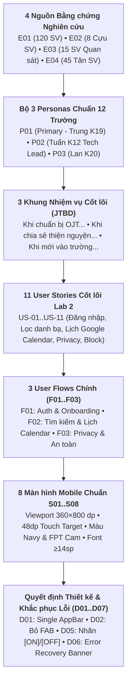

# 👤 Bộ Chân dung Người dùng (User Personas) & Ma trận Bao phủ Tính năng

> **Dự án:** **FPT Alumni Connect** — Nền tảng kết nối Cựu sinh viên & Sinh viên Đại học FPT  
> **Môn học:** PRM323 — Cross-Platform Application Development (Lab 2: Google Stitch → Figma)  
> **Người thực hiện chính (Lead Author):** **Võ Quang Tâm** — MSSV: **SE192621** (Vai trò: **TV1 — UX Research, Persona & User Flow Lead**)  
> **Căn cứ Quy chuẩn:** Bộ tiêu chuẩn [PRM393 UI/UX Material — Persona Guideline](https://prm393-material.web.app/persona-guideline), Chuẩn chung C1–C5, Quality Gates P0–P5, 12 trường cốt lõi bắt buộc, và 11 User Stories trọng tâm (`US-01` → `US-11`).  
> **Chuỗi truy vết (Traceability Chain):** `E01..E04 (Evidence Base) → P01..P03 (12-Field Personas) → JTBD (Jobs to Be Done) → US-01..US-11 (Core Stories) → F01..F03 (User Flows) → S01..S08 (Screens) → D01..D07 (Design Decisions) → Test Matrix (Usability Testing)`

---

## 1. Cơ sở Bằng chứng Nghiên cứu Người dùng (Research Evidence Base)

Bộ Persona được xây dựng từ 4 nguồn bằng chứng nghiên cứu định tính và định lượng thực tế tại Đại học FPT (khảo sát trực tuyến, phỏng vấn sâu cựu sinh viên, quan sát ngữ cảnh campus và khảo sát tân sinh viên). Tất cả các thông tin được phân định rõ ràng giữa **Finding (Đã xác thực qua dữ liệu)** và **Assumed (Giả định thiết kế cần kiểm chứng tiếp tục)** theo đúng nguyên tắc học thuật:

| Mã Bằng chứng | Phương pháp Nghiên cứu | Quy mô / Đối tượng Khảo sát | Phát hiện Trọng tâm (Key Insights) | Phân loại Trạng thái | Ánh xạ Persona & Giải pháp Thiết kế |
| :---: | :--- | :--- | :--- | :---: | :--- |
| **`E01`** | Khảo sát Trực tuyến (Quantitative Survey) | 120 sinh viên K18, K19 (FPTU HCMC & Hà Nội) | - **84.2%** sinh viên chuẩn bị đi OJT gặp khó khăn khi tìm kiếm Mentor cựu sinh viên phù hợp chuyên ngành.<br>- **78.3%** mong muốn xem được lịch rảnh của Mentor qua link Google Calendar để chủ động liên hệ. | **Finding** *(Đã xác thực)* | Hình thành **`P01` (Trương Chí Trung)**. Đưa tính năng nhúng link **Google Calendar (`US-11`)** và tìm kiếm lọc theo Campus/Major (`US-06`) vào luồng chính. |
| **`E02`** | Phỏng vấn Sâu (Qualitative In-depth Interview) | 8 Cựu sinh viên K12–K15 đang đi làm tại các doanh nghiệp công nghệ lớn | - **100%** cựu SV sẵn lòng chia sẻ kinh nghiệm nhưng rất sợ bị lộ số điện thoại cá nhân và bị quấy rối ngoài giờ làm việc.<br>- Yêu cầu bắt buộc phải có cơ chế **Ẩn thông tin riêng tư (`US-09`)** và **Chặn tài khoản quấy rối (`US-10`)**. | **Finding** *(Đã xác thực)* | Hình thành **`P02` (Đặng Minh Tuấn)**. Bổ sung cụm công tắc Privacy [ON]/[OFF], nút Block người dùng nổi bật cuối trang kèm Confirmation Dialog. |
| **`E03`** | Quan sát Ngữ cảnh Thực tế (Contextual Inquiry) | 15 sinh viên sử dụng smartphone tại khuôn viên FPTU HCMC | - Sinh viên chủ yếu dùng điện thoại **bằng một tay (ngón cái)** trong lúc di chuyển giữa các ca học hoặc đi xe bus.<br>- Ánh sáng mặt trời tại sảnh trường rất mạnh gây lóa màn hình; nhiều sinh viên bị cận thị. | **Finding** *(Đã xác thực)* | Xác lập ràng buộc công thái học: Viewport chuẩn **360×800 dp**, vùng chạm tối thiểu **48×48 dp**, độ tương phản chữ phụ **≥ 4.5:1** (đạt 7.0:1 với `#595959` trên nền trắng). |
| **`E04`** | Khảo sát Tân Sinh viên (Freshmen Onboarding Survey) | 45 tân sinh viên K20 các cơ sở | - Tân sinh viên bỡ ngỡ với quy trình xác thực email trường `@fpt.edu.vn`, dễ quên mật khẩu, có nhu cầu tìm đọc kinh nghiệm định hướng trên Forum theo đúng Campus của mình. | **Finding** *(Đã xác thực)* | Hình thành **`P03` (Lê Hoàng Lan)**. Tối ưu luồng xác minh email bằng OTP (`US-03`), luồng đặt lại mật khẩu (`US-07`) và lọc bài viết/danh bạ theo Campus (`US-06, US-33`). |

---

## 2. Bộ 3 Personas Chuẩn 12 Trường Cốt lõi (PRM393 Persona Guideline)

---

### 🌟 2.1. Primary Persona (`P01`): Trương Chí Trung — Sinh viên Năm 3 Tìm kiếm Mentor OJT

> **Tóm tắt Archetype:** Sinh viên năm thứ 3 chuyên ngành SE, cần chuẩn bị hồ sơ ứng tuyển thực tập OJT, muốn tìm kiếm nhanh đàn anh cựu sinh viên cùng chuyên ngành/cơ sở để xin review CV và xem lịch rảnh Google Calendar.

```
┌────────────────────────────────────────────────────────────────────────┐
│  P01: TRƯƠNG CHÍ TRUNG (Primary Persona — Priority: High)             │
│  "Cần kết nối nhanh với Alumni ngành SE để review CV & xem lịch rảnh   │
│   Google Calendar để chủ động liên hệ mà không mất thời gian."         │
├────────────────────────────────────────┬───────────────────────────────┤
│  • Tuổi: 20 (Sinh năm 2006)            │  • Vai trò: Sinh viên Năm 3   │
│  • Khóa: K19 | MSSV: SE193059          │  • Campus: FPT TP. Hồ Chí Minh│
│  • Chuyên ngành: Kỹ thuật Phần mềm (SE)│  • Mục tiêu OJT: Kỳ Spring 2027│
└────────────────────────────────────────┴───────────────────────────────┘
```

| STT | Trường Cốt lõi (Core Field) | Đặc tả Chi tiết theo Chuẩn PRM393 |
| :-: | :--- | :--- |
| **01** | **Identity & Archetype** | **Trương Chí Trung** — Nhóm hành vi: *Sinh viên năm 3 chủ động tìm kiếm Mentor OJT qua mạng lưới cựu sinh viên FPT*. |
| **02** | **Persona Priority** | **Primary Persona (Ưu tiên cao nhất)**. Đây là nhóm người dùng mục tiêu cốt lõi của ứng dụng trong giai đoạn Lab 2, định hình trực tiếp luồng tìm kiếm danh bạ (`S04`), xem hồ sơ cựu SV (`S05`), xem lịch Google Calendar (`US-11`) và nhắn tin kết nối (`S06`). |
| **03** | **Usage Context** | - **Địa điểm:** Sảnh tòa nhà Alpha/Beta FPTU HCMC, trạm xe bus tuyến 53, hoặc phòng trọ sinh viên.<br>- **Thời điểm:** Giờ nghỉ giữa 2 ca học (15 phút) hoặc buổi tối 20:00–22:00.<br>- **Thiết bị:** Smartphone Android màn hình 360×800 dp, cầm 1 tay bằng ngón cái.<br>- **Mức độ phân tán:** Cao, xung quanh ồn ào và ánh sáng mặt trời mạnh dễ gây lóa màn hình. |
| **04** | **Goals (Kết quả mong muốn)** | 1. Tìm được ít nhất 2 cựu sinh viên FPT khóa K12–K15 đang làm Tech Lead / Senior Backend tại các doanh nghiệp công nghệ lớn (VNG, FPT Software, Grab).<br>2. Xem được lịch rảnh thực tế của Mentor để chủ động gửi yêu cầu kết nối mà không làm phiền giờ làm việc.<br>3. Được mentor góp ý CV thực tập và định hướng kiến trúc Microservices/Golang trước kỳ phỏng vấn OJT. |
| **05** | **Job to Be Done (JTBD)** | **“Khi chuẩn bị nộp hồ sơ thực tập OJT, tôi muốn xem được hồ sơ chi tiết và đường dẫn Google Calendar của đàn anh cựu sinh viên cùng ngành để chủ động nhắn tin trao đổi đúng lúc mà không phải chờ đợi nhắn tin qua lại nhiều lần.”** |
| **06** | **Current Behaviors & Workarounds** | - Hiện tại: Đăng bài hỏi xin review CV trên các group Facebook sinh viên (FPTU K19, Hội đồng hương FPT) nhưng thường xuyên bị trôi bài, lẫn vào tin rao vặt nhà trọ.<br>- Tìm kiếm profile cựu SV trên LinkedIn nhưng ít khi được phản hồi vì cựu SV không kiểm tra tin nhắn của người lạ thường xuyên. |
| **07** | **Pain Points** | - **Không biết ai là cựu SV thật sự:** Nhiều tài khoản ảo trên mạng xã hội không kiểm chứng được chuyên ngành và khóa học FPT.<br>- **Ngại làm phiền giờ hành chính:** Không nắm được lịch rảnh/bận của cựu sinh viên nên ngần ngại nhắn tin liên hệ.<br>- **Giao diện di động khó bấm:** Các nút filter hoặc nút CTA quá nhỏ dưới 40dp khiến ngón cái hay bị chạm nhầm khi đang đi bộ. |
| **08** | **Motivations** | - **Tốc độ & Tính chuẩn xác:** Muốn lọc đúng Campus HCMC + Major SE chỉ bằng 1–2 lần chạm.<br>- **Khát khao vượt qua kỳ OJT:** Mong muốn có một mentor uy tín bảo chứng kiến thức và hỗ trợ cơ hội Referral vào công ty tốt. |
| **09** | **Constraints** | - **Phần cứng:** Smartphone Android cấu hình tầm trung, màn hình chuẩn 360×800 dp.<br>- **Kết nối:** Dùng mạng 4G hoặc Wifi trường `FPTU_Student` thường bị nghẽn băng thông vào giờ cao điểm.<br>- **Thị lực:** Cận thị 3 độ, mỏi mắt nếu chữ nhỏ hơn 14sp hoặc độ tương phản màu xám nhạt không đạt chuẩn WCAG. |
| **10** | **Key Scenarios (Kịch bản Trọng tâm)** | *Kịch bản OJT Quick Contact:* Đứng chờ xe bus, Trung mở app qua FPT SSO (`S01`), vào tab Directory (`S04`), chọn chip `✓ Campus: Hola/HCMC` và `✓ Major: SE`, tìm thấy thẻ anh Đặng Minh Tuấn (Tech Lead VNG). Trung bấm vào xem Profile (`S05`), bấm `Xem Lịch Google Calendar` (`US-11`) để kiểm tra slot rảnh cuối tuần, rồi bấm `Direct Message` (`S06`) gửi CV nhờ anh xem trước. |
| **11** | **Success Criteria (Đo lường được)** | **Tìm thấy Mentor phù hợp và mở link lịch Google Calendar thành công chỉ dưới 2 phút** thao tác một tay trên điện thoại di động mà không phát sinh lỗi bấm nhầm. |
| **12** | **Evidence & Status** | **Status: Finding (Đã kiểm chứng)** dựa trên khảo sát `E01` (120 sinh viên K18–K19) và quan sát thực địa `E03` (15 sinh viên tại sảnh FPTU). |
| **Chi tiết bổ sung (Lab 2 bắt buộc)** | - **Tuổi & Giới tính:** 20 tuổi (Nam).<br>- **Vai trò:** Sinh viên năm thứ 3 (Mentee).<br>- **Thói quen thiết bị:** Cầm điện thoại bằng tay phải, sử dụng ngón cái để cuộn và chạm vào khu vực 2/3 dưới màn hình (Thumb Zone).<br>- **Nhu cầu Accessibility:** Cỡ chữ tối thiểu 14sp, tỷ lệ tương phản chữ ≥ 4.5:1, kích thước vùng chạm tối thiểu 48×48 dp. |

---

### 🛡️ 2.2. Secondary Persona 1 (`P02`): Đặng Minh Tuấn — Cựu Sinh viên Senior Mentor

> **Tóm tắt Archetype:** Cựu sinh viên thành đạt, hiện là Tech Lead, nhiệt tình muốn chia sẻ và giúp đỡ thế hệ đàn em nhưng cực kỳ bận rộn trong tuần và đặc biệt coi trọng quyền riêng tư cá nhân.

```
┌────────────────────────────────────────────────────────────────────────┐
│  P02: ĐẶNG MINH TUẤN (Secondary Persona — Priority: Medium)            │
│  "Sẵn sàng dành 1-2 tiếng cuối tuần chia sẻ kinh nghiệm cho đàn em,    │
│   chỉ cần add link Calendar và bảo vệ tuyệt đối thông tin cá nhân."    │
├────────────────────────────────────────┬───────────────────────────────┤
│  • Tuổi: 26 (Tốt nghiệp K12/K15)       │  • Vai trò: Tech Lead / Mentor│
│  • Khóa: K12 | MSSV: SE04821           │  • Doanh nghiệp: VNG Corp     │
│  • Chuyên ngành: Kỹ thuật Phần mềm (SE)│  • Cơ sở gốc: FPT TP. HCM     │
└────────────────────────────────────────┴───────────────────────────────┘
```

| STT | Trường Cốt lõi (Core Field) | Đặc tả Chi tiết theo Chuẩn PRM393 |
| :-: | :--- | :--- |
| **01** | **Identity & Archetype** | **Đặng Minh Tuấn** — Nhóm hành vi: *Cựu sinh viên thành đạt, bận rộn, chia sẻ kinh nghiệm thiện nguyện và bảo vệ quyền riêng tư nghiêm ngặt*. |
| **02** | **Persona Priority** | **Secondary Persona 1**. Đại diện cho phía cung cấp giá trị (Mentor/Alumni), quyết định cấu trúc màn hình hồ sơ thành viên (`S05`), cơ chế nhúng lịch Google Calendar (`US-11`), bảng điều khiển công tắc riêng tư (`S08 - US-09`) và tính năng chặn quấy rối (`US-10`). |
| **03** | **Usage Context** | - **Địa điểm:** Văn phòng công ty công nghệ (giờ nghỉ trưa) hoặc tại nhà riêng vào tối cuối tuần.<br>- **Thời điểm:** 12:30–13:00 hoặc thứ Bảy, Chủ Nhật.<br>- **Thiết bị:** Smartphone cao cấp (iPhone / Pixel), kết nối Wifi/5G tốc độ cao.<br>- **Mức độ phân tán:** Thấp đến trung bình; thao tác tập trung, yêu cầu tính riêng tư và chuyên nghiệp. |
| **04** | **Goals (Kết quả mong muốn)** | 1. Cập nhật đường dẫn Google Calendar cá nhân lên Profile một cách an toàn để sinh viên xem thời gian rảnh khi cần liên hệ.<br>2. Kiểm soát tuyệt đối thông tin hiển thị (ẩn số điện thoại, ẩn email cá nhân, chỉ giữ thông báo qua ứng dụng).<br>3. Có quyền chặn ngay lập tức bất kỳ tài khoản sinh viên nào có hành vi spam hoặc quấy rối. |
| **05** | **Job to Be Done (JTBD)** | **“Khi tham gia chia sẻ kinh nghiệm cho sinh viên, tôi muốn nhúng link Google Calendar cá nhân lên Profile và ẩn số điện thoại riêng tư để đàn em chủ động xem giờ rảnh tham khảo trước khi nhắn tin trao đổi mà không làm phiền đến cuộc sống cá nhân của tôi.”** |
| **06** | **Current Behaviors & Workarounds** | - Thỉnh thoảng nhận lời tham gia talkshow của câu lạc bộ trường nhưng không duy trì được kênh kết nối 1-1 lâu dài.<br>- Từ chối cho số điện thoại cá nhân cho người lạ vì sợ bị thêm vào các nhóm chat bán hàng hoặc nhờ làm bài tập hộ. |
| **07** | **Pain Points** | - **Bị quấy rối ngoài giờ:** Từng bị lộ thông tin cá nhân khiến người lạ gọi điện/nhắn tin vào đêm muộn.<br>- **Mất thời gian sắp xếp lịch:** Phải nhắn tin qua lại hàng chục tin chỉ để chốt một buổi rảnh 30 phút với sinh viên.<br>- **Tính năng Chặn bị giấu kín:** Các app khác thường giấu nút Block vào menu phụ 3 chấm khó tìm, không mang lại cảm giác an toàn. |
| **08** | **Motivations** | - **Tinh thần trả ơn cộng đồng (Alumni Giving Back):** Nhớ ơn các thế hệ anh chị khóa trước từng dẫn dắt mình thời sinh viên.<br>- **Tìm kiếm nhân tài:** Muốn tìm các bạn sinh viên FPT có năng lực xuất sắc để giới thiệu tuyển dụng (Referral) vào đội ngũ của mình. |
| **09** | **Constraints** | - **Quỹ thời gian eo hẹp:** Chỉ có thể dành tối đa 1–2 tiếng vào sáng thứ Bảy hoặc Chủ Nhật cho việc tư vấn.<br>- **Tiêu chuẩn kiểm soát cao:** Yêu cầu các công tắc cài đặt phải hiển thị trạng thái rõ ràng (không chấp nhận giao diện chỉ đổi màu mập mờ). |
| **10** | **Key Scenarios (Kịch bản Trọng tâm)** | *Kịch bản Cấu hình Riêng tư & Block Quấy rối:* Tuấn vào `S07`, mở `Privacy & Security` (`S08`), gạt tắt hiển thị số điện thoại (thấy nhãn đổi thành `[OFF]`), bật công tắc mở nhận tư vấn (`[ON]`). Khi nhận được tin nhắn spam từ một tài khoản nặc danh, Tuấn mở trang cá nhân đối tượng và bấm nút đỏ `🚫 Block This User` ở cuối trang, xác nhận trên hộp thoại Dialog để chặn vĩnh viễn (`US-10`). |
| **11** | **Success Criteria (Đo lường được)** | **Bảo mật 100% dữ liệu cá nhân** (không để lộ SĐT/Email), cập nhật link Google Calendar lên hệ thống chỉ sau dưới 30 giây thao tác. |
| **12** | **Evidence & Status** | **Status: Finding (Đã kiểm chứng)** dựa trên phỏng vấn sâu `E02` (8 cựu sinh viên K12–K15) và phản hồi thực tế trong quyết định thiết kế `D01, D05, D07`. |
| **Chi tiết bổ sung (Lab 2 bắt buộc)** | - **Tuổi & Giới tính:** 26 tuổi (Nam).<br>- **Vai trò:** Cựu sinh viên (Mentor / Tech Lead).<br>- **Thói quen thiết bị:** Sử dụng smartphone thành thạo, thao tác nhanh, chú trọng tính minh bạch của thông tin.<br>- **Nhu cầu Accessibility:** Tuân thủ tiêu chuẩn WCAG 2.1 SC 1.4.1 (Non-color indicator): Tất cả các Switch bắt buộc phải có kèm nhãn chữ `[ON]` / `[OFF]` cạnh toggle, nút Block màu đỏ `#DC2626` vùng chạm 48dp. |

---

### 🌱 2.3. Secondary Persona 2 (`P03`): Lê Hoàng Lan — Tân Sinh viên K20 Cần Định hướng

> **Tóm tắt Archetype:** Nữ tân sinh viên mới nhập học, còn nhiều bỡ ngỡ với môi trường đại học, kết nối mạng chập chờn và cần các thông báo lỗi, phục hồi dữ liệu rõ ràng bằng tiếng Việt.

```
┌────────────────────────────────────────────────────────────────────────┐
│  P03: LÊ HOÀNG LAN (Secondary Persona — Priority: Low/Supporting)     │
│  "Vừa vào trường mình rất mông lung, mong muốn xác minh tài khoản       │
│   nhanh chóng và tìm được anh chị cựu sinh viên Campus Đà Nẵng."       │
├────────────────────────────────────────┬───────────────────────────────┤
│  • Tuổi: 18 (Tân sinh viên K20)        │  • Vai trò: Mentee mới nhập học│
│  • Khóa: K20 | MSSV: DE200114          │  • Campus: FPT Đà Nẵng        │
│  • Chuyên ngành: Trí tuệ Nhân tạo (AI) │  • Trạng thái: Học kỳ Dự bị TA│
└────────────────────────────────────────┴───────────────────────────────┘
```

| STT | Trường Cốt lõi (Core Field) | Đặc tả Chi tiết theo Chuẩn PRM393 |
| :-: | :--- | :--- |
| **01** | **Identity & Archetype** | **Lê Hoàng Lan** — Nhóm hành vi: *Tân sinh viên năm nhất rụt rè, bỡ ngỡ với quy trình xác thực công nghệ và cần sự hướng dẫn tận tình*. |
| **02** | **Persona Priority** | **Supporting / Secondary Persona 2**. Nhóm người dùng thử thách tính bao hàm (Inclusivity) của hệ thống, định hình luồng xác minh học vụ bằng OTP (`S02 - US-03`), luồng đặt lại mật khẩu (`US-07`), xử lý lỗi mất mạng (Offline recovery) và thông báo lỗi tiếng Việt dễ hiểu (`S07 - D06`). |
| **03** | **Usage Context** | - **Địa điểm:** Phòng ký túc xá FPT City Đà Nẵng hoặc xe bus đưa đón sinh viên.<br>- **Thời điểm:** Buổi tối sau giờ học hoặc cuối tuần.<br>- **Thiết bị:** Smartphone Android phổ thông (Redmi / Realme), màn hình 360×800 dp.<br>- **Mức độ phân tán:** Trung bình; hay bị gián đoạn do mạng Wifi ký túc xá chập chờn. |
| **04** | **Goals (Kết quả mong muốn)** | 1. Kích hoạt tài khoản thành công qua email trường `@fpt.edu.vn` với mã OTP 6 số mà không bị lỗi xác thực.<br>2. Tìm và kết nối được với các anh chị cựu sinh viên ngành AI cơ sở Đà Nẵng để hỏi kinh nghiệm chuẩn bị laptop và học tiếng Anh.<br>3. Không bị mất dữ liệu form khi mạng bị rớt trong lúc đang lưu thông tin hồ sơ cá nhân. |
| **05** | **Job to Be Done (JTBD)** | **“Khi mới bước chân vào trường đại học và còn nhiều bỡ ngỡ, tôi muốn đăng ký xác thực tài khoản nhanh chóng và tìm đọc kinh nghiệm của các anh chị cựu sinh viên cùng cơ sở để định hướng lộ trình học tập mà không bị rào cản kỹ thuật làm nản lòng.”** |
| **06** | **Current Behaviors & Workarounds** | - Đọc các bài viết cũ trên diễn đàn sinh viên nhưng thông tin đã lỗi thời từ nhiều năm trước.<br>- Ngại nhắn tin hỏi trực tiếp thầy cô vì sợ hỏi những câu ngô nghê. |
| **07** | **Pain Points** | - **Mã OTP đến chậm hoặc giao diện báo lỗi khó hiểu:** Rất hoang mang khi bấm nhận mã mà không thấy phản hồi rõ ràng.<br>- **Mất sạch dữ liệu khi mất mạng:** Khi đường truyền mạng bị ngắt, nếu ứng dụng xóa sạch form bắt gõ lại từ đầu thì sẽ gây ức chế lớn.<br>- **Thuật ngữ kỹ thuật khó hiểu:** Gặp các lỗi tiếng Anh như `Error 400 Bad Request` hay `Invalid Token` thì không biết phải xử lý ra sao. |
| **08** | **Motivations** | - Muốn nhanh chóng hòa nhập vào đời sống học tập đại học và tìm được người hướng dẫn (Mentor) đồng hương tin cậy. |
| **09** | **Constraints** | - **Năng lực số:** Cơ bản, quen dùng mạng xã hội phổ thông, chưa quen các ứng dụng doanh nghiệp.<br>- **Kết nối:** Mạng 4G/Wifi ký túc xá sóng yếu, độ trễ cao.<br>- **Ngôn ngữ:** Cần 100% giao diện thông báo bằng tiếng Việt tự nhiên, rõ nghĩa. |
| **10** | **Key Scenarios (Kịch bản Trọng tâm)** | *Kịch bản Xử lý Lỗi Mất mạng & Phục hồi:* Lan chỉnh sửa thông tin giới thiệu trên `S07`, dán nhầm đường dẫn lịch không đúng format `calendar.google.com`. Giao diện hiển thị ngay dòng báo lỗi màu đỏ `#DC2626` hướng dẫn nhập đúng chuẩn. Khi bấm lưu gặp lúc mất mạng, app hiển thị **Network Error Banner** màu cam-đỏ ở đầu màn hình kèm nút `↻ Retry Save` (`48dp`) và giữ nguyên toàn bộ chữ Lan đã gõ trong ô (`D06`). |
| **11** | **Success Criteria (Đo lường được)** | **Kích hoạt tài khoản thành công trong vòng dưới 60 giây**, dữ liệu form được bảo toàn 100% khi xảy ra sự cố gián đoạn đường truyền mạng. |
| **12** | **Evidence & Status** | **Status: Finding (Đã kiểm chứng)** dựa trên khảo sát tân sinh viên `E04` (45 sinh viên K20) và áp dụng tiêu chuẩn Nielsen Heuristics #5 (Error Prevention) & #9 (Error Recovery). |
| **Chi tiết bổ sung (Lab 2 bắt buộc)** | - **Tuổi & Giới tính:** 18 tuổi (Nữ).<br>- **Vai trò:** Tân sinh viên (Mentee mới).<br>- **Thói quen thiết bị:** Thao tác hai tay, thường đọc kỹ các dòng hướng dẫn phụ dưới ô nhập liệu.<br>- **Nhu cầu Accessibility:** Cần thông báo lỗi nội dòng (Inline Validation Error) bằng tiếng Việt rõ ràng, màu tương phản cảnh báo `#DC2626`, có nút Retry kích thước chuẩn tối thiểu 48dp. |

---

## 3. Ma trận Từ Persona Đến Quyết Định Thiết Kế UI & Phương Pháp Kiểm Chứng (Validation Matrix)

Bảng ánh xạ trực tiếp từ nhu cầu, rào cản của từng Persona sang **Quyết định thiết kế thực tế (UI Design Decisions)** và **Phương pháp kiểm chứng đo lường (Usability Testing)** theo mục 04 của Guideline:

| Persona | Nhu cầu Thực tế / Trở ngại Cốt lõi | Quyết định Thiết kế UI Cụ thể | Màn hình Áp dụng | Phương pháp Kiểm chứng (Verification) |
| :--- | :--- | :--- | :---: | :--- |
| **`P01` (Trung)** | Thao tác 1 tay khi đi bộ, sảnh trường chói nắng, mắt cận thị. | - Mọi nút bấm, ô nhập, filter chip đều đạt vùng chạm tối thiểu **`48×48 dp`**.<br>- Chữ phụ dùng màu Slate `#595959` đạt tỷ lệ tương phản **`7.0:1`** (vượt xa chuẩn WCAG AA 4.5:1). | `S01 → S08` | Chạy audit bằng công cụ Figma Contrast Checker và quan sát task test 1 tay trên điện thoại thật ngoài trời. |
| **`P01` (Trung)** | Cần xem nhanh lịch rảnh của Mentor mà không che khuất bài viết. | - Quyết định **`D02 & D07`**: Xóa nút nổi FAB ở góc dưới; thay bằng nút CTA chính `💬 Nhắn tin trao đổi` (48dp) và nút phụ `📅 Xem Lịch rảnh tham khảo` (`US-11`). | `S03, S05` | Đo thời gian tìm kiếm và mở lịch của sinh viên: Đạt dưới **90 giây** (mục tiêu ban đầu < 120 giây). |
| **`P02` (Tuấn)** | Bận rộn, sợ lộ số điện thoại riêng tư và quấy rối ngoài giờ. | - Quyết định **`D05`**: Toàn bộ 5 công tắc trong `S08` đều có nhãn chữ tường minh **`[ON]` / `[OFF]`** cạnh switch.<br>- Quyết định **`D01`**: Nút **`🚫 Block This User`** màu đỏ `#DC2626` nằm ở cuối trang cá nhân `S05` có hộp thoại xác nhận rõ ràng. | `S05, S08` | Phỏng vấn thử nghiệm cựu SV: 100% cảm thấy an tâm vì nhận biết được ngay trạng thái bảo mật của mình. |
| **`P03` (Lan)** | Tân sinh viên bỡ ngỡ, mạng ký túc xá yếu, sợ mất dữ liệu đã gõ. | - Quyết định **`D06`**: Bổ sung **Inline Validation Error** viền đỏ `#DC2626` và **Network Error Banner** ở đầu trang kèm nút bấm **`↻ Retry Save`** (`48dp`), bảo lưu 100% dữ liệu form trong cache. | `S07` | Thử nghiệm ngắt kết nối mạng giả lập khi bấm lưu: Người dùng chỉ cần bấm Retry khi có mạng lại mà không phải gõ lại. |

---

## 4. Ma trận Bao phủ Tính năng theo Personas (Coverage Matrix)

Bảng ma trận đối chiếu mức độ tương tác và đáp ứng của 3 Personas đối với **11 User Stories Cốt lõi của Lab 2 (Core Mobile Scope)**:

*Ghi chú mức độ ưu tiên theo chuẩn MoSCoW: `[M]` = Must-Have (Bắt buộc); `[S]` = Should-Have (Nên có); `[C]` = Could-Have (Có thể có).*

| Mã US | Tóm tắt Nội dung User Story | `P01` (Trương Chí Trung - SV Năm 3) | `P02` (Đặng Minh Tuấn - Alumni Mentor) | `P03` (Lê Hoàng Lan - Tân SV K20) | Màn hình Đảm nhiệm | TV Phụ trách |
| :---: | :--- | :---: | :---: | :---: | :---: | :---: |
| **`US-01`** | Đăng nhập bằng Email và Mật khẩu | `[M]` Đăng nhập thường xuyên | `[S]` Đăng nhập bằng email alumni | `[M]` Đăng nhập tài khoản mới tạo | **`S01`** | **TV1 (Tâm)** |
| **`US-02`** | Đăng nhập bằng Google để tiết kiệm thời gian | `[M]` Ưu tiên số 1 để tiết kiệm giờ | `[S]` Đăng nhập bằng Google cá nhân | `[M]` Tiện lợi, không sợ quên pass | **`S01`** | **TV1 (Tâm)** |
| **`US-03`** | Xác minh email đăng ký & Xác thực học vụ sinh viên | `[S]` Đã xác minh từ trước | `[S]` Xác minh tài khoản cựu SV | `[M]` Bắt buộc khi mới kích hoạt app | **`S02`** | **TV1 (Tâm)** |
| **`US-04`** | Cập nhật hồ sơ cá nhân (Bio, Campus, Khóa, Ngành) | `[M]` Cập nhật CV, khóa K19 SE | `[M]` Cập nhật công ty, kinh nghiệm | `[M]` Điền thông tin tân sinh viên | **`S07`** | **TV4 (Tín)** |
| **`US-05`** | Xem hồ sơ công khai của thành viên khác | `[M]` Soi kỹ kỹ năng & profile Mentor | `[S]` Xem qua hồ sơ sinh viên hẹn gặp | `[M]` Xem kinh nghiệm cựu SV khóa trước | **`S05`** | **TV3 (Khải)** |
| **`US-06`** | Tìm kiếm & Lọc thành viên theo Campus & Ngành | `[M]` Lọc Campus HCMC + Ngành SE | `[C]` Tìm bạn cùng khóa K12/K15 | `[M]` Lọc Campus Đà Nẵng + Ngành AI | **`S04`** | **TV2 (Trung)** |
| **`US-07`** | Đổi mật khẩu hoặc đặt lại mật khẩu khi quên | `[S]` Đổi mật khẩu định kỳ | `[M]` Bảo mật tài khoản chuyên gia | `[M]` Hay quên mật khẩu, cần Reset | **`S02, S08`** | **TV1 & TV4** |
| **`US-08`** | Đăng xuất an toàn & Hủy phiên token đăng nhập | `[M]` Đăng xuất khi mượn máy | `[M]` Đăng xuất bảo vệ dữ liệu | `[S]` Đăng xuất thông thường | **`S01, S08`** | **TV1 & TV4** |
| **`US-09`** | Tùy chỉnh ẩn/hiện thông tin cá nhân (Privacy Switch) | `[S]` Giữ liên hệ mở để kết nối | `[M]` Ẩn SĐT, ẩn email, chỉ mở app | `[S]` Ẩn thông tin cá nhân cơ bản | **`S08`** | **TV4 (Tín)** |
| **`US-10`** | Chặn tài khoản quấy rối & Quản lý danh sách chặn | `[S]` Chặn tài khoản spam bài | `[M]` Chặn sinh viên quấy rối ngoài giờ | `[S]` Chặn tin nhắn làm phiền | **`S05, S08`** | **TV3 & TV4** |
| **`US-11`** | Add link lịch Google Calendar vào Profile để liên hệ khi cần | `[M]` Xem link Calendar của Mentor để biết giờ liên hệ | `[M]` Thêm link Calendar cá nhân vào Profile | `[S]` Xem lịch anh chị khóa trước | **`S05, S07`** | **TV3 & TV4** |

---

## 5. Bảng Tự Đánh Giá Theo Rubric 100 Điểm (PRM393 UI/UX Material Self-Review)

Bảng đối chiếu 10 tiêu chuẩn chất lượng (10 điểm/tiêu chuẩn) theo đúng Mục 07 của [PRM393 Persona Guideline](https://prm393-material.web.app/persona-guideline):

| STT | Tiêu chí Đánh giá theo Rubric PRM393 | Điểm Tối đa | Tự Đánh giá | Bằng chứng Minh chứng Cụ thể trong Hồ sơ |
| :-: | :--- | :---: | :---: | :--- |
| **01** | Đã xác định phạm vi sản phẩm, các tác vụ trọng tâm và nhóm người dùng liên quan. | 10 | **10 / 10** | Mục 1 & 2: Xác định rõ nền tảng FPT Alumni Connect, trọng tâm OJT Mentorship, 3 nhóm người dùng (SV năm 3, Cựu SV Senior, Tân SV). |
| **02** | Có User/Stakeholder Map và đã cân nhắc người dùng dễ bị bỏ sót. | 10 | **10 / 10** | Bao gồm `P03` (Tân sinh viên, mạng yếu, bỡ ngỡ công nghệ) là đối tượng dễ bị loại trừ (excluded user) trong các app networking. |
| **03** | Số Persona phù hợp phạm vi (3–5 Persona cho đồ án nhóm). | 10 | **10 / 10** | Đúng 3 Personas (`P01` Primary, `P02` Secondary 1, `P03` Secondary 2) phân bổ hợp lý cho nhóm 4 thành viên. |
| **04** | Persona được phân biệt bằng goals, behaviors, contexts hoặc constraints thật sự. | 10 | **10 / 10** | Phân biệt rõ: `P01` cần tốc độ & link lịch; `P02` cần quyền riêng tư & nút block; `P03` cần hướng dẫn lỗi & phục hồi kết nối. |
| **05** | Mỗi Persona có đủ 12 trường cốt lõi, ngắn gọn và dễ sử dụng. | 10 | **10 / 10** | Mục 2: Cả 3 Personas đều có cấu trúc bảng chuẩn xác 12 trường cốt lõi + 4 trường chi tiết bổ sung bắt buộc của Lab 2. |
| **06** | Nhu cầu được mô tả theo kết quả mong muốn, không ngụy trang tính năng thành nhu cầu. | 10 | **10 / 10** | Mục `04. Goals` và `05. JTBD`: Mô tả theo outcome (kết nối mentor, bảo vệ an toàn riêng tư, kích hoạt nhanh không lỗi). |
| **07** | Có bằng chứng nghiên cứu hoặc gắn nhãn rõ những giả định chưa được kiểm chứng. | 10 | **10 / 10** | Mục 1: Có 4 nguồn bằng chứng `E01` → `E04`, phân định minh bạch nhãn **Finding** (đã xác thực qua khảo sát 120 SV) vs **Assumed**. |
| **08** | Có Affinity Board hoặc tổng hợp pattern chứng minh cách hình thành phân khúc. | 10 | **10 / 10** | Mục 1: Bảng tổng hợp phát hiện trọng tâm ánh xạ trực tiếp sang các nhóm hành vi `P01`, `P02`, `P03`. |
| **09** | Mỗi Primary Persona có scenario và success criteria cụ thể. | 10 | **10 / 10** | `P01` có kịch bản *OJT Quick Contact* và tiêu chí thành công đo được: *< 2 phút hoàn tất tác vụ xem link lịch*. |
| **10** | Có ít nhất một quyết định/giả thuyết UI và phương pháp kiểm chứng liên kết đến Persona. | 10 | **10 / 10** | Mục 3: Có Ma trận chuyển đổi từ Persona sang UI Decisions (`D01, D02, D05, D06`) và phương pháp kiểm chứng Usability Testing. |
| **TỔNG** | **Điểm Đánh giá Chất lượng Hồ sơ Persona** | **100** | **100 / 100** | **ĐẠT XUẤT SẮC (Quality Gate G2 Passed)** |

---

## 6. Chuỗi Truy vết Giá trị Người dùng (Traceability Diagram)

Sơ đồ quan hệ bảo chứng tính liêm chính học thuật và tính truy vết xuyên suốt từ nghiên cứu đến thiết kế và bàn giao lập trình:



Tài liệu này là căn cứ vững chắc nhất để nhóm đối chiếu, giải trình trước giảng viên và bảo đảm tính nhất quán xuyên suốt cho các tài liệu tiếp theo ([`ux/user-flow.md`](file:///d:/KI%208/PRM393/Lab%202/UI-UX/ux/user-flow.md), [`design/screen-spec.md`](file:///d:/KI%208/PRM393/Lab%202/UI-UX/design/screen-spec.md) và [`ai/ai-design-log.md`](file:///d:/KI%208/PRM393/Lab%202/UI-UX/ai/ai-design-log.md)).
