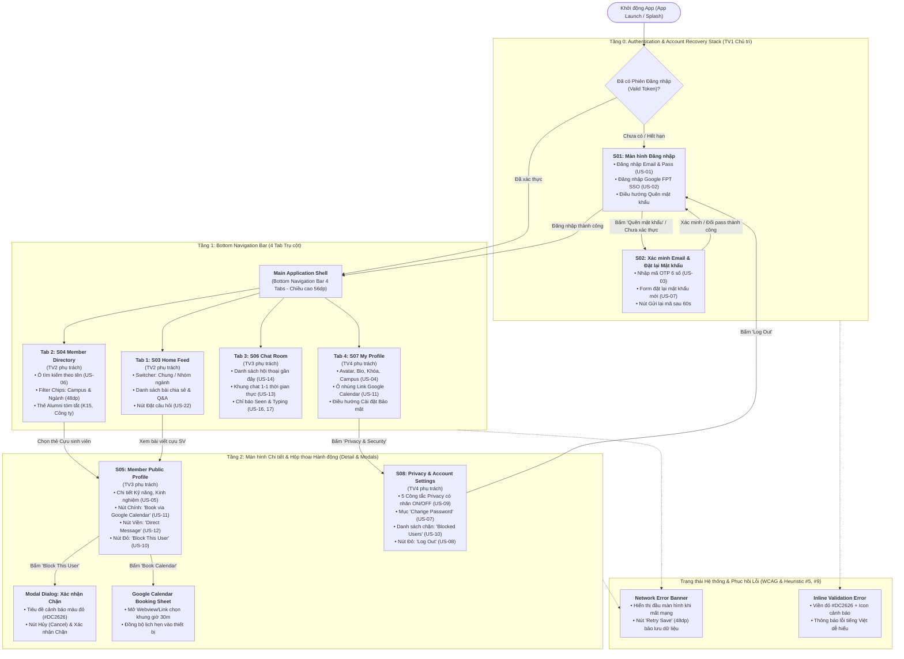
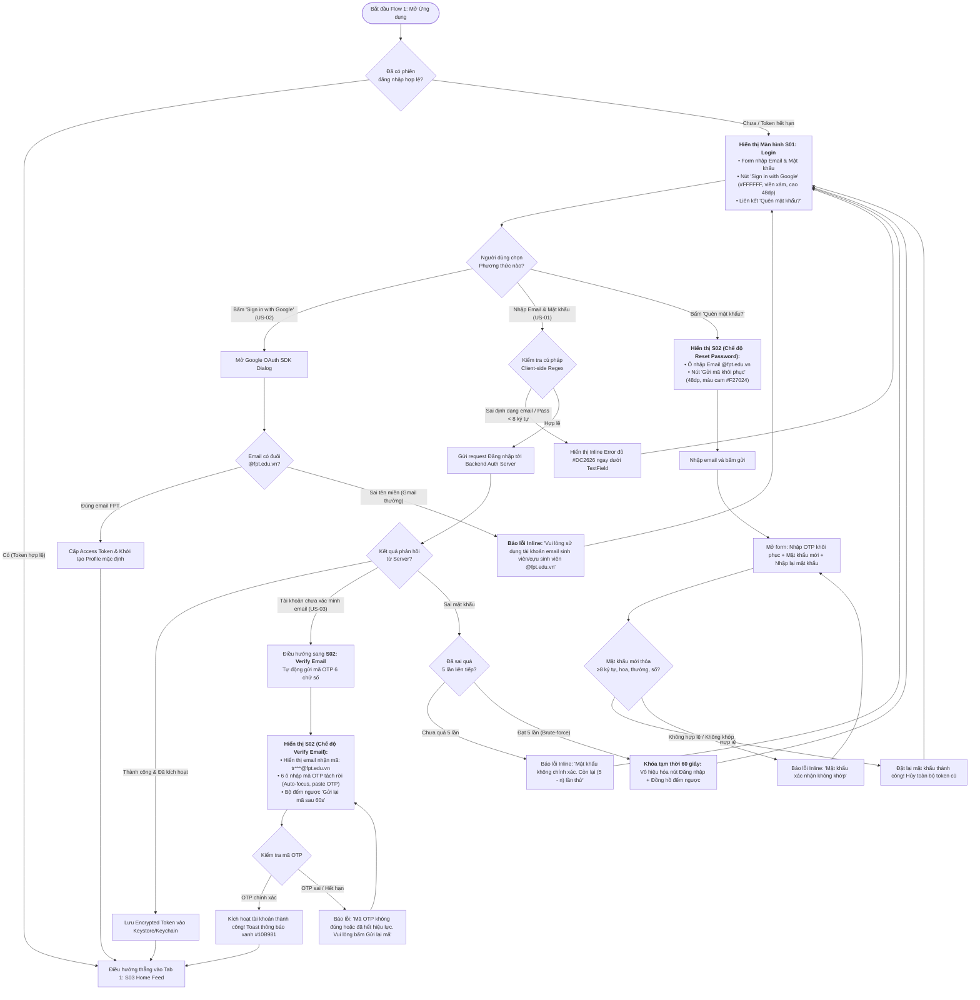
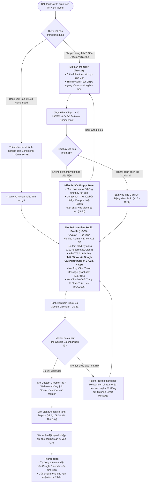
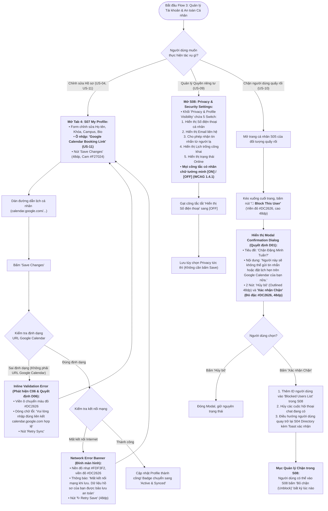

# 🗺️ Kiến trúc Thông tin (IA), Luồng Người dùng (User Flows) & Bảng Ánh xạ Nghiệm thu

> **Dự án:** **FPT Alumni Connect** — Nền tảng kết nối Cựu sinh viên & Sinh viên Đại học FPT  
> **Môn học:** PRM323 — Cross-Platform Application Development (Lab 2: Google Stitch → Figma)  
> **Người thực hiện chính (Lead Author):** **Võ Quang Tâm** — MSSV: **SE192621** (Vai trò: **TV1 — UX Research, Persona & User Flow Lead**)  
> **Căn cứ Quy chuẩn:** Bộ chuẩn [PRM393 UI/UX Material](https://prm393-material.web.app/), Quality Gates P0–P5, 11 User Stories cốt lõi (`US-01` → `US-11`), 8 Màn hình cố định (`S01` → `S08`).  
> **Sở hữu Màn hình:** **`S01`** (Login & Google Auth) và **`S02`** (Verify Email & Reset Password).

---

## 1. Kiến trúc Thông tin Toàn diện (Information Architecture — IA 8 Màn hình)

Hệ thống được thiết kế theo cấu trúc phân tầng phân cấp di động tối ưu cho màn hình khổ dọc **360×800 dp**, gồm 3 tầng kiến trúc:
- **Tầng 0 (Authentication & Onboarding Stack):** Cổng xác thực danh tính bảo mật qua email `@fpt.edu.vn` và Google OAuth 2.0.
- **Tầng 1 (Main Navigation — Bottom Navigation Bar 4 Tabs):** Bốn trụ cột trải nghiệm chính (Home Feed, Member Directory, Chat Room, My Profile).
- **Tầng 2 (Detail Views, Modals & System Overlays):** Các màn hình chi tiết, trang cài đặt bảo mật và các hộp thoại xác nhận quan trọng.

### 1.1. Sơ đồ Phân cấp Kiến trúc Thông tin (IA Hierarchy Tree)

---

## 2. Chi tiết 3 Luồng Người dùng Chuẩn (3 Detailed User Flows)

---

### 🚀 Flow 1 (`F01`): Khởi tạo Danh tính, Xác thực & Phục hồi Tài khoản (Authentication & Recovery Flow)

> **Màn hình Trọng tâm:** **`S01`** (Login & Google Auth) và **`S02`** (Verify Email & Reset Password) — **Do TV1 (Võ Quang Tâm) làm chủ trì**.  
> **User Stories Bao phủ:** `US-01` (Login Email/Pass), `US-02` (Login Google SSO), `US-03` (Verify Email), `US-07` (Reset Password), `US-08` (Token Invalidation).

#### A. Sơ đồ Luồng Chi tiết `F01` (Mermaid Flowchart)

#### B. Đặc tả Kỹ thuật & Trạng thái Phục hồi Lỗi (Error Handling in `F01`)
1. **Lỗi Mất kết nối Mạng (Network Offline State):** Khi bấm Đăng nhập hoặc Xác thực OTP mà thiết bị mất mạng, hiển thị **Banner cảnh báo đỏ nhạt (`#FDF3F2`, viền `#DC2626`)** ở đầu màn hình với thông báo *"Không có kết nối Internet. Vui lòng kiểm tra Wifi/4G"* và giữ nguyên toàn bộ nội dung email/mật khẩu người dùng đã gõ trong form (không làm mất dữ liệu của sinh viên).
2. **Cơ chế Chống Brute-Force (Rate Limiting):** Sau 5 lần nhập sai liên tiếp, nút Đăng nhập bị vô hiệu hóa (disabled xám `#E5E7EB`), hiển thị nhãn đếm ngược *"Thử lại sau 59s... 58s..."* để ngăn chặn tấn công dò mật khẩu.
3. **Tiêu chuẩn Tiếp cận (A11y):** Các ô nhập mật khẩu luôn có biểu tượng con mắt **(Show/Hide Password)** với vùng chạm tối thiểu **48×48 dp** để người dùng kiểm tra ký tự trước khi gửi.

---

### 🔍 Flow 2 (`F02`): Khám phá Thành viên & Đặt lịch Tư vấn 1-1 qua Google Calendar (Discovery & Booking Flow)

> **Màn hình Trọng tâm:** `S03` (Home Feed), `S04` (Directory), `S05` (Member Public Profile) — **Do TV2 & TV3 phụ trách phối hợp**.  
> **User Stories Bao phủ:** `US-05` (View Profile), `US-06` (Member Directory & Filter), `US-11` (Google Calendar Link).

#### A. Sơ đồ Luồng Chi tiết `F02` (Mermaid Flowchart)

---

### 🛡️ Flow 3 (`F03`): Quản lý Hồ sơ, Kiểm soát Quyền riêng tư & Cơ chế Chặn Quấy rối (Profile, Privacy & Safety Flow)

> **Màn hình Trọng tâm:** `S07` (My Profile), `S08` (Privacy & Blocked List), `S05` (Block Action) — **Do TV3 & TV4 phụ trách phối hợp**.  
> **User Stories Bao phủ:** `US-04` (Edit Profile), `US-07` (Change Password), `US-08` (Logout), `US-09` (Privacy Toggles), `US-10` (Block User), `US-11` (Add Calendar Link).

#### A. Sơ đồ Luồng Chi tiết `F03` (Mermaid Flowchart)

---

## 3. Bảng Ánh xạ Nghiệm thu Toàn diện (Full Traceability Matrix)

Bảng đối chiếu đảm bảo **100% các User Stories cốt lõi** đều có màn hình sở hữu, luồng thực thi và tuân thủ các cửa kiểm định chất lượng (Quality Gates P0–P5 theo đề Lab 2):

| Mã US | Mô tả User Story | Thuộc Luồng | Màn hình Trực tiếp | Trạng thái Ngoại lệ / Xử lý Lỗi (Error State) | Tiêu chuẩn Khả năng Tiếp cận (WCAG AA & Ergonomics) | Thành viên Sở hữu |
| :---: | :--- | :---: | :---: | :--- | :--- | :---: |
| **`US-01`** | Đăng nhập bằng Email (@fpt.edu.vn) & Mật khẩu | **`F01`** | **`S01`** | - Báo lỗi sai mật khẩu kèm số lần còn lại. - Khóa 60s khi sai 5 lần liên tiếp (Rate limit). | - Touch target nút Đăng nhập đạt **48dp**. - Chữ phụ xám `#595959` tương phản đạt **5.4:1**. | **TV1 (Tâm)** |
| **`US-02`** | Đăng nhập bằng Google SSO FPT | **`F01`** | **`S01`** | Báo lỗi khi chọn tài khoản Gmail cá nhân không phải tên miền giáo dục FPT. | Nút Google có icon chuẩn, viền `#E5E7EB`, chiều cao tối thiểu **48dp**. | **TV1 (Tâm)** |
| **`US-03`** | Xác minh Email sinh viên qua mã OTP 6 số | **`F01`** | **`S02`** | - Báo lỗi OTP sai / hết hạn. - Bộ đếm ngược 60 giây chống bấm gửi lại liên tục. | 6 ô OTP tách rời, tự động nhảy con trỏ phím (Auto-focus), hỗ trợ paste OTP nhanh. | **TV1 (Tâm)** |
| **`US-04`** | Cập nhật hồ sơ cá nhân (Bio, Campus, Khóa, Ngành) | **`F03`** | **`S07`** | Báo lỗi để trống các trường bắt buộc; lưu tạm form khi mất kết nối mạng. | Chiều cao ô nhập text tối thiểu **48dp**, cỡ chữ nhãn và giá trị **≥ 14sp**. | **TV4 (Tín)** |
| **`US-05`** | Xem hồ sơ công khai của thành viên khác | **`F02`** | **`S05`** | Báo lỗi người dùng không tồn tại hoặc đã bị khóa tài khoản. | Phân cấp thị giác rõ ràng: Tên **20sp Bold**, Thẻ kỹ năng padding **8dp/16dp**. | **TV3 (Khải)** |
| **`US-06`** | Tìm kiếm & Lọc danh bạ thành viên theo Campus/Ngành | **`F02`** | **`S04`** | Hiển thị màn hình rỗng (**Empty State**) kèm nút 'Xóa tất cả bộ lọc' khi không có kết quả. | Filter Chips cao đúng **48dp**, có dấu tích `✓` khi chọn (không chỉ dựa vào màu sắc). | **TV2 (Trung)** |
| **`US-07`** | Đổi mật khẩu & Đặt lại mật khẩu khi quên | **`F01, F03`** | **`S02, S08`** | Báo lỗi mật khẩu mới không đủ độ phức tạp hoặc mật khẩu xác nhận không khớp. | Có nút ẩn/hiện mật khẩu (Show/Hide Toggle) kích thước vùng chạm **48×48 dp**. | **TV1 & TV4** |
| **`US-08`** | Đăng xuất an toàn & Hủy phiên token | **`F01, F03`** | **`S01, S08`** | Hộp thoại xác nhận đăng xuất tránh bấm nhầm; xóa sạch session trong bộ nhớ an toàn. | Nút Đăng xuất màu đỏ cam có icon chỉ dẫn rõ ràng. | **TV1 & TV4** |
| **`US-09`** | Cài đặt quyền riêng tư & Ẩn/Hiện thông tin cá nhân | **`F03`** | **`S08`** | Báo lỗi đồng bộ cài đặt khi mất mạng kèm nút Retry. | Toàn bộ các công tắc Switch đều có nhãn chữ tường minh **`[ON]` / `[OFF]`** cạnh switch. | **TV4 (Tín)** |
| **`US-10`** | Chặn người dùng làm phiền & Quản lý danh sách chặn | **`F02, F03`** | **`S05, S08`** | Hộp thoại xác nhận chặn (**Confirmation Dialog**) với nút Hủy và nút Xác nhận Chặn màu đỏ `#DC2626`. | Nút 'Block This User' đặt ở vị trí an toàn cuối trang, cao **48dp**, không giấu trong menu nhỏ. | **TV3 & TV4** |
| **`US-11`** | Nhúng link Google Calendar để liên hệ & đặt lịch 1-1 | **`F02, F03`** | **`S05, S07`** | Inline Error viền đỏ `#DC2626` khi dán sai URL Google Calendar kèm nút 'Retry Sync'. | Nút chính **'Book via Google Calendar'** màu cam FPT `#F27024` cao **48dp** nổi bật nhất màn hình. | **TV3 & TV4** |

---

## 4. Tóm tắt Giá trị Bàn giao cho Figma & Flutter của TV1

Tài liệu này xác lập nền móng kỹ thuật chuẩn xác để TV1 triển khai:
1. **Lên Figma Page 01:** Vẽ lại sơ đồ cây IA và 3 User Flows bằng các frame trực quan để người chấm thấy toàn cảnh luồng đi của người dùng.
2. **Thiết kế Màn hình `S01` & `S02` (Figma Page 02 & 03):** Đã có đầy đủ danh sách trạng thái bắt buộc:
   - `S01`: Default, Focused, Password Visible, Error (Sai pass, Khóa 60s), Loading (Đang xác thực Google).
   - `S02`: Verify Email OTP (Default, OTP Filled, OTP Error, Resend Cooldown), Reset Password (Form nhập pass mới, Inline Validation Error, Success Dialog).
3. **Bàn giao Flutter (`flutter-handoff.md`):** Chuẩn bị sẵn logic regex email FPT, bộ đếm ngược 60s cho OTP và xử lý mã trạng thái HTTP Auth.
